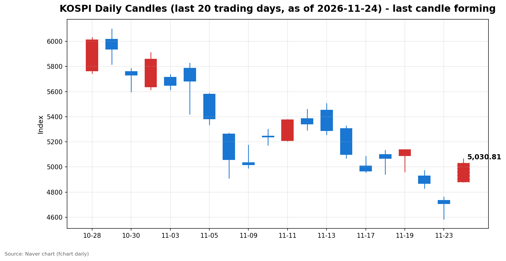
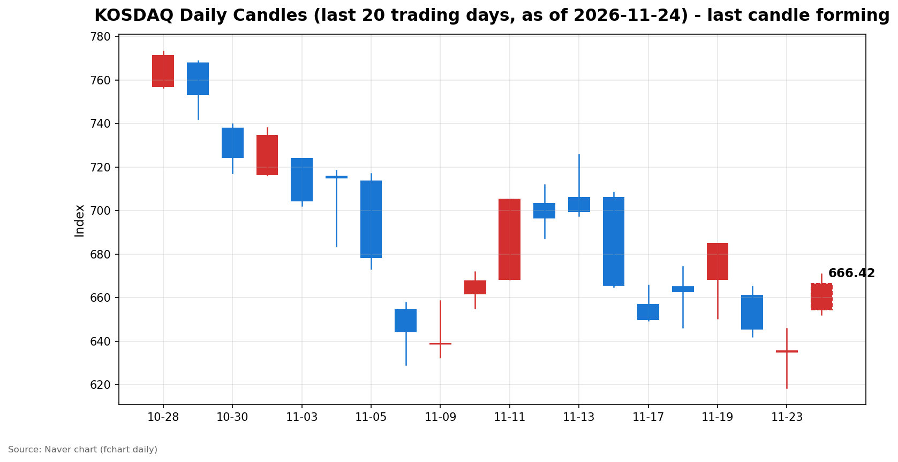

안녕하세요, [한국투자증권](https://securities.koreainvestment.com/main/Main.jsp)에서 [한투-한국투자증권](https://play.google.com/store/apps/details?id=com.truefriend.neosmartarenewal&hl=ko) 개발을 담당하고 있는 way입니다. 
간밤 뉴욕증시 폭등에 국내 증시는 급등 출발한 뒤, 오전 고점에서 소폭 되돌리며 5,000선 위에서 오전장을 마쳤습니다. 

## 오전장 요약

코스피는 전일 대비 6.72% 오른 5,025.14로 오전장을 마쳤습니다. 
장 초반 4,880.16으로 출발해 5,065.74까지 올랐고, 고점에서는 40.60포인트 되돌렸으나 5,000선은 지켰습니다. 
코스닥도 전일 대비 4.78% 오른 665.84로 오전장을 마쳤습니다. 
코스피200은 6.99% 올랐고, 장 초반에는 코스피200 선물 급등으로 매수 사이드카가 발동했습니다. 
간밤 나스닥이 6.51% 폭등한 여파가 장 초반부터 그대로 반영됐고, 낙폭 과대에 따른 반발 매수 심리도 함께 작용했습니다. 

## 오늘의 스냅샷

| 지수 | 현재가 | 전일 대비 | 등락률 | 시가 | 고가 | 저가 | 거래량 | 거래대금 |
| --- | --- | --- | --- | --- | --- | --- | --- | --- |
| [코스피](https://finance.naver.com/sise/sise_index.naver?code=KOSPI) | 5,025.14 | +316.60 | +6.72% | 4,880.16 | 5,065.74 | 4,880.16 | 106,505천주 | 9,144,874백만원 |
| [코스닥](https://finance.naver.com/sise/sise_index.naver?code=KOSDAQ) | 665.84 | +30.39 | +4.78% | 654.31 | 670.95 | 652.21 | 274,398천주 | 3,671,039백만원 |

스냅샷 기준 시각은 2026년 11월 24일 오후 12시 27분 한국시간입니다. 
전일 종가는 네이버 실시간 수치에서 역산한 값으로, 코스피 4,708.54, 코스닥 635.45입니다. 
역산값은 네이버 일봉의 11월 23일 종가와 일치합니다. 
당일 봉은 형성 중인 봉으로, 마감 전에는 계속 변합니다. 
코스피 거래대금은 약 9조 1,449억원, 코스닥 거래대금은 약 3조 6,710억원입니다. 

## 차트

최근 20거래일 일봉 차트입니다. 
빨간 봉은 종가가 시가보다 높은 날, 파란 봉은 종가가 시가보다 낮은 날입니다. 
당일 봉은 형성 중인 봉으로, 마감 전에는 계속 변합니다. 

## 원인·촉매 분석

오늘 급등의 직접 촉매는 젠슨 황 엔비디아 최고경영자의 복귀입니다. 
인공지능 투자 사이클에 대한 불확실성이 시장을 짓누르던 상황에서, 상징성이 큰 인물의 복귀는 투자심리를 단숨에 되돌렸습니다. 
나스닥이 6.51% 오른 것은 단순한 기술적 반등이 아니라, 인공지능 관련 성장주에 대한 할인율 우려가 한 번에 완화된 결과로 해석됩니다. 
지난주 금요일에는 공포지수가 장중 40.03까지 치솟았다가 35.89로 마감하는 등 공포가 극단에 달했던 만큼, 반발의 폭도 컸습니다. 
중앙일보 GMC 허브에서는 11월 24일자 G모닝이 젠슨 황 복귀를 다뤘고, G프터눈은 확인 시점인 오후 12시 30분 기준으로 아직 게시되지 않았습니다. 
국내 증시는 11월 17일 종가 4,968.48에서 11월 23일 종가 4,708.54까지 5.23% 하락하며 4거래일 연속 내린 뒤였습니다. 
낙폭이 컸던 만큼 간밤 훈풍에 대한 반응 폭도 컸고, 장 초반 코스피는 전일 대비 6%를 넘기며 5,000선을 회복했습니다. 
수급 구도도 반전을 뒷받침합니다. 
전일 코스피에서는 외국인이 2,560억원을 순매도했고 개인도 3,532억원을 순매도했으며, 기관이 1,758억원, 기타법인이 4,334억원을 순매수했습니다. 
전일 코스닥에서도 외국인이 376억원, 개인이 1,694억원을 순매도했고 기관이 1,950억원을 순매수했습니다. 
하락장에서 외국인과 개인이 던진 물량을 기관과 기타법인이 받았던 구도입니다. 
당일 장중 수급은 아직 확정치가 아니나, 잠정치로는 코스피에서 외국인이 6,594억원을 순매수하며 매수 주체로 돌아선 흐름이 나타나고 있습니다. 
장중 잠정치는 마감까지 얼마든지 달라질 수 있어, 종가 기준 수급으로 재확인해야 합니다. 
환율은 오전 9시 28분 1,339.50원에서 정오 무렵 1,345.30원으로 소폭 올랐습니다. 
한국투자증권 MTS 기준 원달러 환율은 전일 대비 2.70원, 0.20% 오른 수준으로, 외국인 매수 부담을 크게 높이는 방향은 아닙니다. 
다만 이번 급등이 실물경기 개선에서 비롯된 것은 아닙니다. 
한국은행이 발표한 11월 소비심리는 두 달째 하락했고, 대출금리 상승이 소비심리를 압박하고 있습니다. 
자산시장의 반등과 가계의 체감 경기 사이에는 여전히 간극이 있습니다. 

## 핵심 사건 3가지

### 1. 젠슨 황 엔비디아 최고경영자 복귀, 엔비디아 31.48% 폭등

엔비디아 이사회가 젠슨 황 최고경영자의 복귀를 즉시 승인했습니다. 
엔비디아 주가는 23일 뉴욕증시에서 31.48% 폭등해 165.05달러로 마감했습니다. 
시가총액은 하루 만에 9,520억 달러 늘었고, 2003년 이후 최대 하루 상승폭이라고 중앙일보 G모닝이 전했습니다. 
필라델피아반도체지수는 14% 올랐고 구성 종목 30개가 모두 상승했으며, 블룸버그 집계 아시아 반도체주 지수는 장중 최대 9.5% 올라 7월 31일 이후 최대 상승폭을 기록했습니다. 
나스닥 종합지수는 24,089.56으로 1,471.83포인트, 6.51% 올랐고, 스탠더드앤드푸어스 500지수는 7,237.17로 326.78포인트, 4.73% 올랐습니다. 
인공지능 악재가 중첩되며 연일 하락하던 시장이 하루 만에 방향을 바꾼 사건입니다. 
국내에서는 장 초반 삼성전자와 SK하이닉스가 각각 7.86%, 10.14% 급등하며 반응했습니다. 
인공지능 밸류체인에 대한 시장의 믿음이 인물 하나의 복귀 소식에 얼마나 크게 흔들리는지를 보여주는 사례입니다. 
반등의 지속 여부는 엔비디아 실적과 인공지능 수요의 실체가 뒤따라주는지에 달려 있습니다. 

### 2. 삼성전자 정기 임원인사 131명 승진, HBM·로봇·AI 인재 중용

삼성전자가 24일 부사장 39명, 상무 78명 등 131명을 승진하는 정기 임원인사를 실시했습니다. 
승진 규모는 작년 161명보다 20% 가까이 줄었으나, 반도체에서 70명이 대거 발탁됐습니다. 
고대역폭메모리와 인공지능 시대 메모리 호황을 이끈 핵심 인재, 파운드리와 로보틱스 전문가가 승진 명단의 중심에 섰습니다. 
여성 신임 승진자는 11명으로 역대 최다를 기록했습니다. 
성과 중심의 선별 인사가 인공지능과 로봇을 신성장동력으로 삼는 방향을 분명히 보여준다는 점에서, 시장의 관심은 인사 자체보다 그 뒤의 사업 방향에 쏠려 있습니다. 
이 인사는 당일 오전 딥서치 트렌딩 이슈 2위로 꼽혔습니다. 

### 3. 홈플러스, 11월 26일부터 온라인 배송 중단

기업회생 절차를 밟고 있는 홈플러스가 오는 26일부터 온라인 배송을 중단합니다. 
납품대금 지급 지연으로 상품 수급에 차질이 빚어진 데 따른 조치입니다. 
재개 시점은 정해지지 않았고, 예약 주문은 자동 취소와 환불이 진행됩니다. 
전점 재고가 200억원 밑으로 떨어졌다는 보도가 나왔습니다. 
유통업계의 구조적 어려움이 자금난과 맞물려 현실화한 사례입니다. 
매장 영업의 지속 여부도 이번 주가 분수령이 될 것으로 보입니다. 
유통·소비재 섹터에서는 개별 기업의 재무 건전성을 선별하는 흐름이 이어질 수 있습니다. 

## 섹터·테마 영향 체인

가장 강한 축은 인공지능·반도체 밸류체인입니다. 
엔비디아 폭등이 미국 반도체주 반등으로 이어졌고, 국내 반도체와 전자부품으로 온기가 확산됐습니다. 
한국투자증권 MTS가 오전 강했던 테마로 꼽은 종목은 전자부품 쪽에 집중됐습니다. 
아모텍은 22.85%, 대주전자재료는 12.05%, 삼화콘덴서는 10.95%, 삼성전기는 10.67% 올랐습니다. 
코스모신소재도 10.43% 오르며 2차전지 소재 쪽 강세를 보였습니다. 
인공지능 서버와 데이터센터 수요가 전자부품 수요로 연결되는 고리가 다시 주목받고 있습니다. 
로봇 테마도 강세입니다. 
삼성전자의 로봇 육성 의지와 임원인사에서 로봇 인재를 중용한 흐름이 맞물리며 로봇과 관련 부품주가 일제히 올랐습니다. 
전력 수주 흐름도 이어지고 있습니다. 
데이터센터와 인공지능 인프라 확장이 전력 수요로 연결되는 구조가 유지되고 있습니다. 
코스피200이 6.99% 오르며 코스피 상승률 6.72%를 웃돈 점도 대형주 중심의 반등임을 보여줍니다. 
반면 자동차 밸류체인은 종목별로 엇갈렸습니다. 
전기차 가격 경쟁과 비용 부담에 따른 수익성 저하 우려로 기아가 오전 장 초반 하락세를 보였습니다. 
같은 밸류체인 안에서도 인공지능·로봇과 연결된 쪽과 가격 경쟁에 노출된 쪽의 온도 차가 뚜렷합니다. 

## 최근 5거래일 일봉

### 코스피

| 날짜 | 시가 | 고가 | 저가 | 종가 | 거래량 |
| --- | --- | --- | --- | --- | --- |
| 11월 17일 | 5,008.09 | 5,084.06 | 4,957.00 | 4,968.48 | 193,978천주 |
| 11월 18일 | 5,098.82 | 5,133.14 | 4,943.17 | 5,067.44 | 219,090천주 |
| 11월 19일 | 5,090.04 | 5,137.89 | 4,963.61 | 5,137.89 | 195,695천주 |
| 11월 20일 | 4,928.51 | 4,971.31 | 4,831.69 | 4,869.96 | 206,729천주 |
| 11월 23일 | 4,734.90 | 4,759.88 | 4,586.80 | 4,708.54 | 218,577천주 |

### 코스닥

| 날짜 | 시가 | 고가 | 저가 | 종가 | 거래량 |
| --- | --- | --- | --- | --- | --- |
| 11월 17일 | 656.82 | 665.79 | 649.62 | 650.06 | 467,132천주 |
| 11월 18일 | 664.93 | 674.30 | 646.31 | 662.81 | 462,804천주 |
| 11월 19일 | 668.31 | 684.81 | 650.39 | 684.81 | 398,792천주 |
| 11월 20일 | 660.98 | 665.15 | 642.13 | 645.68 | 421,847천주 |
| 11월 23일 | 634.93 | 645.93 | 618.74 | 635.45 | 405,856천주 |

## 오전 강했던 테마와 흐름 변화

오전 강했던 테마는 전자부품과 2차전지 소재였습니다. 
한국투자증권 MTS 기준 아모텍 22.85%, 대주전자재료 12.05%, 삼화콘덴서 10.95%, 삼성전기 10.67%, 코스모신소재 10.43%로, 다섯 종목 모두 두 자릿수 상승률을 기록했습니다. 
지수 흐름은 시가 대비 방향 전환 없이 상승 기조를 유지했습니다. 
코스피는 시가 4,880.16에서 출발해 고가 5,065.74까지 오른 뒤 5,025.14로 소폭 되돌렸고, 고점 대비 하락폭은 0.80% 수준입니다. 
코스닥도 시가 654.31에서 고가 670.95까지 오른 뒤 665.84로 되돌렸고, 고점 대비 하락폭은 0.76% 수준입니다. 
두 지수 모두 오전 고점에서 소폭 밀렸으나, 시가보다 크게 높은 수준을 유지하고 있습니다. 
오전 장 초반의 급등 이후 숨 고르기 국면으로, 오후에는 고점 회복 여부와 5,000선 유지 여부가 갈림길이 됩니다. 

## 오후 전망과 확인할 시나리오

오전 흐름이 이어지는지를 가늠하는 첫 기준은 코스피 5,000선 유지 여부입니다. 
종가가 5,000선 위에서 마감하면 반등의 지속 신호로 읽힐 수 있고, 5,000선을 내주면 오전 급등이 단기 되돌림에 그쳤다는 해석이 힘을 얻을 수 있습니다. 
확인할 가격 레벨은 코스피 5,000선과 당일 시가 4,880.16, 코스닥 당일 시가 654.31과 650선입니다. 
수급 쪽에서는 외국인의 장중 순매수 전환이 종가까지 이어지는지를 확인해야 합니다. 
잠정치로는 코스피에서 외국인이 6,594억원을 순매수하고 있으나, 마감 기준 수급은 장중과 달라질 수 있습니다. 
기관의 순매수 규모도 종가 기준으로 다시 확인해야 합니다. 
환율은 1,340원대 유지 여부가 관건입니다. 
오전 9시 28분 1,339.50원에서 정오 무렵 1,345.30원으로 소폭 올랐고, 오후에 원화 약세 쪽으로 더 기울면 외국인 매수세에 부담이 될 수 있습니다. 
미국 선물과 야간 움직임, 엔비디아 관련 후속 소식도 오후에 확인할 변수입니다. 
단기적으로는 급등 뒤 차익 실현 물량이 나올 수 있는 구간이므로, 지수 단위에서는 변동성 확대에 유의해야 합니다. 
이 글은 교육·해설 목적의 시황 정리이며, 특정 종목의 매수·매도 권유나 목표주가 제시가 아닙니다. 

## 마치며

간밤 뉴욕증시 폭등과 젠슨 황 복귀가 만든 반등의 온기가 오전장 내내 이어졌습니다. 
오후에는 5,000선 유지 여부와 종가 기준 수급을 확인하며, 급등의 지속 여부를 가늠해야 합니다. 
