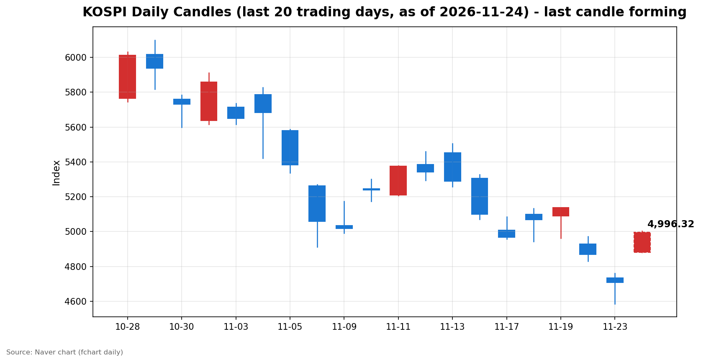
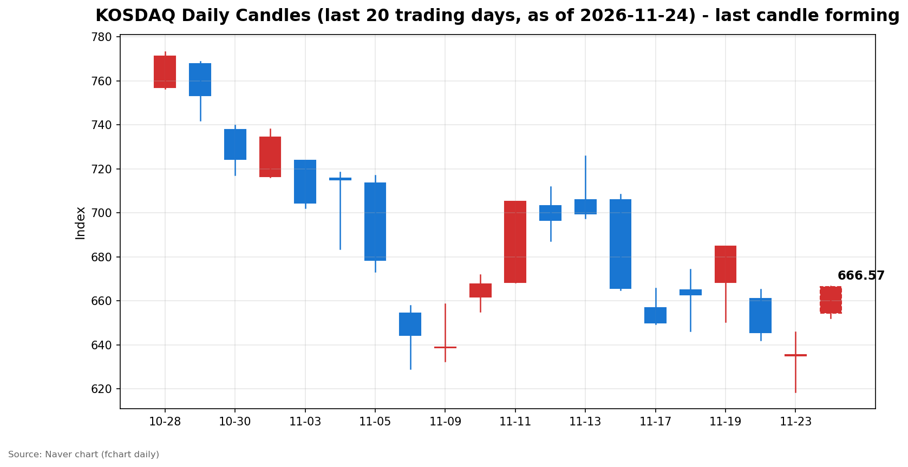

안녕하세요, [한국투자증권](https://securities.koreainvestment.com/main/Main.jsp)에서 [한투-한국투자증권](https://play.google.com/store/apps/details?id=com.truefriend.neosmartarenewal&hl=ko) 개발을 담당하고 있는 way입니다. 
간밤 뉴욕증시가 젠슨 황 엔비디아 최고경영자 복귀 소식에 폭등했고, 국내 증시는 5,000선을 회복하며 급등 출발했습니다. 

## 배경

간밤 미국 증시는 젠슨 황 엔비디아 최고경영자의 복귀 소식에 폭등했습니다. 
나스닥 종합지수는 24,089.56으로 1,471.83포인트, 6.51% 올랐습니다. 
스탠더드앤드푸어스 500지수는 7,237.17로 326.78포인트, 4.73% 올랐습니다. 
엔비디아는 이사회가 황 최고경영자의 복귀를 즉시 승인했다는 소식에 31.48% 폭등해 165.05달러로 거래를 마쳤습니다. 
미국 반도체주 전반이 반등하면서 국내 반도체주에도 강한 반등 기대가 유입됐습니다. 
원달러 환율은 1,339.50원으로 전일 대비 3.10원, 0.23% 내리며 원화 강세 쪽으로 움직였습니다. 
국내 증시는 전일 코스피가 3.31%, 코스닥이 1.58% 하락하며 4거래일 연속 하락한 뒤였습니다. 
전일 하락장에서 외국인과 개인이 동반 순매도했고, 기관과 기타법인이 매물을 받았습니다. 
낙폭 과대에 따른 반발 매수 심리와 간밤 미국발 훈풍이 장 초반 동시에 작용했습니다. 

## 오늘의 스냅샷

| 지수 | 현재가 | 전일 대비 | 등락률 | 시가 | 고가 | 저가 | 거래량 | 거래대금 |
| --- | --- | --- | --- | --- | --- | --- | --- | --- |
| [코스피](https://finance.naver.com/sise/sise_index.naver?code=KOSPI) | 4,986.54 | +278.00 | +5.90% | 4,880.16 | 5,003.29 | 4,880.16 | 35,237천주 | 3,310,659백만원 |
| [코스닥](https://finance.naver.com/sise/sise_index.naver?code=KOSDAQ) | 666.60 | +31.15 | +4.90% | 654.31 | 666.60 | 652.21 | 100,561천주 | 1,327,228백만원 |

스냅샷 기준 시각은 2026년 11월 24일 오전 9시 28분 한국시간입니다. 
전일 종가는 네이버 실시간 수치에서 역산한 값으로, 코스피 4,708.54, 코스닥 635.45입니다. 
역산값은 네이버 일봉의 11월 23일 종가와 일치합니다. 
코스피는 장 초반 5,000선을 회복했습니다. 
오전 9시 2분 기준 코스피는 5,000.47로 전일 대비 6.20% 올랐습니다. 
코스피200 선물 급등으로 매수 사이드카가 발동했습니다. 
발동 당시 코스피200 선물 가격은 전일 대비 6.66% 오른 775.08이었습니다. 

## 차트

최근 20거래일 일봉 차트입니다. 
빨간 봉은 종가가 시가보다 높은 날, 파란 봉은 종가가 시가보다 낮은 날입니다. 
당일 봉은 형성 중인 봉으로, 마감 전에는 계속 변합니다. 

## 원인·촉매 분석

오늘 급등의 직접 촉매는 젠슨 황 엔비디아 최고경영자의 복귀입니다. 
인공지능 투자 사이클에 대한 불확실성이 시장을 짓누르던 상황에서, 상징성이 큰 인물의 복귀는 투자심리를 단숨에 되돌렸습니다. 
나스닥이 6.51% 오른 것은 단순한 기술적 반등이 아니라, 인공지능 관련 성장주에 대한 할인율 우려가 한 번에 완화된 결과로 해석됩니다. 
국내 증시는 전일 4거래일 연속 하락으로 낙폭이 컸던 만큼, 간밤 훈풍에 대한 반응 폭도 컸습니다. 
코스피가 장 초반 6% 넘게 오르며 5,000선을 회복한 것은 하락 피로감과 공포 심리가 동시에 해소되는 국면입니다. 
수급 구도도 반전을 뒷받침합니다. 
전일 코스피에서 외국인은 2,560억원을 순매도했으나, 장 초반에는 4,319억원을 순매수하며 매수 주체로 돌아섰습니다. 
선물시장에서도 외국인이 1,454억원을 순매수했습니다. 
반면 개인은 장 초반 4,145억원을 순매도하며 차익 실현에 나섰습니다. 
외국인의 현선물 동반 매수는 단기 수급의 방향이 바뀌었음을 보여줍니다. 
다만 장 초반 수급은 마감까지 얼마든지 달라질 수 있어, 종가 기준 수급으로 재확인해야 합니다. 
환율도 우호적으로 움직였습니다. 
원달러 환율이 1,339.50원으로 소폭 내리며 외국인 매수 부담을 낮췄습니다. 
금리 쪽에서는 대출금리 상승이 소비심리를 압박하고 있어, 급등의 온기가 실물경기로 이어지는지는 별개 문제입니다. 

## 핵심 사건 3가지

### 1. 젠슨 황 엔비디아 최고경영자 복귀, 엔비디아 31.48% 폭등

엔비디아 이사회가 젠슨 황 최고경영자의 복귀를 즉시 승인했습니다. 
엔비디아 주가는 23일 뉴욕증시에서 31.48% 폭등해 165.05달러로 마감했습니다. 
이사회는 11월 22일 복귀를 의결했고, 새 고용 계약은 2027년 6월 주주총회 승인을 조건으로 한다고 중앙일보 G모닝이 전했습니다. 
나스닥 종합지수는 6.51% 올랐고, 스탠더드앤드푸어스 500지수는 4.73% 올랐습니다. 
인공지능 악재가 중첩되며 연일 하락하던 시장이 하루 만에 방향을 바꾼 사건입니다. 
국내에서는 삼성전자와 SK하이닉스가 장 초반 각각 7.86%, 10.14% 급등하며 반응했습니다. 
인공지능 밸류체인에 대한 시장의 믿음이 인물 하나의 복귀 소식에 얼마나 크게 흔들리는지를 보여주는 사례입니다. 
반등의 지속 여부는 엔비디아 실적과 인공지능 수요의 실체가 뒤따라주는지에 달려 있습니다. 

### 2. 소비심리 두 달째 하락, 가계저축 체감 3년 8개월 만에 최저

한국은행이 발표한 11월 소비심리는 두 달째 하락했습니다. 
현재가계저축지수는 89로, 2023년 3월 이후 3년 8개월 만에 가장 낮았습니다. 
한국은행은 주가 하락과 대출금리 상승을 배경으로 꼽았습니다. 
증시 급등과 소비심리 악화가 같은 아침에 나란히 나온 것이 특징입니다. 
자산시장의 반등이 가계의 체감 경기로 이어지기까지는 시간이 필요합니다. 
대출금리 상승이 계속되면 소비 여력 회복은 더뎌질 수 있습니다. 
내수 관련 업종의 실적 흐름을 볼 때는 심리지표와 금리 방향을 함께 봐야 합니다. 

### 3. 홈플러스, 11월 26일부터 온라인 배송 중단

기업회생 절차를 밟고 있는 홈플러스가 오는 26일부터 온라인 배송을 중단합니다. 
납품대금 지급 지연으로 상품 수급에 차질이 빚어진 데 따른 조치입니다. 
재개 시점은 정해지지 않았고, 예약 주문은 자동 취소와 환불이 진행됩니다. 
전점 재고가 200억원 밑으로 떨어졌다는 보도가 나왔습니다. 
유통업계의 구조적 어려움이 자금난과 맞물려 현실화한 사례입니다. 
매장 영업의 지속 여부도 이번 주가 분수령이 될 것으로 보입니다. 
유통·소비재 섹터에서는 개별 기업의 재무 건전성을 선별하는 흐름이 이어질 수 있습니다. 

## 섹터·테마 영향 체인

가장 강한 축은 인공지능·반도체 밸류체인입니다. 
엔비디아 폭등이 미국 반도체주 반등으로 이어졌고, 국내 반도체와 전자부품으로 온기가 확산됐습니다. 
삼성전기는 장 초반 11.18%, 삼화콘덴서는 10.95% 올랐습니다. 
아모텍은 23.23% 오르며 전자부품 쪽 강세를 이끌었습니다. 
인공지능 서버와 데이터센터 수요가 전자부품 수요로 연결되는 고리가 다시 주목받고 있습니다. 
로봇 테마도 강세입니다. 
삼성전자의 로봇 육성 의지와 자사주 소각 등 주주환원 정책이 맞물리며 로봇과 관련 부품주가 일제히 올랐습니다. 
휴머노이드 보행 시험 성공과 글로벌 공급 계약 소식도 로봇주 강세를 뒷받침했습니다. 
전력 수주 흐름도 이어지고 있습니다. 
데이터센터와 인공지능 인프라 확장이 전력 수요로 연결되는 구조가 유지되고 있습니다. 
2차전지 테마는 대규모 공급 계약과 자사주 매입 소식에 실적 개선 기대가 높아지며 강세를 보였습니다. 
코스모신소재는 9.22%, 대주전자재료는 8.77% 올랐습니다. 
반면 자동차 밸류체인은 종목별로 엇갈렸습니다. 
전기차 가격 경쟁과 비용 부담에 따른 수익성 저하 우려로 기아가 하락세를 보였습니다. 
현대오토에버는 로봇과 인공지능 투자 기대로 소폭 올랐습니다. 
같은 밸류체인 안에서도 인공지능·로봇과 연결된 쪽과 가격 경쟁에 노출된 쪽의 온도 차가 뚜렷합니다. 

## 최근 5거래일 일봉

| 날짜 | 시가 | 고가 | 저가 | 종가 | 거래량 |
| --- | --- | --- | --- | --- | --- |
| 2026-11-17 | 5,008.09 | 5,084.06 | 4,957.00 | 4,968.48 | 193,978천주 |
| 2026-11-18 | 5,098.82 | 5,133.14 | 4,943.17 | 5,067.44 | 219,090천주 |
| 2026-11-19 | 5,090.04 | 5,137.89 | 4,963.61 | 5,137.89 | 195,695천주 |
| 2026-11-20 | 4,928.51 | 4,971.31 | 4,831.69 | 4,869.96 | 206,729천주 |
| 2026-11-23 | 4,734.90 | 4,759.88 | 4,586.80 | 4,708.54 | 218,577천주 |
| 2026-11-24 | 4,880.16 | 5,003.29 | 4,880.16 | 4,987.91 | 35,132천주 |

위 표는 코스피 기준입니다. 
2026년 11월 24일 행은 형성 중인 봉으로, 종가와 거래량은 차트 생성 시점 기준이며 마감 전에는 계속 변합니다. 

| 날짜 | 시가 | 고가 | 저가 | 종가 | 거래량 |
| --- | --- | --- | --- | --- | --- |
| 2026-11-17 | 656.82 | 665.79 | 649.62 | 650.06 | 467,132천주 |
| 2026-11-18 | 664.93 | 674.30 | 646.31 | 662.81 | 462,804천주 |
| 2026-11-19 | 668.31 | 684.81 | 650.39 | 684.81 | 398,792천주 |
| 2026-11-20 | 660.98 | 665.15 | 642.13 | 645.68 | 421,847천주 |
| 2026-11-23 | 634.93 | 645.93 | 618.74 | 635.45 | 405,856천주 |
| 2026-11-24 | 654.31 | 666.59 | 652.21 | 666.59 | 100,293천주 |

위 표는 코스닥 기준입니다. 
2026년 11월 24일 행은 형성 중인 봉으로, 종가와 거래량은 차트 생성 시점 기준이며 마감 전에는 계속 변합니다. 

## 전일 수급

전일인 11월 23일 코스피에서는 외국인이 2,560억원을 순매도했습니다. 
개인은 3,532억원을 순매도했습니다. 
기관은 1,758억원을 순매수했습니다. 
기관 안에서는 금융투자가 4,695억원을 순매수하며 매수를 주도했습니다. 
반면 연기금은 1,577억원, 사모펀드는 1,053억원을 순매도했습니다. 
기타법인은 4,334억원을 순매수했습니다. 
전일 하락장에서 외국인과 개인이 함께 팔았고, 금융투자 중심의 기관과 기타법인이 매물을 받았습니다. 
하락의 깊이에 비해 기관의 매수세가 버팀목 역할을 한 구도입니다. 
코스닥에서는 외국인이 376억원을 순매도했습니다. 
개인은 1,694억원을 순매도했습니다. 
기관은 1,950억원을 순매수했습니다. 
기관 안에서는 금융투자가 1,485억원을 순매수하며 매수를 주도했습니다. 
기타법인은 120억원을 순매수했습니다. 
코스닥도 코스피와 같은 구도였습니다. 
외국인과 개인의 동반 매도를 기관이 받아낸 하루였습니다. 
다만 전일 수급은 하락장에서의 수급일 뿐, 오늘 급등의 수급은 종가 기준으로 다시 확인해야 합니다. 

## 단기·중기 전망과 확인할 시나리오

단기적으로는 반등의 지속 여부를 가늠하는 구간입니다. 
코스피가 5,000선을 회복한 뒤 이를 종가까지 지켜내는지가 첫 번째 확인 지점입니다. 
장 초반 5,000선을 넘었다가 되돌아온 전례가 있어, 종가 기준 안착 여부가 중요합니다. 
전일 저점인 코스피 4,586.80과 코스닥 618.74는 단기 지지선으로 볼 수 있습니다. 
반등이 이어지면 직전 고점인 코스피 5,137.89와 코스닥 684.81이 다음 저항 구간이 됩니다. 
외국인의 현선물 동반 매수가 종가까지 이어지는지도 확인해야 합니다. 
장 초반 외국인의 코스피 순매수는 4,319억원, 선물 순매수는 1,454억원이었습니다. 
이 매수세가 유지되면 단기 수급의 방향 전환으로 해석할 수 있습니다. 
반대로 장중 차익 매물이 늘고 외국인 매수가 꺾이면 일시적 반등에 그칠 수 있습니다. 
중기적으로는 인공지능 수요의 실체가 관건입니다. 
엔비디아 복귀 소식이 심리를 되돌렸지만, 실적과 수주 같은 숫자가 뒤따라야 반등이 추세가 됩니다. 
소비심리 하락과 대출금리 상승은 내수 쪽의 부담 요인으로 남아 있습니다. 
시나리오를 나누면, 첫째는 외국인 매수 지속과 5,000선 안착으로 반등이 이어지는 흐름입니다. 
둘째는 장중 차익 실현으로 상승폭을 반납하며 5,000선 아래에서 마감하는 흐름입니다. 
셋째는 미국 증시의 추가 소식에 따라 변동성이 커지는 흐름입니다. 
어느 쪽이든 특정 종목을 사고파는 판단이 아니라, 지수와 섹터 단위의 흐름을 확인하는 관점이 필요합니다. 

## 장 초반 확인할 점

코스피 5,000선 안착 여부를 종가까지 지켜봐야 합니다. 
외국인의 현선물 매수세가 유지되는지 확인해야 합니다. 
반도체와 전자부품의 강세가 오후까지 이어지는지 봐야 합니다. 
로봇과 2차전지 테마의 강세 지속 여부도 확인 지점입니다. 
개인 순매도 규모가 장 후반 어떻게 변하는지도 봐야 합니다. 
원달러 환율의 방향도 외국인 수급과 함께 확인해야 합니다. 

## 마치며

간밤 뉴욕증시의 폭등이 국내 증시의 강한 반등으로 이어졌습니다. 
종가 기준 5,000선 안착 여부와 외국인 매수 지속 여부를 오후 장에서 확인하겠습니다. 
이 글은 시장 해설을 위한 것으로, 특정 종목의 매수나 매도를 권유하는 내용이 아닙니다. 
