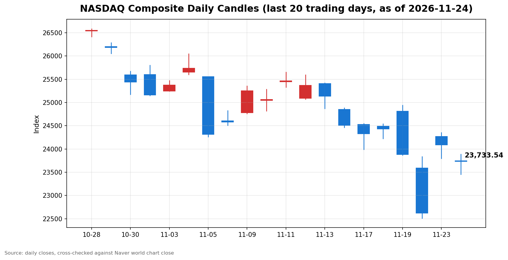

안녕하세요, [한국투자증권](https://securities.koreainvestment.com/main/Main.jsp)에서 [한투-한국투자증권](https://play.google.com/store/apps/details?id=com.truefriend.neosmartarenewal&hl=ko) 개발을 담당하고 있는 way입니다. 
현지시간 11월 24일 화요일, 나스닥은 전일 급등을 되돌리며 1.48% 하락 마감했습니다. 

## 마감 요약

나스닥 종합은 전일 대비 356.02포인트, 1.48% 내린 23,733.54로 마감했습니다. 
S&P500은 36.08포인트, 0.50% 내린 7,201.09로 마감했습니다. 
다우는 423.39포인트, 0.85% 오른 50,018.70으로 마감했습니다. 
나스닥은 전일 대비 343.70포인트 낮은 23,745.86으로 개장하며 갭 하락으로 출발했습니다. 
월요일 상승분 1,471.83포인트 중 356.02포인트, 약 24%를 하루 만에 반납했습니다. 
최근 5거래일 나스닥 종가는 11월 18일 24,429.88, 11월 19일 23,879.20, 11월 20일 22,617.73, 11월 23일 24,089.56, 11월 24일 23,733.54입니다. 
변동성 지수는 26.35로 전일 26.62에서 소폭 하락했습니다. 
미국 10년물 국채수익률은 전일 4.92%와 비슷한 4.90% 수준에서 마감했습니다. 
국내 증시는 미국장 개장 전에 마감해 코스피가 6.32% 오른 5,006.03, 코스닥이 4.79% 오른 665.88로 장을 마쳤습니다. 
중앙일보 GMC 11월 24일 G프터눈은 아시아 증시에서 코스피 6.32%, 코스닥 4.79%, 닛케이225 3.91%, 가권지수 8.99%가 올랐다고 전했습니다. 
중앙일보 GMC 11월 24일 G브닝은 개장 전 프리마켓에서 나스닥100 선물이 1.49% 하락했다고 전했습니다. 

## 오늘의 마감 스냅샷

| 지수 | 종가 | 전일 대비 | 등락률 | 전일 종가 | 당일 고가 | 당일 저가 |
| --- | --- | --- | --- | --- | --- | --- |
| 나스닥 종합 | 23,733.54 | -356.02 | -1.48% | 24,089.56 | 23,884.74 | 23,455.84 |
| S&P500 | 7,201.09 | -36.08 | -0.50% | 7,237.17 | 7,223.95 | 7,138.93 |
| 다우 | 50,018.70 | +423.39 | +0.85% | 49,595.31 | 50,075.12 | 49,294.49 |

스냅샷 기준 시각은 미국 동부시간 2026년 11월 24일 오후 4시 20분, 한국시간 11월 25일 오전 6시 20분입니다. 
나스닥 수치는 [네이버 월드 차트](https://finance.naver.com/world/sise.naver?symbol=NAS@IXIC)([나스닥 종합 가격 페이지](https://stock.naver.com/worldstock/index/.IXIC/price))에서 확인한 장마감 값입니다. 
네이버 월드 차트 페이지는 자바스크립트 기반이라 curl 직접 조회로는 수치를 확인할 수 없었으나, 브라우저로 같은 페이지를 열어 종가와 전일 대비, 등락률, 시가와 고가, 저가를 직접 확인했습니다. 
나스닥 종가 23,733.54와 등락률 1.48% 하락은 Yahoo Finance 일별 데이터와도 일치합니다. 
S&P500과 다우 종가는 Yahoo Finance 일별 데이터를 기준으로 했습니다. 
한투 MTS 해외 대시보드 교차 조회에서는 나스닥 23,733.54와 같은 값이 확인됐으나, 조회 시점마다 다른 스냅샷이 돌아오기도 했습니다. 
본문 수치는 네이버와 Yahoo Finance가 일치하는 공식 종가를 기준으로 했습니다. 
나스닥의 52주 범위는 최저 20,690.25, 최고 27,722.75입니다. 
원·달러 환율은 한투 MTS 기준 1,345.20원 수준이었습니다. 

## 차트

최근 20거래일 일봉 차트입니다. 
빨간 봉은 종가가 시가보다 높은 날, 파란 봉은 종가가 시가보다 낮은 날입니다. 

## 원인·촉매 분석

오늘 장의 근본 촉매는 인공지능 랠리의 되돌림입니다. 
월요일 젠슨 황 복귀 소식에 31.48% 폭등했던 엔비디아는 화요일 5.86% 하락했습니다. 
복귀 결정의 정치적·거버넌스 리스크를 시장이 다시 따지기 시작하면서, 월요일의 열기가 하루 만에 식었습니다. 
반도체 전반으로 차익 실현이 번지며 필라델피아 반도체지수는 7.88% 하락했습니다. 
되돌림의 배경에는 새로운 불확실성도 있었습니다. 
중앙일보 GMC 11월 24일 G브닝은 메가스피드의 미 무역 블랙리스트 등재 소식, 젠슨 황의 12월 1일과 3일 미 연방의회 청문회 출석 예정, HPE의 인공지능 서버 부문 마진 압박 경고를 전했습니다. 
복귀 소식으로 가려졌던 거버넌스·무역 리스크가 다시 부각되며 차익 실현을 자극했습니다. 
금리 경로는 이날 하락의 촉매가 아니었습니다. 
미국 10년물 국채수익률은 전일 4.92%에서 4.90%로 거의 움직이지 않았습니다. 
달러 지수는 104.32에서 103.83으로 소폭 하락했고, 원·달러 환율도 1,345.20원 수준에서 안정적이었습니다. 
국제유가는 서부텍사스산 원유가 80.17달러에서 81.48달러로 1.63% 오르며 에너지주의 하방을 받쳤습니다. 
지수 간 방향 차이는 충격의 중심이 어디였는지 보여줍니다. 
나스닥이 1.48% 내린 반면 S&P500은 0.50% 내리는 데 그쳤고, 다우는 0.85% 올랐습니다. 
기술주와 인공지능 관련주에 충격이 집중됐던 지난주와 같은 구도가, 반등 하루 만에 되돌림 국면에서도 그대로 나타났습니다. 
10월 소비자물가는 전월 대비 0.4%, 근원 0.3%로 시장 예상치를 웃돌았습니다. 
시장은 12월 8일부터 9일까지 열리는 연방공개시장위원회에서 25bp 인상을 기정사실로 가격에 반영하고 있습니다. 
중앙일보 GMC 11월 24일 G프터눈은 존 윌리엄스 뉴욕 연은 총재가 신중한 금리 인상 속도를 시사하면서도 인플레이션을 억제하기 위해 해야 할 일이 남아 있다고 했다고 전했습니다. 
시타델증권은 연준의 통화 긴축 기조와 인공지능 설비투자 둔화라는 두 가지 악재가 충돌할 위험을 지적했다고 같은 글이 전했습니다. 
수요일 오전 8시 30분에는 10월 개인소비지출 물가지수와 3분기 국내총생산 2차 추정치가 발표됩니다. 
금리 인상 기대가 높아진 국면에서는 성장주 밸류에이션에 대한 부담이 커지기 쉽습니다. 
다만 이날 10년물 수익률이 거의 움직이지 않았다는 점은, 금리보다 인공지능 종목의 되돌림이 하락을 주도했음을 보여줍니다. 

## 핵심 사건 3가지

첫째, 엔비디아의 급반락입니다. 
엔비디아는 월요일 125.53달러에서 165.05달러로 31.48% 폭등한 뒤, 화요일 155.38달러로 5.86% 하락했습니다. 
월요일 하루 시가총액은 9,520억 달러 늘었는데, 화요일 하락으로 그 증가분의 일부를 반납했습니다. 
월요일에는 델 20.5%, 마이크론 19%, TSMC 14%, 샌디스크 11% 등 인공지능·반도체주가 함께 올랐습니다. 
로이터 보도에 따르면 투자자들은 젠슨 황 복직을 둘러싼 정치적·거버넌스 리스크를 다시 따지기 시작했습니다. 
젠슨 황의 12월 1일과 3일 미 연방의회 청문회 출석 예정도 전해졌습니다. 
복귀 소식 자체는 월요일의 폭등 재료였지만, 복귀 과정의 불확실성이 해소되지 않았다는 인식이 되돌림을 불렀습니다. 
인공지능 랠리의 상징 종목이 흔들리자 관련주 전반으로 매도 심리가 번졌습니다. 

둘째, 앤트로픽의 공모가 하회입니다. 
로이터 보도에 따르면 앤트로픽 주가는 13.4% 하락한 76달러로, 공모가 83달러를 밑돌았습니다. 
지난주 기록적인 기업공개를 마친 지 며칠 만에 공모가를 내준 셈입니다. 
상장 직후의 열기가 식으면서 인공지능 테마 전반에 대한 신뢰가 시험받고 있습니다. 
엔비디아와 앤트로픽이 동시에 흔들린 점은, 인공지능 랠리가 단일 종목의 문제가 아니라 테마 전반의 되돌림 국면이라는 신호입니다. 

셋째, 아날로그디바이스의 실적 가이던스 실망입니다. 
아날로그디바이스는 실적 전망이 시장 기대에 못 미치면서 17.37% 하락했습니다. 
378.75달러에서 312.95달러로 마감했습니다. 
실망스러운 전망은 반도체 전반의 차익 실현을 키웠고, 필라델피아 반도체지수는 월요일 14.03% 급등분의 절반 이상을 하루 만에 반납했습니다. 
반도체 업황 자체의 둔화 신호로 읽기에는 이르지만, 고평가 부담이 큰 국면에서는 실적 전망 하나가 업종 전반의 매도를 부를 수 있음을 보여줬습니다. 

## 지수·섹터 영향 체인

기술·반도체가 직격탄을 맞았고, 경기방어주가 피난처가 됐습니다. 
필라델피아 반도체지수가 7.88% 하락하며 나스닥 하락을 주도했습니다. 
엔비디아와 반도체 관련주가 함께 내렸다는 점은, 인공지능 하드웨어 수요에 대한 기대가 한 번에 되돌려졌음을 보여줍니다. 
반면 헬스케어와 필수소비재 등 경기방어주는 상승하며 다우를 떠받쳤습니다. 
다우가 0.85% 오른 것은 기술주 약세와 별개로, 가치주와 방어주로 자금이 이동했기 때문입니다. 
에너지주도 국제유가 상승에 힘입어 상대적으로 견조했습니다. 
서부텍사스산 원유는 81.48달러로 1.63% 올랐습니다. 
금리에서 성장주 밸류에이션으로 이어지는 연결고리는 이날은 약하게 작용했습니다. 
10년물 수익률이 4.90%로 거의 움직이지 않았기 때문입니다. 
대신 인공지능 기대로 이어진 반도체 밸류에이션의 연결고리가 하락의 중심이었습니다. 
월요일의 폭등이 기대의 급격한 복원이었다면, 화요일의 하락은 그 기대가 얼마나 취약한지 보여준 되돌림입니다. 
S&P500이 0.50% 하락에 그친 것은, 기술주 약세를 방어주와 가치주 상승이 상당 부분 상쇄했기 때문입니다. 

## 다우·S&P500 마감 흐름

다우는 50,018.70으로 마감하며 50,000선을 되찾았습니다. 
전일 대비 423.39포인트, 0.85% 상승입니다. 
장중 고가는 50,075.12, 저가는 49,294.49였습니다. 
장중 저가 49,294.49까지 밀렸다가 방어주 매수세가 들어오며 상승 전환했습니다. 
S&P500은 7,201.09로 마감하며 7,200선을 지켰습니다. 
전일 대비 36.08포인트, 0.50% 하락입니다. 
장중 고가는 7,223.95, 저가는 7,138.93이었습니다. 
기술주 약세와 방어주 강세가 맞물리며 낙폭이 제한됐습니다. 
다우가 오르고 나스닥이 내린 분화는, 자금이 인공지능 테마에서 가치·방어주로 이동하고 있음을 보여줍니다. 
다만 하루의 분화만으로 자금 이동의 추세를 단정하기는 이릅니다. 
수요일 물가 지표 발표 이후 방향이 바뀔 가능성도 열려 있습니다. 

## 단기·중기 전망과 다음 거래일 확인할 시나리오

단기적으로는 수요일 오전 8시 30분 발표되는 10월 개인소비지출 물가지수가 첫 번째 분기점입니다. 
연준이 가장 중시하는 물가 지표로, 시장 예상치는 전월 대비 0.3% 상승입니다. 
예상보다 뜨겁게 나오면 12월 연방공개시장위원회에서 50bp 인상 가능성을 다시 따지게 되고, 성장주 부담이 커질 수 있습니다. 
예상에 부합하거나 낮게 나오면 25bp 인상 경로가 굳어지며 기술주 되돌림이 진정될 여지가 있습니다. 
같은 시각 발표되는 3분기 국내총생산 2차 추정치도 함께 확인해야 합니다. 
시장 예상치는 연율 3.4%입니다. 
나스닥은 당일 저가 23,455.84와 전일 종가 24,089.56 사이 구간이 단기 기준선이 됩니다. 
당일 저가 23,455.84를 밑돌면 월요일 상승분의 절반을 반납하는 23,353.64 부근까지 되돌림이 깊어질 수 있습니다. 
반대로 24,089.56을 되찾으면 되돌림이 진정되는 신호로 볼 수 있습니다. 
중기적으로는 12월 8일부터 9일까지의 연방공개시장위원회와 12월 4일 발표되는 11월 고용보고서가 방향을 가릅니다. 
목요일은 추수감사절로 휴장하고 금요일은 단축 거래가 이어집니다. 
연휴를 앞둔 주간에는 거래량이 줄며 변동성이 커질 수 있습니다. 
월요일 폭등과 화요일 되돌림이 보여주듯, 인공지능 테마는 하루 만에 방향이 뒤집힐 수 있는 국면입니다. 
지수와 섹터 단위의 흐름을 확인하며 리스크를 관리하는 관점이 필요합니다. 

## 마치며

월요일의 폭등이 하루 만에 되돌려지며, 인공지능 랠리의 취약함이 드러난 하루였습니다. 
수요일 물가 지표를 확인하기 전까지는 되돌림이 진정되는지, 깊어지는지 지켜봐야 합니다. 
이 글은 교육·해설 목적의 시황 정리이며, 특정 종목의 매수·매도를 권유하지 않습니다. 
