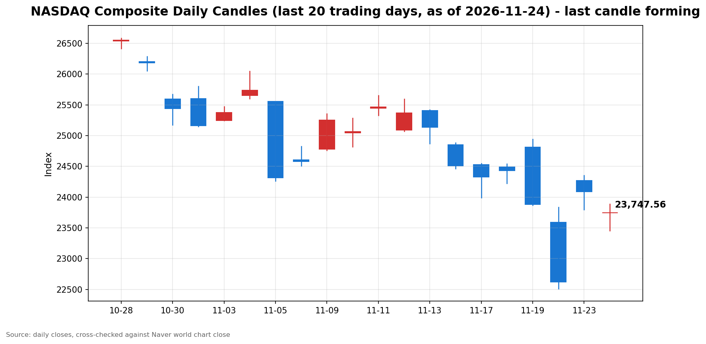

안녕하세요, [한국투자증권](https://securities.koreainvestment.com/main/Main.jsp)에서 [한투-한국투자증권](https://play.google.com/store/apps/details?id=com.truefriend.neosmartarenewal&hl=ko) 개발을 담당하고 있는 way입니다. 
전일 6.51% 급등했던 나스닥이 화요일 장중에도 되돌림을 이어가고 있고, 다우는 장중 5만 선을 넘어섰습니다. 

## 장중 요약

나스닥 종합지수는 장중 23,811.53으로 전일 종가보다 1.15% 내리고 있습니다. 
전일 급등을 주도한 AI 반도체주가 되돌림의 중심에 있습니다. 
엔비디아는 6.96% 내리고 있고, 마이크론은 10.13%, AMD는 8.79% 내리고 있습니다. 
반면 다우는 0.81% 오르며 장중 고가 50,075.12를 기록해 5만 선을 넘어섰습니다. 
S&P500은 0.43% 내리며 나스닥보다 낙폭이 작습니다. 
아시아 증시는 전일 미국 랠리를 이어받아 급등했습니다. 
중앙일보 GMC의 11월 24일자 G프터눈 브리핑에 따르면 코스피는 6.32%, 닛케이225는 3.91%, 대만 가권지수는 8.99% 올랐습니다. 
미국 장중 흐름은 아시아의 급등과 정반대로, 전일 급등분을 되돌리는 방향입니다. 

## 오늘의 스냅샷

| 지수 | 현재가 | 전일 대비 | 등락률 | 전일 종가 | 시가 | 장중 고가 | 장중 저가 |
| --- | --- | --- | --- | --- | --- | --- | --- |
| [나스닥 종합](https://stock.naver.com/worldstock/index/.IXIC/price) | 23,811.53 | -278.03 | -1.15% | 24,089.56 | 23,745.86 | 23,884.74 | 23,455.84 |
| S&P500 | 7,206.39 | -30.78 | -0.43% | 7,237.17 | 7,172.33 | 7,223.95 | 7,138.93 |
| 다우 | 49,998.08 | +402.77 | +0.81% | 49,595.31 | 49,494.60 | 50,075.12 | 49,294.49 |

스냅샷 기준 시각은 2026년 11월 24일 오후 1시경(미국 동부시간), 2026년 11월 25일 오전 3시경(한국시간)입니다. 
나스닥 수치는 한투 MTS 해외 대시보드와 야후 파이낸스 기준이며, S&P500과 다우 수치도 야후 파이낸스 기준입니다. 
네이버 월드 차트 페이지는 직접 조회가 막혀 수치를 추출하지 못했습니다. 
네이버 월드 차트 출처는 [네이버 월드 차트](https://finance.naver.com/world/sise.naver?symbol=NAS@IXIC)와 [Npay 증권 나스닥 종합 페이지](https://stock.naver.com/worldstock/index/.IXIC/price)입니다. 
당일 수치는 형성 중인 값으로, 마감 전에는 계속 변합니다. 
미 10년물 국채수익률은 4.91% 수준이며, 달러 지수는 103.79 수준입니다. 
서부텍사스산 원유(WTI)는 배럴당 81.39달러로 전일 대비 1.52% 올랐습니다. 
원·달러 환율은 1,341.60원 수준입니다. 
나스닥 100 선물은 26,292.75로 1.92% 내리고 있습니다. 

## 차트

최근 20거래일 일봉 차트입니다. 
빨간 봉은 종가가 시가보다 높은 날, 파란 봉은 종가가 시가보다 낮은 날입니다. 
당일 봉은 형성 중인 봉으로, 마감 전에는 계속 변합니다. 

## 원인·촉매 분석

오늘 하락의 주된 성격은 전일 급등에 대한 되돌림입니다. 
전일 나스닥이 6.51% 올랐고 엔비디아가 31.48% 급등했으니, 단기 차익 실현 매물이 나올 자리는 충분했습니다. 
장중 한때 나스닥은 23,455.84까지 밀려 전일 종가 대비 2.63% 내리기도 했습니다. 
이후 23,800선으로 회복했지만, 낙폭을 대부분 되돌리지는 못하고 있습니다. 
금리는 하락 요인이 아니었습니다. 
미 10년물 국채수익률은 4.91%로 전일 종가 4.92%와 거의 같았고, 큰 방향 변화가 없었습니다. 
달러도 하락 요인이 아니었습니다. 
달러 지수는 103.79로 전일 종가 104.32보다 소폭 낮아졌습니다. 
유가도 나스닥 하락을 설명하지 못합니다. 
서부텍사스산 원유는 1.52% 오르며 에너지 쪽에는 우호적인 흐름이었습니다. 
중앙일보 GMC의 11월 24일자 G브닝 브리핑은 되돌림 분위기를 "하룻밤 꿈이었나"라는 제목으로 전했습니다. 
G브닝은 프리마켓에서 나스닥 100 선물이 1.49%, S&P500 선물이 0.81%, 다우 선물이 0.42% 내렸다고 전했습니다. 
지수 간 방향 차이도 되돌림의 성격을 뒷받침합니다. 
나스닥이 1.15% 내리는 동안 S&P500은 0.43% 내리는 데 그쳤고, 다우는 0.81% 올랐습니다. 
하락이 시장 전체가 아니라 전일 급등을 주도한 성장·기술주에 집중되고 있습니다. 

## 핵심 사건 3가지

첫째, 젠슨 황 복귀 랠리 하루 만의 되돌림입니다. 
젠슨 황 엔비디아 최고경영자(CEO)는 사임 11일 만에 복직했고, 전일 엔비디아 주가는 31.48% 급등해 165.05달러로 마감했습니다. 
시가총액은 하루 만에 9,520억 달러 늘었습니다. 
그러나 화요일 장중 엔비디아는 153.56달러로 6.96% 내리고 있습니다. 
장중 저가는 150.50달러까지 밀렸습니다. 
뉴스1은 삭소마켓의 차루 차나나 투자전략가가 "젠슨 황 혼자 시장을 떠받칠 수는 없다"고 평가했다고 전했습니다. 
복귀가 AI 거래를 짓누르던 큰 불확실성 하나를 해소했지만, 그 자체가 상승 추세를 이어가는 동력은 아니라는 지적입니다. 
키움증권 한지영 연구원은 AI 업체들의 투자 수익성과 메모리 다운사이클 우려 등 10월 이후 증시 조정을 초래했던 근본적인 불안이 완전히 해소됐다고 보기는 어렵다고 지적했습니다. 
젠슨 황 복귀는 단기 호재로 작용하겠지만, 향후 변동성 확대 가능성에 대비할 필요가 있다는 평가입니다. 

둘째, 앤트로픽의 공모가 하회입니다. 
최근 뉴욕증시에 입성한 AI 기업 앤트로픽 주가는 3거래일 연속 하락하며 장중 공모가 83달러를 밑돌았습니다. 
연합뉴스는 엔비디아가 전일 상승분을 반납하는 가운데 앤트로픽도 장 초반 공모가를 하회했다고 전했습니다. 
앤트로픽은 지난 19일 상장 첫날 급등하며 시가총액 2조 달러를 돌파했지만, 이튿날 9% 넘게 하락해 88.91달러로 마감한 바 있습니다. 
상장 직후의 급등이 이어지지 못하고 되돌림에 들어간 모습입니다. 
중앙일보 GMC의 G브닝 브리핑은 HPE의 AI 서버 마진 경고도 투심을 식힌 요인으로 꼽았습니다. 
AI 인프라의 수익성 우려가 하드웨어 전반으로 번지는 모습입니다. 

셋째, 미국의 과잉생산 관세 발표가 임박했다는 소식입니다. 
월스트리트저널(WSJ) 보도에 따르면 미국 무역대표부(USTR)는 16개 경제권을 상대로 진행해온 과잉생산·산업보조금 관련 무역법 301조 조사를 사실상 마무리하고 이르면 이번 주 최종 결과와 후속 관세 부과 방안을 발표할 전망입니다. 
조사 대상은 중국, 유럽연합(EU), 한국, 일본 등 16개 경제권입니다. 
한국, 일본, EU는 기존 무역합의에 따라 15% 이하의 관세율을 적용받을 가능성이 크다고 전해졌습니다. 
중국에는 상대적으로 높은 관세가 부과될 전망입니다. 
철강, 자동차, 배터리, 반도체 등 주력 품목이 사정권에 들어 있습니다. 
다만 디지털 규제를 겨냥한 미국의 추가 무역조사 가능성도 변수로 거론되고 있습니다. 
아직 발표 전인 사안이라 실제 관세 수준과 대상 품목은 확인이 필요합니다. 

## 지수·섹터 영향 체인

반도체·AI 하드웨어 섹터가 되돌림의 중심에 있습니다. 
전일 폭등을 주도한 엔비디아가 6.96% 내리며 나스닥 하락을 이끌고 있습니다. 
마이크론이 10.13% 내리며 낙폭이 가장 크고, AMD가 8.79%, TSMC가 4.16%, 브로드컴이 3.18% 내리고 있습니다. 
메모리 쪽 낙폭이 특히 큰 것은 메모리 다운사이클 우려가 다시 부각되고 있기 때문입니다. 
전일 급등한 AI 관련주 전반에 차익 실현 압력이 번지고 있습니다. 
소프트웨어·플랫폼 섹터는 상대적으로 견조합니다. 
마이크로소프트가 1.30%, 애플이 1.24%, 팔란티어가 2.20% 오르고 있습니다. 
하드웨어에서 소프트웨어로 자금이 이동하는 기술주 안의 순환매가 나타나고 있습니다. 
중앙일보 GMC의 11월 24일자 GMC 리포트는 팔로알토 네트웍스가 45억 달러를 들여 자체 AI 서버 인프라 구축에 나서고, 분기 매출이 전년 대비 39.2% 늘었다고 전했습니다. 
보안 소프트웨어 기업이 AI 인프라 수직계열화에 나서는 흐름은 소프트웨어 쪽의 투자 심리를 뒷받침합니다. 
에너지 섹터는 상대적으로 우호적인 환경입니다. 
서부텍사스산 원유가 1.52% 오르며 에너지 가격 흐름이 받쳐주고 있습니다. 
금융·산업·가치주는 상대 강세를 보이고 있습니다. 
다우가 0.81% 오르며 장중 5만 선을 넘어선 것이 자금의 순환매를 보여줍니다. 
헬스케어 섹터는 정책 우려가 별개의 부담입니다. 
메디케어 어드밴티지 별점 산정 기준 변경에 따른 성과급 감소 우려로 유나이티드헬스와 휴매나가 전일 하락했습니다. 
금리에서 성장주 밸류에이션으로 이어지는 연결고리는 오늘 작동하지 않았습니다. 
미 10년물 금리가 거의 움직이지 않았기 때문입니다. 
오늘 하락은 금리 요인이 아니라 심리·수급 요인으로 설명되는 흐름입니다. 

## 다우·S&P500 흐름

다우는 49,998.08로 0.81% 오르며 전일 상승세를 이어가고 있습니다. 
전일 다우는 3.01% 올랐고, 오늘도 장중 고가 50,075.12를 기록하며 5만 선에 다가서고 있습니다. 
S&P500은 7,206.39로 0.43% 내리며 나스닥보다 낙폭이 작습니다. 
전일 S&P500은 4.73% 올랐습니다. 
전일 상승률은 나스닥 6.51%, S&P500 4.73%, 다우 3.01% 순으로, 성장·기술주 중심의 랠리였습니다. 
오늘은 그 순서가 뒤집혔습니다. 
다우가 오르고 나스닥이 가장 많이 내리며, 자금이 성장주에서 가치·방어주로 이동하고 있습니다. 
전면적인 하락이 아니라 지수 안에서의 순환매라는 점이 오늘 흐름의 특징입니다. 

## 오전과 오후 흐름 변화

오전 10시 시점과 오후 1시 시점을 비교하면 나스닥의 낙폭은 1.05%에서 1.15%로 소폭 깊어졌습니다. 
숫자만 보면 큰 변화가 없어 보이지만, 장중 흐름은 한 차례 크게 흔들렸습니다. 
나스닥은 오전 저가 23,629.77 아래로 더 밀려 23,455.84까지 내렸다가 23,800선으로 회복했습니다. 
낙폭이 유지되는 가운데 변동성이 커진 모습입니다. 
다우는 오전 0.54% 상승에서 오후 0.81% 상승으로 오름폭을 키웠습니다. 
장중 고가 50,075.12를 기록하며 5만 선을 넘어섰습니다. 
S&P500은 오전 0.38% 하락에서 오후 0.43% 하락으로 거의 같은 수준을 유지하고 있습니다. 
오전에는 나스닥만 빠지고 다우가 오르는 구도였는데, 오후에도 같은 구도가 이어지고 있습니다. 
방향 전환은 없었고, 오전의 순환매 흐름이 오후까지 유지되고 있습니다. 

## 마감까지 전망과 확인할 시나리오

장중 흐름이 되돌림 뒤 재반등인지, 추세 전환의 시작인지는 마감까지 확인할 필요가 있습니다. 
가장 먼저 확인할 수치는 24,000선 회복 여부입니다. 
나스닥이 24,000선을 되찾으면 되돌림 뒤 재반등을 시도하는 흐름이 될 수 있습니다. 
반대로 장중 저가 23,455.84를 다시 밑돌면 낙폭 확대를 경계해야 합니다. 
엔비디아의 150달러선 방어 여부도 확인할 수치입니다. 
장중 저가 150.50달러에서 반등한 만큼, 이 가격대가 단기 지지선으로 작용하는지 지켜봐야 합니다. 
다우의 5만 선 안착 여부도 확인할 대목입니다. 
장중에는 50,075.12까지 올랐지만, 현재가는 49,998.08로 5만 선을 소폭 밑돌고 있습니다. 
마감 종가가 5만 선 위에 머무는지 여부가 심리에 영향을 줄 수 있습니다. 
이번 주에는 과잉생산 관세 발표 시점도 변수입니다. 
USTR의 발표가 실제로 나오면 대상 품목과 관세 수준에 따라 반도체·자동차 관련주의 반응이 갈릴 수 있습니다. 
추수감사절 주간이라 목요일은 휴장이고 금요일은 단축 거래입니다. 
거래가 얇아지는 시기라 장중 변동성이 커질 수 있습니다. 
단기적으로는 되돌림이 이어질 수 있지만, 금리와 달러가 안정적인 만큼 전면적인 하락으로 단정하기는 어렵습니다. 
마감까지는 지수·섹터 단위의 흐름을 확인하며 리스크를 관리하는 관점이 필요합니다. 

## 마치며

전일 급등 하루 만에 나스닥은 되돌림에 들어갔고, 다우는 5만 선 돌파를 시도하고 있습니다. 
이 글은 시황 해설을 위한 것으로, 특정 종목의 매수나 매도를 권유하는 내용이 아닙니다. 
