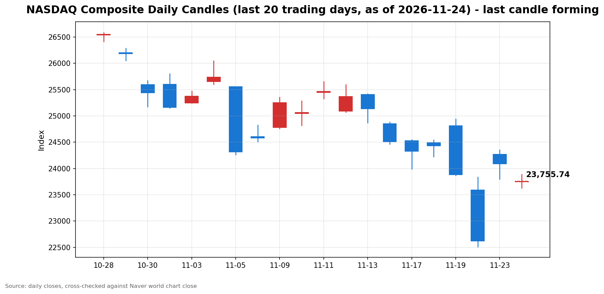

안녕하세요, [한국투자증권](https://securities.koreainvestment.com/main/Main.jsp)에서 [한투-한국투자증권](https://play.google.com/store/apps/details?id=com.truefriend.neosmartarenewal&hl=ko) 개발을 담당하고 있는 way입니다. 
전일 6.51% 급등했던 나스닥이 화요일 개장과 함께 1%대 되돌림으로 출발하고 있습니다. 

## 배경

지난 11월 23일(현지시간) 나스닥 종합지수는 24,089.56으로 6.51% 급등 마감했습니다. 
젠슨 황 엔비디아 최고경영자(CEO)가 사임 11일 만에 복직했다는 소식이 전해지며 투자 심리가 빠르게 회복됐습니다. 
엔비디아는 이날 31.48% 급등한 165.05달러로 마감했고, 시가총액은 하루 만에 9,520억 달러 늘었습니다. 
중앙일보 GMC의 11월 24일자 G모닝 브리핑은 이를 두고 "9520억 달러짜리 복직, 그가 돌아왔다"라는 제목을 달았습니다. 
아시아 증시도 전일 미국 랠리를 이어받아 강세를 보였습니다. 
일본 니케이225 지수는 3.91% 올랐고, 한국과 대만 증시도 반도체주를 중심으로 크게 올랐습니다. 
다만 화요일 정규장 개장 뒤 나스닥은 차익 실현 매물에 밀리며 하락으로 돌아섰습니다. 
개장 30분 시점의 나스닥은 전일 종가보다 1.05% 낮은 수준에서 움직이고 있습니다. 

## 오늘의 스냅샷

| 지수 | 현재가 | 전일 대비 | 등락률 | 전일 종가 | 시가 | 고가 | 저가 |
| --- | --- | --- | --- | --- | --- | --- | --- |
| [나스닥 종합](https://stock.naver.com/worldstock/index/.IXIC/price) | 23,837.68 | -251.88 | -1.05% | 24,089.56 | 23,745.86 | 23,884.74 | 23,629.77 |
| S&P500 | 7,209.77 | -27.40 | -0.38% | 7,237.17 | 7,172.33 | 7,223.95 | 7,138.93 |
| 다우 | 49,864.15 | +268.84 | +0.54% | 49,595.31 | 49,494.60 | 49,912.00 | 49,294.49 |

스냅샷 기준 시각은 2026년 11월 24일 오전 10시(미국 동부시간), 2026년 11월 25일 오전 0시(한국시간)입니다. 
나스닥 수치는 [네이버 월드 차트](https://finance.naver.com/world/sise.naver?symbol=NAS@IXIC)와 [Npay 증권 나스닥 종합 페이지](https://stock.naver.com/worldstock/index/.IXIC/price) 기준이며, S&P500과 다우 수치는 야후 파이낸스 기준입니다. 
한투 MTS 해외 대시보드에서도 같은 시각 나스닥이 1.06% 하락으로 확인됐습니다. 
당일 수치는 형성 중인 값으로, 마감 전에는 계속 변합니다. 
나스닥 거래량은 236,903천주로 집계됐습니다. 
나스닥 52주 범위는 최저 20,690.25에서 최고 27,722.75입니다. 
미 10년물 국채수익률은 4.91% 수준이며, 달러 지수는 103.78 수준입니다. 
서부텍사스산 원유(WTI)는 배럴당 81.43달러로 전일 대비 1.57% 올랐습니다. 
원·달러 환율은 1,341.60원 수준입니다. 
나스닥 선물은 26,311.50으로 1.85% 하락해 정규장 약세를 예고했습니다. 

## 차트

최근 20거래일 일봉 차트입니다. 
빨간 봉은 종가가 시가보다 높은 날, 파란 봉은 종가가 시가보다 낮은 날입니다. 
당일 봉은 형성 중인 봉으로, 마감 전에는 계속 변합니다. 

## 원인·촉매 분석

오늘 하락의 주된 성격은 전일 급등에 대한 되돌림입니다. 
전일 나스닥이 6.51% 올랐고 엔비디아가 31.48% 급등했으니, 단기 차익 실현 매물이 나올 자리는 충분했습니다. 
장 초반 엔비디아는 155달러대에서 움직이며 전일 종가보다 6% 가까이 밀렸습니다. 
금리는 하락 요인이 아니었습니다. 
미 10년물 국채수익률은 4.91%로 전일 종가 4.92%와 거의 같았고, 큰 방향 변화가 없었습니다. 
달러도 하락 요인이 아니었습니다. 
달러 지수는 103.78로 전일 종가 104.32보다 소폭 낮아졌습니다. 
유가도 나스닥 하락을 설명하지 못합니다. 
서부텍사스산 원유는 1.57% 오르며 에너지 쪽에는 우호적인 흐름이었습니다. 
나스닥 선물은 개장 전부터 1.85% 하락해 정규장의 약세를 미리 보여주고 있었습니다. 
지수 간 방향 차이도 되돌림의 성격을 뒷받침합니다. 
나스닥이 1.05% 내리는 동안 S&P500은 0.38% 내리는 데 그쳤고, 다우는 0.54% 올랐습니다. 
하락이 시장 전체가 아니라 전일 급등을 주도한 성장·기술주에 집중되고 있습니다. 

## 핵심 사건 3가지

첫째, 젠슨 황 엔비디아 최고경영자(CEO)의 복직입니다. 
엔비디아 이사회는 사임 11일 만에 황을 사장·최고경영자·이사로 만장일치 복직시켰습니다. 
중앙일보 GMC의 11월 24일자 G모닝 브리핑은 블룸버그 보도를 인용해, 복직 방침이 트럼프 대통령의 압박 속에 11월 22일 일요일 단 몇 시간 만에 확정됐다고 전했습니다. 
트럼프 대통령은 황 CEO를 "위대한 애국자이자 미국의 보물"이라고 했다고 전해졌습니다. 
복귀 소식이 전해진 11월 23일 엔비디아 주가는 31.48% 급등한 165.05달러로 마감해 2003년 이후 최대 하루 상승폭을 기록했습니다. 
시가총액은 하루 만에 9,520억 달러 늘었습니다. 
델이 20.5%, 마이크론이 19%, TSMC가 14%, 팔란티어가 11%, 테슬라가 11.5% 오르는 등 AI 관련주가 동반 급등했습니다. 
리더십 불확실성이 걷히며 AI 투자 심리가 회복됐다는 신호로 시장은 받아들였습니다. 

둘째, 급반등 다음 날의 차익 실현입니다. 
전일 6.51% 급등한 나스닥은 화요일 개장과 함께 되돌림에 들어갔습니다. 
장 초반 나스닥은 1.05% 하락했고, 엔비디아도 6% 가까이 밀렸습니다. 
전일 상승분의 일부를 반납하는 흐름으로, 급등 직후 나타나는 전형적인 되돌림입니다. 
중앙일보 GMC의 11월 24일자 G브닝 브리핑 제목은 "하룻밤 꿈이었나"로, 되돌림 분위기를 그대로 보여줍니다. 
다만 되돌림이 추세 전환인지, 단기 숨 고르기인지는 장 초반 흐름만으로 판단하기 어렵습니다. 

셋째, AI 랠리의 지속 가능성에 대한 의문이 여전하다는 점입니다. 
키움증권 한지영 연구원은 AI 업체들의 투자 수익성과 메모리 다운사이클 우려 등 10월 이후 증시 조정을 초래했던 근본적인 불안이 완전히 해소됐다고 보기는 어렵다고 지적했습니다. 
젠슨 황 복귀는 단기 호재로 작용하겠지만, 향후 변동성 확대 가능성에 대비할 필요가 있다는 평가입니다. 
헬스케어주도 지수 안에서 차별화됐습니다. 
메디케어 어드밴티지 별점 산정 기준 변경에 따른 성과급 감소 우려 등으로 유나이티드헬스가 1.1%, 휴매나가 1.62% 하락했습니다. 
정책 변수가 특정 섹터에는 별개의 하방 압력으로 작용하고 있습니다. 

## 지수·섹터 영향 체인

반도체·AI 인프라 섹터가 되돌림의 중심에 있습니다. 
전일 폭등을 주도한 엔비디아가 장 초반 6% 가까이 밀리며 나스닥 하락을 이끌고 있습니다. 
전일 급등한 AI 관련주 전반에도 차익 실현 압력이 번지고 있습니다. 
개별 종목의 장중 움직임은 확인이 필요합니다. 
소프트웨어·AI 응용 섹터도 전일 상승분을 되돌리는지 장 초반 흐름을 확인할 필요가 있습니다. 
에너지 섹터는 상대적으로 우호적인 환경입니다. 
서부텍사스산 원유가 1.57% 오르며 에너지 가격 흐름이 받쳐주고 있습니다. 
헬스케어 섹터는 정책 우려가 직접적인 부담입니다. 
메디케어 어드밴티지 별점 변경 우려가 유나이티드헬스와 휴매나의 하락으로 이어졌습니다. 
금융·산업·가치주는 상대 강세를 보이고 있습니다. 
다우가 0.54% 오르며 50,000선에 다가선 것이 자금의 순환매를 보여줍니다. 
금리에서 성장주 밸류에이션으로 이어지는 연결고리는 오늘 작동하지 않았습니다. 
미 10년물 금리가 거의 움직이지 않았기 때문입니다. 
오늘 하락은 금리 요인이 아니라 심리·수급 요인으로 설명되는 흐름입니다. 

## 다우·S&P500 흐름

다우는 49,864.15로 0.54% 오르며 전일 상승세를 이어가고 있습니다. 
전일 다우는 3.01% 올랐고, 오늘도 장중 고가 49,912.00을 기록하며 50,000선에 다가서고 있습니다. 
S&P500은 7,209.77로 0.38% 내리며 나스닥보다 낙폭이 작습니다. 
전일 S&P500은 4.73% 올랐습니다. 
전일 상승률은 나스닥 6.51%, S&P500 4.73%, 다우 3.01% 순으로, 성장·기술주 중심의 랠리였습니다. 
오늘은 그 순서가 뒤집혔습니다. 
다우가 오르고 나스닥이 가장 많이 내리며, 자금이 성장주에서 가치·방어주로 이동하고 있습니다. 
전면적인 하락이 아니라 지수 안에서의 순환매라는 점이 오늘 흐름의 특징입니다. 

## 단기·중기 전망과 장 초반 확인할 시나리오

장 초반에 가장 먼저 확인할 수치는 24,000선 방어 여부입니다. 
나스닥이 24,000선을 지키면 되돌림 뒤 재반등을 시도하는 흐름이 될 수 있습니다. 
24,000선을 내주면 전일 저가 23,794.96을 테스트하는 흐름이 될 수 있습니다. 
위쪽에서는 전일 종가 24,089.56이 첫 저항이 되고, 전일 고가 24,353.65가 다음 저항입니다. 
엔비디아의 155달러대 안착 여부도 함께 확인할 필요가 있습니다. 
엔비디아가 155달러대를 지키면 AI 관련주 되돌림이 제한될 수 있습니다. 
거래량도 확인할 변수입니다. 
이번 주는 추수감사절 주간으로, 11월 26일 목요일은 휴장하고 11월 27일 금요일은 조기 마감합니다. 
거래가 줄어드는 주간에는 작은 매물에도 변동성이 커질 수 있습니다. 
미 10년물 국채수익률이 4.9%대를 유지하는지도 확인할 필요가 있습니다. 
금리가 크게 오르면 성장주 밸류에이션 부담이 다시 부각될 수 있습니다. 
중기적으로는 AI 투자 수익성과 메모리 사이클에 대한 의문이 해소되지 않으면 변동성이 이어질 수 있습니다. 
젠슨 황 복귀는 리더십 불확실성을 걷어냈지만, 투자 수익성에 대한 근본 질문까지 해소하지는 못했습니다. 
단기적으로는 전일 급등분의 되돌림이 어디까지 이어지는지가 관건입니다. 
중기적으로는 AI 관련 실적과 메모리 가격 흐름이 방향을 가를 것으로 보입니다. 

## 마치며

전일 6.51% 급등했던 나스닥이 화요일 개장과 함께 1.05% 되돌림으로 출발했습니다. 
되돌림이 단기 숨 고르기에 그칠지, 추가 조정으로 이어질지는 24,000선 방어 여부와 엔비디아 흐름이 가를 것으로 보입니다. 
이 글은 시장 해설을 목적으로 하며, 특정 종목의 매수·매도를 권유하는 내용이 아닙니다. 
