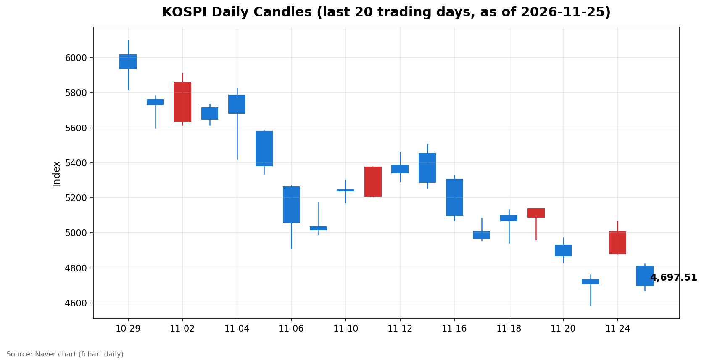
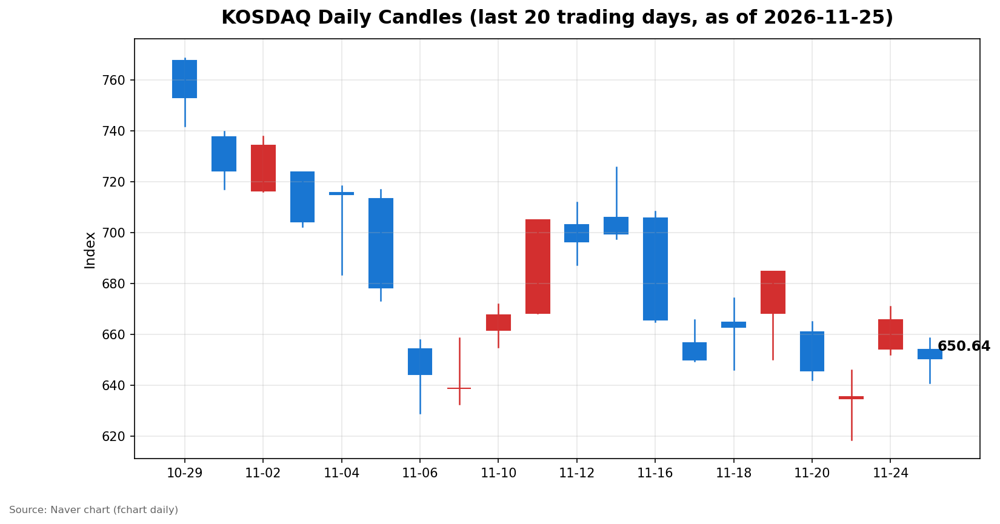

안녕하세요, [한국투자증권](https://securities.koreainvestment.com/main/Main.jsp)에서 [한투-한국투자증권](https://play.google.com/store/apps/details?id=com.truefriend.neosmartarenewal&hl=ko) 개발을 담당하고 있는 way입니다. 
오늘 국내 증시는 전날의 급반등을 하루 만에 되돌리며 큰 폭으로 하락했습니다. 

## 마감 요약

코스피는 전 거래일보다 308.52포인트 내린 4,697.51로 마감했습니다. 
등락률은 마이너스 6.16퍼센트입니다. 
코스닥은 15.24포인트 내린 650.64로 마감했습니다. 
등락률은 마이너스 2.29퍼센트입니다. 
코스피는 장이 열리자마자 5퍼센트 넘게 하락했고, 장중 4,672.55까지 밀렸다가 4,700선을 회복하지 못한 채 마감했습니다. 
전날 6.32퍼센트 급등했던 흐름이 하루 만에 꺾인 셈입니다. 

## 오늘의 마감 스냅샷

| 지수 | 종가 | 전일 대비 | 등락률 | 시가 | 고가 | 저가 | 거래량 | 거래대금 |
| --- | --- | --- | --- | --- | --- | --- | --- | --- |
| [코스피](https://finance.naver.com/sise/sise_index.naver?code=KOSPI) | 4,697.51 | -308.52 | -6.16% | 4,809.00 | 4,823.36 | 4,672.55 | 1억 8,152만 주 | 14조 5,367억 원 |
| [코스닥](https://finance.naver.com/sise/sise_index.naver?code=KOSDAQ) | 650.64 | -15.24 | -2.29% | 654.21 | 658.67 | 641.08 | 4억 596만 주 | 5조 504억 원 |

전일 종가는 코스피 5,006.03, 코스닥 665.88입니다. 
수치는 네이버 실시간 시세와 일봉 데이터를 교차 확인했습니다. 

## 차트

최근 20거래일 일봉 차트입니다. 
빨간 봉은 종가가 시가보다 높은 날, 파란 봉은 종가가 시가보다 낮은 날입니다. 

## 원인·촉매 분석

오늘 급락의 직접적인 촉매는 간밤 미국 기술주의 급락입니다. 
엔비디아는 5.86퍼센트, AMD는 8.86퍼센트, 마이크론은 11.01퍼센트 하락했습니다. 
SK하이닉스 미국예탁증권도 9.9퍼센트 내렸습니다. 
필라델피아 반도체지수는 7.88퍼센트 하락했습니다. 
나스닥은 1.48퍼센트, 스탠더드앤드푸어스500은 0.5퍼센트 내렸습니다. 
엔비디아는 젠슨 황 복귀 소식에 전날 31퍼센트 넘게 급등했다가 하루 만에 반락했습니다. 
마이크론은 BNP파리바가 투자의견을 하향하고 DRAM과 NAND 수급 균형 시점을 앞당기면서 하락했습니다. 
중앙일보 GMC의 11월 25일 G모닝 브리핑도 간밤 미국 반도체지수 하락을 오늘 급락의 배경으로 짚었습니다. 
인공지능 투자 거품과 데이터센터 수익성에 대한 우려가 다시 불거진 것이 배경입니다. 
2028년 이후 메모리 반도체 공급 과잉 가능성도 함께 제기됐습니다. 
전날 젠슨 황 엔비디아 최고경영자 복귀 소식에 올랐던 주가가 하루 만에 되돌아갔습니다. 
국내에서는 반도체 대형주가 지수를 끌어내렸습니다. 
삼성전자와 SK하이닉스는 8퍼센트 안팎으로 하락했습니다. 
코스피200은 7.05퍼센트 내렸고, 선물도 6.86퍼센트 하락했습니다. 
관세 리스크도 심리를 눌렀습니다. 
미국 무역대표부는 한국을 포함한 16개 경제 주체를 대상으로 과잉 생산 관세 조사 결과를 조만간 발표할 전망입니다. 
미국 상무부는 중국의 첨단 인공지능 반도체 우회 확보를 차단하기 위해 싱가포르 데이터센터 업체 등을 수출통제 명단에 추가했습니다. 
아시아 증시 전반이 함께 하락했습니다. 
대만 가권지수는 장중 8.6퍼센트 폭락했습니다. 
금리 쪽에서는 국내 가계대출 금리가 10월에 연 5퍼센트를 넘어섰습니다. 
고정형 주택담보대출 금리는 5.13퍼센트로 13개월 연속 올랐고, 전체 주택담보대출 금리는 4.98퍼센트로 14년 7개월 만에 가장 높았습니다. 
연 5퍼센트 이상 금리가 적용된 신규 가계대출 비중은 1년 전 9.0퍼센트에서 40.1퍼센트로 뛰었습니다. 
다만 오늘 급락을 금리만으로 설명하기는 어렵습니다. 
당일 원·달러 환율은 1,341.80원으로 전일 대비 0.09퍼센트 하락해 비교적 안정적이었습니다. 

## 핵심 사건 3가지

첫째, 미국 기술주의 급락입니다. 
간밤 뉴욕 증시에서 나스닥과 필라델피아 반도체 지수가 약세를 보였습니다. 
엔비디아·AMD·마이크론이 일제히 큰 폭으로 내렸고, 이는 개장 직후 국내 반도체주 급락으로 직결됐습니다. 
인공지능 거품 논란이 재점화됐다는 점에서 단순한 차익 실현을 넘어선 심리적 충격이 있었습니다. 

둘째, 개장 직후 매도 사이드카 발동입니다. 
코스피는 장이 열리자마자 5퍼센트 넘게 하락해 매도 사이드카가 발동했습니다. 
올해 들어 이날까지 사이드카 발동 횟수는 유가증권시장 62회, 코스닥시장 40회로 총 102회입니다. 
장 초반의 급락이 프로그램 매매를 자극하며 낙폭을 키우는 구조가 반복됐습니다. 

셋째, 국내 가계대출 금리 5퍼센트 돌파입니다. 
한국은행 집계에서 10월 은행 가계대출 금리(신규 취급액 기준)가 2년 11개월 만에 연 5퍼센트를 넘어섰습니다. 
고정형 주택담보대출 금리는 역대 최장인 13개월 연속 상승했습니다. 
차입 비용 상승은 가계 소비 여력과 내수 관련 업종의 밸류에이션에 부담으로 작용합니다. 

## 섹터·테마 영향 체인

반도체 밸류체인이 가장 큰 타격을 받았습니다. 
인공지능 수요 둔화 우려는 메모리 반도체에서 장비·소재로 이어지는 연결고리를 자극했습니다. 
2028년 이후 인공지능 수요가 둔화하면 반도체 제조 장비 투자도 상당 폭 줄어들 수 있다는 평가가 나왔습니다. 
이에 따라 반도체 대형주와 장비·소재 관련 종목이 함께 약세를 보였습니다. 
자동차와 로봇 관련 종목도 약세로 마감했습니다. 
현대차와 현대모비스가 약세를 보이며 지수 하락에 가세했습니다. 
반면 보안주가 두드러진 강세를 보였습니다. 
안랩은 29.96퍼센트, 파수AI는 29.95퍼센트 올랐습니다. 
미국 보안주 호조와 금융권 해킹 우려가 보안 수요 기대를 키웠습니다. 
화장품 관련 종목도 선방했습니다. 
코스메카코리아는 13.28퍼센트, 코스맥스는 12.18퍼센트 올랐습니다. 
에쓰오일은 9.3조 원 규모의 샤힌 프로젝트를 준공하며 석유화학 비중 확대 소식을 전했습니다. 
중견기업의 3분기 수출은 367억 달러로 역대 최대를 기록했습니다. 
반도체와 바이오가 실적을 견인했습니다. 

## 최근 5거래일 일봉

| 날짜 | 코스피 시가 | 코스피 고가 | 코스피 저가 | 코스피 종가 | 코스닥 시가 | 코스닥 고가 | 코스닥 저가 | 코스닥 종가 |
| --- | --- | --- | --- | --- | --- | --- | --- | --- |
| 11월 19일 | 5,090.04 | 5,137.89 | 4,963.61 | 5,137.89 | 668.31 | 684.81 | 650.39 | 684.81 |
| 11월 20일 | 4,928.51 | 4,971.31 | 4,831.69 | 4,869.96 | 660.98 | 665.15 | 642.13 | 645.68 |
| 11월 23일 | 4,734.90 | 4,759.88 | 4,586.80 | 4,708.54 | 634.93 | 645.93 | 618.74 | 635.45 |
| 11월 24일 | 4,880.16 | 5,065.74 | 4,880.16 | 5,006.03 | 654.31 | 670.95 | 652.21 | 665.88 |
| 11월 25일 | 4,809.00 | 4,823.36 | 4,672.55 | 4,697.51 | 654.21 | 658.67 | 641.08 | 650.64 |

코스피는 11월 19일 종가 5,137.89에서 오늘 4,697.51까지 5거래일 동안 8.57퍼센트 하락했습니다. 
11월 24일의 6.32퍼센트 반등은 하루 만에 되돌아갔습니다. 
코스닥은 같은 기간 684.81에서 650.64로 5.00퍼센트 내렸습니다. 

## 당일 수급

코스피에서는 외국인이 1조 8,994억 원을 순매도했습니다. 
개인은 1조 4,232억 원을 순매수했습니다. 
기관은 8억 원 순매도로 사실상 중립이었습니다. 
기타법인은 4,769억 원을 순매수했습니다. 
외국인의 매도 물량을 개인이 받아낸 구도입니다. 
다만 개인의 매수가 지수 하락을 막지는 못했습니다. 
기관 내부에서는 금융투자가 3,645억 원, 연기금이 451억 원을 순매수했고, 투신은 3,506억 원, 사모펀드는 837억 원을 순매도했습니다. 
기관 전체가 한 방향으로 움직인 것이 아니라 세부 주체별로 엇갈렸습니다. 
코스닥에서는 개인이 345억 원을 순매도했습니다. 
외국인은 12억 원 순매수, 기관은 268억 원 순매수로 소폭 매수 우위였습니다. 
기타법인은 65억 원을 순매수했습니다. 
코스닥 수급은 코스피와 달리 큰 쏠림이 없었습니다. 
선물시장에서는 외국인이 7,041억 원을 순매수했고 기관이 7,329억 원을 순매도했습니다. 
수급 숫자는 네이버 시장동향 최종값을 기준으로 했습니다. 

## 강했던 테마와 흐름

보안주가 가장 강했습니다. 
안랩과 파수AI가 나란히 30퍼센트 안팎으로 올랐습니다. 
지니언스와 라온시큐어도 두 자릿수 상승률을 기록했습니다. 
해킹과 보안 취약점 이슈가 이어지며 보안 솔루션 수요 기대가 커졌습니다. 
화장품 테마도 강했습니다. 
코스메카코리아와 코스맥스, 한국콜마가 동반 상승했습니다. 
중견기업 수출 호조 소식에서 반도체와 바이오, 화장품이 실적 견인 요인으로 언급됐습니다. 
반면 반도체·자동차·로봇은 약세 흐름이 우세했습니다. 
급락 장에서도 방어적 성격의 테마와 개별 호재가 있는 종목으로 자금이 쏠리는 모습이 나타났습니다. 

## 단기·중기 전망과 내일 확인할 시나리오

단기적으로는 변동성 확대 국면이 이어질 가능성이 큽니다. 
코스피는 11월 24일 반등분을 하루 만에 반납했고, 4,700선이 다시 무너졌습니다. 
당일 저점 4,672.55와 11월 23일 저점 4,586.80이 단기 지지 구간으로 확인됩니다. 
위로는 5,006.03 수준인 전일 종가와 5,000선 회복 여부가 관건입니다. 
코스닥은 641.08인 당일 저점과 650선 안착 여부가 단기 분기점이 됩니다. 
다음 거래일에는 미국 10월 개인소비지출 물가와 블랙 프라이데이 소비 관련 소식이 주목됩니다. 
미국 기술주의 추가 하락 여부도 확인해야 합니다. 
인공지능 거품 논란이 이어지면 반도체 중심의 변동성은 더 커질 수 있습니다. 
반대로 미국 지표가 안정되면 단기 반등 시도도 가능합니다. 
중기적으로는 메모리 반도체 공급 과잉 논쟁과 관세 조사 결과가 방향을 가를 변수입니다. 
과잉 생산 관세 조사 결과 발표 시점과 내용에 따라 수출주 심리가 달라질 수 있습니다. 
금리 쪽에서는 가계대출 금리 상승세가 내수 심리에 미치는 영향을 지켜봐야 합니다. 
이코노미스트 23명 중 21명이 한국은행 기준금리 인상을 전망했다는 조사도 나왔습니다. 
리스크 관리 관점에서는 지수 단위에서 지지·저항 구간을 확인하며 변동성에 대비하는 접근이 필요합니다. 
특정 종목에 대한 매수나 매도 판단은 이 글의 범위를 벗어납니다. 

## 마치며

오늘 국내 증시는 인공지능 거품 우려와 미국 기술주 급락, 관세 리스크가 겹치며 큰 폭으로 하락했습니다. 
이 글은 시장 해설과 교육 목적으로 작성됐으며, 매수나 매도를 권유하지 않습니다. 
