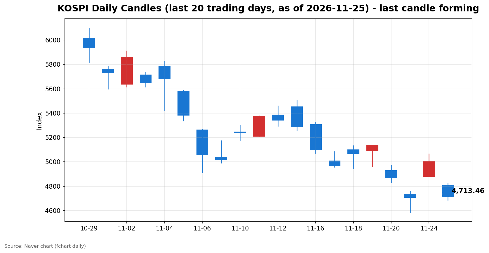
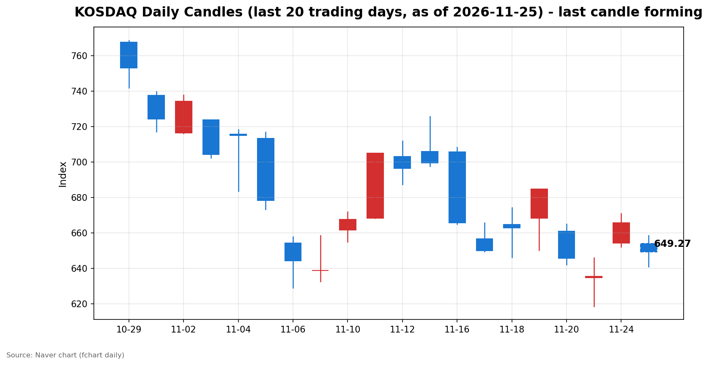

안녕하세요, [한국투자증권](https://securities.koreainvestment.com/main/Main.jsp)에서 [한투-한국투자증권](https://play.google.com/store/apps/details?id=com.truefriend.neosmartarenewal&hl=ko) 개발을 담당하고 있는 way입니다. 
전일 6% 넘게 급등했던 코스피가 하루 만에 5% 넘게 밀리며 5,000선을 반납한 오전장의 흐름을 정리합니다. 

## 오전장 요약

코스피는 전일 대비 290.86포인트(-5.81%) 내린 4,715.17까지 밀리며 오전장을 마쳤습니다. 
전일 5,006.03으로 5,000선을 되찾은 지 하루 만에 다시 5,000선 아래로 내려온 것입니다. 
코스닥은 16.52포인트(-2.48%) 내린 649.36으로, 코스피보다 낙폭이 작았습니다. 
개장 8분 만에 코스피 매도 사이드카가 발동했고, 전일 매수 사이드카가 발동한 지 하루 만의 일입니다. 

## 오늘의 스냅샷

| 지수 | 현재가 | 전일 대비 | 등락률 | 시가 | 고가 | 저가 | 거래량 | 거래대금 |
| --- | --- | --- | --- | --- | --- | --- | --- | --- |
| 코스피 | 4,715.17 | -290.86 | -5.81% | 4,809.00 | 4,823.36 | 4,687.51 | 109,752천주 | 7조 9,532억 원 |
| 코스닥 | 649.36 | -16.52 | -2.48% | 654.21 | 658.67 | 641.08 | 268,696천주 | 3조 1,553억 원 |

스냅샷 기준 시각은 2026년 11월 25일 12시 27분(KST)입니다. 
당일 봉은 형성 중인 봉으로, 마감 전에는 계속 변합니다. 
전일 종가는 코스피 5,006.03, 코스닥 665.88이며, 네이버 실시간 데이터에서 역산한 값과 일봉 종가가 일치합니다. 
코스피는 [네이버 코스피 시세](https://finance.naver.com/sise/sise_index.naver?code=KOSPI), 코스닥은 [네이버 코스닥 시세](https://finance.naver.com/sise/sise_index.naver?code=KOSDAQ)에서 확인할 수 있습니다. 

## 차트

최근 20거래일 일봉 차트입니다. 
빨간 봉은 종가가 시가보다 높은 날, 파란 봉은 종가가 시가보다 낮은 날입니다. 
당일 봉은 형성 중인 봉으로, 마감 전에는 계속 변합니다. 

## 원인·촉매 분석

오늘 급락의 직접적인 촉매는 간밤 미국 반도체주의 급락입니다. 
필라델피아 반도체지수는 전일 14.03% 급등한 뒤 간밤 7.88% 하락했고, 나스닥도 1.48% 내리며 마감했습니다. 
젠슨 황 엔비디아 CEO의 복귀 소식에 하루 만에 31% 폭등했던 엔비디아발 랠리가 차익실현에 부딪힌 것입니다. 
복귀 소식으로 경영 공백 우려는 메워졌지만, AI 과잉 투자와 대중 규제 우려라는 근본적인 불안 요인은 해소되지 않았다는 평가가 다시 부각됐습니다. 
아시아 반도체주도 동반 급락했습니다. 
일본 어드밴테스트가 13%, 도쿄일렉트론이 12% 내렸고, TSMC는 6.73%, 폭스콘은 9.05% 하락했습니다. 
국내에서는 삼성전자와 SK하이닉스가 오전 기준 8~9%대 하락하며 지수 하락을 주도했습니다. 
트럼프 행정부의 추가 관세 검토 부담도 투자 심리를 압박한 요인으로 거론됩니다. 
미국 무역대표부(USTR)가 중국과 유럽연합 등 14개국의 산업 보조금에 대한 과잉 생산 능력 조사 결과를 곧 발표할 예정이며, 신규 관세 가능성도 거론되고 있습니다. 
엔비디아 이사회가 사전 통보 없이 복귀를 결정했다는 논란도 이어지고 있습니다. 
12월 1일 하원 3개 위원회의 비공개 조사와 12월 3일 상원 은행위원회 공개 청문회가 예정돼 있습니다. 
연준의 금리 인상 압박도 부담 요인입니다. 
보스턴과 클리블랜드, 시카고를 비롯한 8개 지역 연방준비은행 이사회가 10월 연방공개시장위원회를 앞두고 재할인율을 4%에서 4.25%로 올리는 데 찬성한 것으로 알려졌습니다. 
국내에서는 11월 26일 한국은행 금융통화위원회를 앞두고 기준금리 인상 전망이 우세합니다. 
블룸버그 설문에서 이코노미스트 23명 중 21명이 0.25%포인트 인상을 전망했고, 인상 시 기준금리는 3.25%가 됩니다. 
10월 소비자물가는 전체와 근원 모두 전년 동월 대비 2.8% 올라 한은의 물가 목표 2%를 크게 웃돌았습니다. 
이상의 내용은 중앙일보 GMC 허브의 11월 25일자 G모닝과 관련 기사에서 확인한 내용입니다. 
전일 급등의 기반이 얇았다는 점도 되돌림을 키웠습니다. 
코스피가 전일 6% 넘게 오르는 동안에도 거래대금은 오히려 줄어, 상승분을 쉽게 내줄 수밖에 없는 구조였다는 지적이 나옵니다. 
전일 수급을 보면 코스피에서 외국인이 8,129.8억 원, 기관이 8,734.0억 원을 순매수했고 개인이 21,349.9억 원을 순매도했습니다. 
코스닥에서는 외국인이 1,299.3억 원, 기관이 2,224.6억 원을 순매수했고 개인이 3,366.4억 원을 순매도했습니다. 
외국인과 기관이 이끈 반등에서 개인은 보유 물량을 덜어낸 구도였고, 외국인의 매수가 하루 만에 매도로 돌아서며 되돌림이 빠르게 진행됐습니다. 
장중 수급 확정치는 마감 이후에 확인이 필요합니다. 

## 핵심 사건 3가지

첫째, 필라델피아 반도체지수의 급락입니다. 
전일 14.03% 급등했던 지수가 간밤 7.88% 하락하며 젠슨 황 복귀 랠리가 하루 만에 꺾였습니다. 
엔비디아 실적 서프라이즈와 CEO 복귀라는 호재가 AI 산업의 구조적 불안을 덮지 못했다는 신호로 읽힙니다. 
중앙일보 GMC 리포트는 엔비디아에 남은 리스크로 지배구조 불확실성과 대중국 수출 규제, 6,680억 달러 규모의 약정·보증을 꼽았습니다. 
국내 반도체 밸류체인이 미국 반도체지수와 같은 방향으로 움직이는 만큼, 국내 지수 하락의 직접적인 진원지가 됐습니다. 

둘째, 개장 8분 만의 매도 사이드카 발동입니다. 
코스피는 4,809.00으로 3.94% 내리며 출발한 뒤 낙폭을 키워 장중 4,687.51까지 밀렸습니다. 
전일 매수 사이드카가 발동한 지 하루 만의 매도 사이드카이며, 올해 들어 코스피와 코스닥 양 시장에서 발동된 사이드카는 총 102회로, 매수와 매도가 각각 51회씩 정확히 절반을 이룹니다. 
오전 11시 기준 코스피 시가총액은 전일보다 211조 2,002억 원 감소해, 전일 늘었던 262조 1,383억 원의 대부분을 하루 만에 반납했습니다. 

셋째, 한·중 교류 확대 기대 속 K뷰티와 게임주의 선별 강세입니다. 
급락장 속에서도 화장품 테마가 강세를 보였고, 뷰티스킨이 26.03%, 실리콘투가 14.15%, 에이피알이 10.82% 올랐습니다. 
한·중 FTA 후속협상 타결 기대와 중국 수요 회복 기대가 배경으로 거론됩니다. 
게임주도 미스터블루 7.91%, 카카오게임즈 6.35%, NC 5.60%, 넷마블 5.09% 오르며 지수와 다른 방향으로 움직였습니다. 
지수 급락 속에서도 자금이 특정 테마로 선별적으로 몰리는 모습입니다. 

## 섹터·테마 영향 체인

반도체 밸류체인이 가장 직접적인 타격을 받았습니다. 
AI 과잉 투자 우려가 불거지면 고밸류에이션 성장주의 할인율이 높아지고, 메모리와 AI 하드웨어 공급망의 수주 기대가 함께 흔들립니다. 
삼성전자와 SK하이닉스의 동반 급락이 지수 하락의 대부분을 설명하는 구조입니다. 
일본과 대만의 반도체주도 두 자릿수 하락률을 기록해, 아시아 반도체 공급망 전반이 같은 충격을 받았습니다. 
반면 내수·중국 노출 테마는 상대적으로 선방했습니다. 
화장품은 한·중 관계 개선 기대와 3분기 실적 성장, 해외 판로 확대라는 재료가 겹치며 강세를 보였습니다. 
게임주는 지수와 무관한 개별 재료로 움직이며 선별 장세를 만들었습니다. 
바이오주도 코스닥에서 알테오젠을 중심으로 약진하며 방어적인 흐름을 보였습니다. 
결국 오늘 오전장은 지수 하락과 테마 선별이 동시에 진행된 장세였습니다. 

## 최근 5거래일 일봉

| 날짜 | 시가 | 고가 | 저가 | 종가 | 거래량 |
| --- | --- | --- | --- | --- | --- |
| 2026-11-19 | 5,090.04 | 5,137.89 | 4,963.61 | 5,137.89 | 195,695천주 |
| 2026-11-20 | 4,928.51 | 4,971.31 | 4,831.69 | 4,869.96 | 206,729천주 |
| 2026-11-23 | 4,734.90 | 4,759.88 | 4,586.80 | 4,708.54 | 218,577천주 |
| 2026-11-24 | 4,880.16 | 5,065.74 | 4,880.16 | 5,006.03 | 194,134천주 |
| 2026-11-25 | 4,809.00 | 4,823.36 | 4,687.51 | 4,715.17(형성 중) | 109,752천주 |

| 날짜 | 시가 | 고가 | 저가 | 종가 | 거래량 |
| --- | --- | --- | --- | --- | --- |
| 2026-11-19 | 668.31 | 684.81 | 650.39 | 684.81 | 398,792천주 |
| 2026-11-20 | 660.98 | 665.15 | 642.13 | 645.68 | 421,847천주 |
| 2026-11-23 | 634.93 | 645.93 | 618.74 | 635.45 | 405,856천주 |
| 2026-11-24 | 654.31 | 670.95 | 652.21 | 665.88 | 441,902천주 |
| 2026-11-25 | 654.21 | 658.67 | 641.08 | 649.36(형성 중) | 268,696천주 |

위 표는 코스피와 코스닥 순서입니다. 
2026년 11월 25일 행은 스냅샷 시점의 형성 중인 봉입니다. 

## 오전 강했던 테마와 흐름 변화

오전 12시 기준 한국투자증권 MTS 시장 브리핑은 급락장 속 K뷰티와 보안주로 매수가 집중되고, 나머지 테마는 선별 장세라고 정리했습니다. 
화장품 테마는 시가 대비 강세를 유지했고, 게임 테마도 오전 내내 지수와 다른 방향으로 움직였습니다. 
반면 반도체 테마는 개장 직후부터 낙폭을 키우며 오전 내내 약세를 이어갔습니다. 
코스피는 시가 4,809.00에서 출발해 고가 4,823.36을 찍은 뒤 저가 4,687.51까지 밀렸다가 4,715.17로 오전장을 마쳤습니다. 
코스닥은 시가 654.21에서 고가 658.67을 찍은 뒤 저가 641.08까지 밀렸다가 649.36으로 오전장을 마쳤습니다. 
두 지수 모두 시가 대비 하락으로 방향이 굳어진 오전장이었습니다. 

## 오후 전망과 확인할 시나리오

오후에는 낙폭 축소와 하락 지속을 가르는 분기점이 될 수치들을 확인해야 합니다. 
첫째, 코스피 4,700선 방어 여부입니다. 
장중 저가 4,687.51을 하회하면 낙폭이 다시 커질 수 있고, 4,700선을 회복하면 오전의 급락이 일시적 되돌림으로 마무리될 가능성이 있습니다. 
둘째, 외국인과 기관의 오후 수급 방향입니다. 
전일 순매수했던 외국인이 오후에도 매도를 이어가면 되돌림이 길어질 수 있습니다. 
장중 수급 확정치는 마감 이후에 확인이 필요합니다. 
셋째, 미국 선물과 아시아 반도체주의 오후 흐름입니다. 
필라델피아 반도체지수의 낙폭이 아시아 장에서 추가로 반영되는지, 미국 선물 흐름이 안정되는지를 봐야 합니다. 
넷째, K뷰티와 게임주 등 선별 테마의 강세 지속 여부입니다. 
지수 하락 속에서도 테마 강세가 유지되면 자금의 선별 이동이 이어지고 있다는 신호로 볼 수 있습니다. 
다섯째, 11월 26일 한국은행 금융통화위원회 결과입니다. 
기준금리 인상 여부는 국내 증시의 금리 민감도에 직접 영향을 주는 변수이므로, 결정과 함께 발표되는 경기 판단도 함께 확인이 필요합니다. 
여섯째, 미국 무역대표부의 과잉 생산 능력 조사 결과 발표 여부입니다. 
신규 관세 논의가 구체화되면 수출주와 반도체 밸류체인의 부담이 커질 수 있습니다. 
오후에는 미국 물가 지표와 대형주 실적, 정책 관련 소식 등 외부 변수도 함께 확인이 필요합니다. 
단기적으로는 변동성이 큰 장세가 이어질 수 있으므로, 지수 레벨과 수급 방향을 함께 확인하는 것이 중요합니다. 

## 마치며

전일 급등분을 하루 만에 반납한 오전장이었습니다. 
오후에는 코스피 4,700선 방어 여부와 외국인의 수급 방향을 확인하며 변동성에 유의하시기 바랍니다. 
이 글은 교육·해설 목적의 시황 정리이며, 특정 종목의 매수·매도를 권유하는 내용이 아닙니다. 
