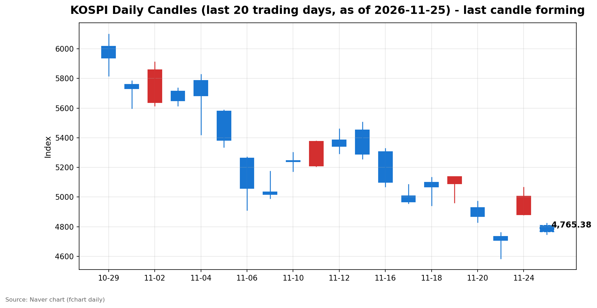
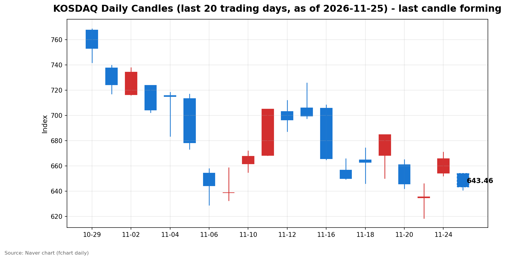

안녕하세요, [한국투자증권](https://securities.koreainvestment.com/main/Main.jsp)에서 [한투-한국투자증권](https://play.google.com/store/apps/details?id=com.truefriend.neosmartarenewal&hl=ko) 개발을 담당하고 있는 way입니다. 
오늘 국내 증시는 간밤 미국 반도체주의 급락 여파로 큰 폭의 하락세로 출발했습니다. 

## 배경: 간밤 미국 증시

간밤 미국 증시는 혼조세로 마감했습니다. 
다우존스30산업평균지수는 전 거래일보다 423.39포인트(0.85%) 오른 50,018.70에 거래를 마쳤습니다. 
반면 스탠더드앤드푸어스(S&P)500지수는 36.08포인트(0.50%) 내린 7,201.09에, 기술주 중심의 나스닥 종합지수는 356.02포인트(1.48%) 내린 23,733.54에 각각 마감했습니다. 
전날 31.5% 폭등했던 엔비디아 주가는 이날 5.86% 하락한 155.38달러에 거래를 마쳤습니다. 
AMD(-8.86%)와 마이크론(-11.01%), SK하이닉스 미국주식예탁증서(ADR, -9.9%) 등 주요 반도체주가 일제히 하락하면서 필라델피아 반도체지수는 7.88% 폭락한 8,832.50에 마감했습니다. 
앤트로픽은 6.54% 하락한 81.91달러에 거래를 마치며 상장 공모가를 밑돌았습니다. 
미국 민간 경제조사단체 컨퍼런스보드가 발표한 11월 소비자신뢰지수는 103.3으로 집계됐습니다. 
미국 서부텍사스산원유(WTI) 선물 가격은 전 거래일보다 1.88달러(2.35%) 오른 배럴당 82.05달러에 마감했습니다. 
원/달러 환율은 1,343.00원으로 전 거래일보다 0.03% 올랐습니다. 

## 오늘의 스냅샷

| 지수 | 현재가 | 전일 대비 | 등락률 | 시가 | 고가 | 저가 | 거래량 | 거래대금 |
| --- | --- | --- | --- | --- | --- | --- | --- | --- |
| 코스피 | 4,763.34 | -242.69 | -4.85% | 4,809.00 | 4,823.36 | 4,750.14 | 36,240천주 | 2,514,557백만원 |
| 코스닥 | 642.79 | -23.09 | -3.47% | 654.21 | 654.21 | 641.08 | 99,548천주 | 1,097,593백만원 |

스냅샷 기준 시각은 2026년 11월 25일 09시 31분(KST)입니다. 
전일 종가는 코스피 5,006.03, 코스닥 665.88입니다. 
코스피는 시가 4,809.00으로 전일 종가보다 3.94% 낮은 수준에서 출발한 뒤 장중 저점 4,750.14까지 밀렸습니다. 
코스닥도 시가 654.21로 전일 종가보다 1.75% 낮은 수준에서 출발했습니다. 
전일 국내 증시는 코스피가 6.32%, 코스닥이 4.79% 오르며 5,000선을 회복한 바 있습니다. 
오늘 하락폭은 전일 상승분의 상당 부분을 되돌리는 수준입니다. 
지수 차트는 [코스피](https://finance.naver.com/sise/sise_index.naver?code=KOSPI)와 [코스닥](https://finance.naver.com/sise/sise_index.naver?code=KOSDAQ)에서 확인할 수 있습니다. 

## 차트

최근 20거래일 일봉 차트입니다. 
빨간 봉은 종가가 시가보다 높은 날, 파란 봉은 종가가 시가보다 낮은 날입니다. 
당일 봉은 형성 중인 봉으로, 마감 전에는 계속 변합니다. 

## 원인·촉매 분석

오늘 급락의 직접적인 촉매는 간밤 미국 반도체주의 급반락입니다. 
전날 젠슨 황 엔비디아 최고경영자(CEO) 복귀 소식에 31.5% 폭등했던 엔비디아는 하루 만에 5.86% 하락했습니다. 
필라델피아 반도체지수는 7.88% 폭락하며 전날 상승폭의 64%를 반납했습니다. 
전날 국내 반도체 대형주가 6%대 상승했던 만큼, 개장부터 되돌림 압력이 집중됐습니다. 
중앙일보 GMC 11월 25일자 G모닝 브리핑은 급락 배경으로 세 가지를 꼽았습니다. 
첫째, 미 무역대표부(USTR)의 중국·유럽연합(EU) 등 14개국 산업 보조금 조사 결과 발표가 임박하면서 신규 관세 우려가 커졌습니다. 
둘째, 트럼프 대통령 개입 의혹 속에 성급하게 이뤄졌다는 엔비디아 이사회 결정에 대한 독립성·절차 논란이 불거졌습니다. 
젠슨 황 CEO는 12월 1일 하원 3개 위원회 비공개 인터뷰와 12월 3일 상원 은행위원회 공개 청문회를 앞두고 있습니다. 
셋째, 8개 지역 연방준비은행 이사회가 재할인율 4%에서 4.25% 인상을 지지하면서 금리 인상 압박이 커졌습니다. 
금리 인상 압박은 성장주 밸류에이션에 부담으로 작용합니다. 
관세 불확실성과 AI 투자 과잉 우려가 겹치면서 차익 실현 매물이 반도체주를 중심으로 쏟아졌습니다. 
전일 수급 구도도 되돌림의 배경이 됐습니다. 
전일 코스피에서 외국인은 8,130억원, 기관은 8,734억원을 순매수하며 지수를 5,000선 위로 끌어올렸습니다. 
반면 개인은 2,135억원을 순매도하며 상승장에서 차익을 실현했습니다. 
하루 만에 외부 충격이 닥치자 전일 매수 주체의 차익 실현 여부가 장 초반의 관전 요소가 됐습니다. 
원/달러 환율은 1,343.00원으로 0.03% 오르는 데 그쳐, 환율발 충격은 제한적인 수준입니다. 
WTI가 배럴당 82.05달러로 2.35% 오른 점은 운송·화학 업종의 비용 부담 요인이나, 오늘 장의 주된 동인은 아닙니다. 

## 핵심 사건 3가지

### 1. 엔비디아·필라델피아 반도체지수 급반락

전날 31.5% 폭등했던 엔비디아는 5.86% 하락한 155.38달러에 마감했습니다. 
마이크론은 11.01%, SK하이닉스 ADR은 9.9% 하락했습니다. 
필라델피아 반도체지수는 7.88% 폭락한 8,832.50에 마감했습니다. 
이는 전날 14.03% 폭등분의 상당 부분을 하루 만에 반납한 것입니다. 
젠슨 황 CEO 복귀라는 단일 재료로 치솟았던 주가가, 복귀 결정의 절차 논란과 AI 투자 과잉 우려가 다시 부각되면서 되돌려진 것입니다. 
국내 반도체 대형주가 전일 6%대 상승했던 만큼, 국내 시장에도 개장 직격탄이 됐습니다. 

### 2. 미국 추가 관세 발표 임박

미 무역대표부(USTR)의 중국·EU 등 14개국 산업 보조금 조사 결과 발표가 임박했습니다. 
외신들은 중국에는 비교적 높은 관세가 부과될 가능성이 있는 반면, 미국과 무역 합의를 맺은 한국과 일본, EU에는 기존 합의에 따른 15% 관세 상한이 유지될 것으로 전망했습니다. 
관세 발표 시점과 적용 범위가 확정되지 않은 불확실성 자체가 위험자산 회피 심리를 자극했습니다. 
관세는 수출 비중이 높은 국내 증시에 직접적인 변수이므로, 발표 내용에 따라 업종별 영향이 달라질 수 있습니다. 

### 3. 한중 FTA 타결 발 화장품·중국 소비 강세 지속

한국과 중국은 11월 18일 정상회담에서 한중 자유무역협정(FTA) 서비스·투자 후속 협상의 실질 타결을 선언했습니다. 
8년 8개월 만에 이뤄진 타결로, 한한령 완화 기대가 커졌습니다. 
11월 23일에는 에이피알이 9.13% 오르는 등 화장품주가 지수 하락 속에서도 급등했습니다. 
11월 1일부터 20일까지 화장품 수출액 잠정치는 전년 동기보다 61.7% 증가했습니다. 
오늘 장 초반에도 화장품 테마가 강세를 보이며 지수 급락과 반대 방향으로 움직이고 있습니다. 
다만 이번 타결이 한한령 전면 해제를 의미하는 것은 아니며, 협정의 정식 서명과 발효 절차가 남아 있습니다. 

## 섹터·테마 영향 체인

반도체·메모리 밸류체인이 가장 직접적인 타격을 받았습니다. 
필라델피아 반도체지수 급락은 국내 반도체주의 개장 하락으로 곧바로 이어졌습니다. 
마이크론에 대한 투자의견 하향과 메모리 수급 균형 시점이 앞당겨질 것이라는 전망도 메모리 업황 기대를 흔들었습니다. 
AI 데이터센터 관련주도 동반 약세입니다. 
간밤 코어위브가 11.85%, 네비우스와 마벨이 10% 안팎 하락하는 등 AI 인프라주가 일제히 밀렸습니다. 
AI 투자 과잉 우려가 반도체를 넘어 데이터센터 밸류체인 전반으로 번지는 모습입니다. 
반면 한중 FTA 타결 기대가 이어지는 중국 소비 테마는 지수 하락 속에서도 강세를 보였습니다. 
한국투자증권 MTS 오전 테마 흐름에서 화장품이 1.89%, 선크림이 2.11%, 여행이 1.30% 올랐습니다. 
바이오소재 테마도 5.64% 오르며 강세를 보였습니다. 
지수 급락 국면에서 중국 시장 회복 기대가 있는 테마로 자금이 이동하는 차별화 흐름입니다. 
금리 인상 압박은 성장주 전반의 밸류에이션 부담으로 작용합니다. 
유가 상승은 에너지 업종에는 우호적이나 운송·화학 업종에는 비용 부담 요인입니다. 
오늘 장은 반도체·AI 밸류체인의 약세와 중국 소비 테마의 강세가 맞서는 구도입니다. 

## 최근 5거래일 일봉

| 날짜 | 시가 | 고가 | 저가 | 종가 | 거래량 |
| --- | --- | --- | --- | --- | --- |
| 2026-11-19 | 5,090.04 | 5,137.89 | 4,963.61 | 5,137.89 | 195,695천주 |
| 2026-11-20 | 4,928.51 | 4,971.31 | 4,831.69 | 4,869.96 | 206,729천주 |
| 2026-11-23 | 4,734.90 | 4,759.88 | 4,586.80 | 4,708.54 | 218,577천주 |
| 2026-11-24 | 4,880.16 | 5,065.74 | 4,880.16 | 5,006.03 | 194,134천주 |
| 2026-11-25 | 4,809.00 | 4,823.36 | 4,750.14 | 4,763.34 | 36,240천주 |

2026년 11월 25일 봉은 형성 중인 봉으로, 종가와 거래량은 09시 31분 기준 스냅샷 값이며 마감 전에는 계속 변합니다. 

| 날짜 | 시가 | 고가 | 저가 | 종가 | 거래량 |
| --- | --- | --- | --- | --- | --- |
| 2026-11-19 | 668.31 | 684.81 | 650.39 | 684.81 | 398,792천주 |
| 2026-11-20 | 660.98 | 665.15 | 642.13 | 645.68 | 421,847천주 |
| 2026-11-23 | 634.93 | 645.93 | 618.74 | 635.45 | 405,856천주 |
| 2026-11-24 | 654.31 | 670.95 | 652.21 | 665.88 | 441,902천주 |
| 2026-11-25 | 654.21 | 654.21 | 641.08 | 642.79 | 99,548천주 |

2026년 11월 25일 봉은 형성 중인 봉으로, 종가와 거래량은 09시 31분 기준 스냅샷 값이며 마감 전에는 계속 변합니다. 
코스피는 11월 19일 5,137.89에서 11월 23일 4,708.54까지 3거래일 연속 하락한 뒤 11월 24일 5,006.03으로 반등했습니다. 
오늘 장 초반 하락으로 5,000선을 다시 내줬습니다. 
코스닥도 11월 19일 684.81에서 11월 23일 635.45까지 밀린 뒤 11월 24일 665.88로 반등했으나, 오늘 640선 초반까지 되밀렸습니다. 

## 전일 수급

전일(11월 24일) 코스피에서 외국인은 8,130억원, 기관은 8,734억원을 순매수했습니다. 
개인은 2,135억원을 순매도했고, 기타법인은 4,486억원을 순매수했습니다. 
외국인과 기관이 함께 사면서 개인의 차익 실현 물량을 받아낸 구도입니다. 
코스닥에서도 외국인이 1,299억원, 기관이 2,225억원을 순매수했고, 개인은 3,366억원을 순매도했습니다. 
양 시장 모두 기관과 외국인이 순매수, 개인이 순매도라는 같은 구도였습니다. 
전일 수급은 상승장에서 기관·외국인이 주도했다는 점에서 긍정적이었으나, 하루 만에 외부 충격이 닥치면서 그 매수분의 지속 여부가 시험대에 올랐습니다. 
당일 수급은 마감 이후 집계되므로 장 초반에는 확인할 수 없습니다. 

## 단기·중기 전망과 확인할 시나리오

단기적으로는 되돌림이 이어질지, 장 초반 낙폭이 축소될지가 관건입니다. 
코스피는 전일 종가 5,006.03이 저항으로 전환됐고, 장중 저점 4,750.14선과 전일 저점 4,880.16선의 지지 여부가 확인 지점입니다. 
코스닥은 640선 안착 여부가 단기 흐름을 가를 수 있습니다. 
흐름 지속 시나리오에서는 필라델피아 반도체지수의 추가 하락과 외국인 순매도 전환이 동반될 수 있습니다. 
일시적 노이즈 시나리오에서는 전일 외국인과 기관의 매수 기조가 유지되면서 장중 낙폭이 축소될 수 있습니다. 
다음에 확인할 이벤트는 USTR 조사 결과 발표와 미국의 추가 관세 내용입니다. 
한국에 15% 관세 상한이 유지되는지가 확인되면 불확실성이 일부 해소될 수 있습니다. 
젠슨 황 CEO의 12월 1일 하원 인터뷰와 12월 3일 상원 청문회도 AI·반도체주의 방향을 가를 변수입니다. 
중기적으로는 메모리 수급 전망과 AI 투자 과잉 논란의 향방이 중요합니다. 
한중 FTA의 정식 서명·발효 절차와 중국향 수출 지표의 회복 여부도 중국 소비 테마의 지속성을 가를 변수입니다. 
한국 수출이 1조 달러를 돌파했다는 소식도 중기적인 수출 모멘텀의 배경이 됩니다. 
지수·섹터 단위의 흐름을 확인하면서 변동성 확대 구간에서는 리스크 관리 관점이 필요합니다. 

## 장 초반 확인할 점

반도체 대형주의 낙폭이 장중 축소되는지 확인이 필요합니다. 
화장품 등 중국 소비 테마의 강세가 지수 하락 속에서도 이어지는지 살펴봐야 합니다. 
외국인과 기관의 당일 수급 방향은 마감 이후 집계되므로, 장중에는 선물·프로그램 매매 흐름을 참고할 수 있습니다. 
코스피 4,750선과 코스닥 640선의 지지 여부도 장 초반의 확인 지점입니다. 
원/달러 환율이 1,343원 선에서 안정되는지도 함께 확인할 필요가 있습니다. 

## 마치며

오늘 장은 간밤 미국 반도체주의 급반락이 국내 증시로 곧바로 번지면서 큰 폭의 하락세로 출발했습니다. 
이 글은 시황 해설을 목적으로 하며, 특정 종목의 매수나 매도를 권유하는 내용이 아닙니다. 
