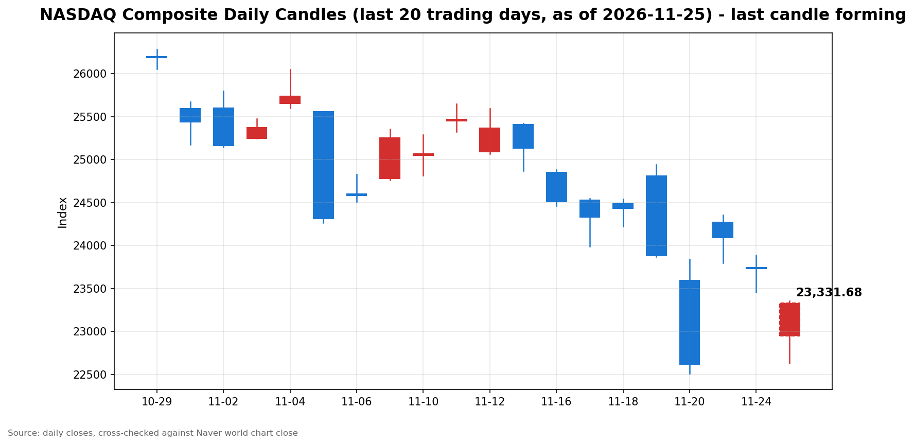

안녕하세요, [한국투자증권](https://securities.koreainvestment.com/main/Main.jsp)에서 [한투-한국투자증권](https://play.google.com/store/apps/details?id=com.truefriend.neosmartarenewal&hl=ko) 개발을 담당하고 있는 way입니다. 
추수감사절을 하루 앞둔 11월 25일 나스닥 장중 흐름을 정리합니다. 

## 장중 요약

추수감사절을 하루 앞둔 11월 25일 장중, 나스닥 종합은 전일 대비 1.67% 하락한 23,336.46에 거래되고 있습니다. 
개장 전 발표된 10월 개인소비지출(PCE) 물가가 전년 동월 대비 3.8% 상승하고, 근원 PCE가 예상보다 높게 나오면서 12월 금리 인상 전망이 굳어졌습니다. 
여기에 트럼프 행정부의 추가 관세 검토 보도와 인공지능(AI) 수요에 대한 회의론이 겹치며 기술주 중심으로 매도세가 나타났습니다. 
다만 지수는 개장 직후 기록한 장중 저점 22,632.40에서 700포인트 이상 반등해 낙폭의 절반 넘게 되돌린 상태입니다. 
다우존스는 보합권에서 거래되며 나스닥과 뚜렷한 방향 차이를 보이고 있습니다. 

## 오늘의 스냅샷

| 지수 | 현재가 | 전일 대비 | 등락률 | 전일 종가 | 시가 | 장중 고가 | 장중 저가 |
| --- | --- | --- | --- | --- | --- | --- | --- |
| 나스닥 종합 | 23,336.46 | -397.08 | -1.67% | 23,733.54 | 22,948.48 | 23,355.51 | 22,632.40 |
| S&P500 | 7,139.32 | -61.77 | -0.86% | 7,201.09 | 7,060.33 | 7,143.94 | 6,970.11 |
| 다우존스 | 50,035.78 | +17.08 | +0.03% | 50,018.70 | 49,469.86 | 50,104.71 | 48,913.74 |

스냅샷 기준 시각은 미국 동부시간 2026년 11월 25일 12시 57분, 한국시간 2026년 11월 26일 02시 57분입니다. 
당일 수치는 형성 중인 수치로, 마감 전에는 계속 변합니다. 
나스닥 수치는 [네이버 월드 차트](https://stock.naver.com/worldstock/index/.IXIC/price)에서 직접 확인한 값이며, 한투 MTS 해외 대시보드와 교차 확인했습니다. 
S&P500 현재가는 한투 MTS 해외 대시보드, 다우존스 시가·고가·저가는 야후 파이낸스 형성 중 일봉 기준입니다. 
나스닥 거래량은 745,345천 주입니다. 

부가 지표는 다음과 같습니다. 
원·달러 환율은 1,346.00원으로 전일 대비 3.00원 상승했습니다. 
미국 국채 10년물 수익률은 4.836%로 전일 4.904%에서 하락했습니다. 
서부텍사스산원유(WTI)는 배럴당 83.50달러로 전일 대비 1.77% 상승했습니다. 
금은 온스당 3,533.60달러로 전일 대비 0.79% 하락했습니다. 
달러인덱스는 103.61로 전일 103.81에서 소폭 하락했습니다. 

최근 5거래일 나스닥 종가는 다음과 같습니다. 

| 날짜 | 종가 | 전일 대비 |
| --- | --- | --- |
| 11월 19일 | 23,879.20 | -2.25% |
| 11월 20일 | 22,617.73 | -5.28% |
| 11월 23일 | 24,089.56 | +6.51% |
| 11월 24일 | 23,733.54 | -1.48% |
| 11월 25일 | 23,336.46 | -1.67% (형성 중) |

## 차트

최근 20거래일 일봉 차트입니다. 
빨간 봉은 종가가 시가보다 높은 날, 파란 봉은 종가가 시가보다 낮은 날입니다. 
당일 봉은 형성 중인 봉으로, 마감 전에는 계속 변합니다. 

## 원인·촉매 분석

오늘 장의 중심 촉매는 개장 전 발표된 10월 PCE 물가입니다. 
헤드라인 PCE는 전년 동월 대비 3.8% 상승해 9월 3.7%보다 높아졌고, 전월 대비로는 0.3% 상승해 예상에 부합했습니다. 
근원 PCE는 전년 동월 대비 3.3% 상승해 9월 3.1%에서 올랐고, 시장 예상 3.2%를 웃돌았습니다. 
3개월 연율 근원 PCE도 3.6%로 9월 수정치 3.0%에서 상승했습니다. 
3분기 국내총생산(GDP) 성장률도 4.3%로 강하게 나오며, 물가와 성장 지표가 함께 금리 인상 쪽으로 기울었습니다. 
시장은 12월 8일부터 9일까지 열리는 연방공개시장위원회(FOMC)에서 25bp 금리 인상을 기정사실로 반영하고 있으며, 1월 추가 인상 가능성까지 가격에 반영되기 시작했습니다. 
이번 PCE는 12월 FOMC 전 마지막 물가 지표라는 점에서 무게가 컸습니다. 
강한 성장과 끈적한 물가가 함께 확인되면서, 연준이 금리 인상 기조에서 물러서기 어렵다는 해석이 확산됐습니다. 
성장주 밸류에이션은 할인율에 민감하므로, 금리 인상 전망 강화는 기술주에 직접적인 부담으로 작용했습니다. 

두 번째 촉매는 관세입니다. 
미국 무역대표부(USTR)는 11월 25일 구조적 과잉생산 관련 무역법 301조 조사 결과를 발표하며 한국에 15% 관세 부과를 제안했습니다. 
15%는 지난해 한미 합의로 정해진 관세 상한과 같은 수준이나, 미국 측은 협의 결과에 따라 최대 25%까지 높일 수 있다는 가능성을 열어뒀습니다. 
제안세율이라 최종 관세율이 확정될 때까지 불확실성이 이어진다는 점이 시장에 부담으로 작용했습니다. 
트럼프 행정부가 중국 등 여러 국가를 대상으로 추가 관세 인상을 검토 중이라는 보도도 같은 날 전해졌습니다. 
관세는 수입 물가와 기업 비용을 통해 물가 상승 압력을 키울 수 있어, 금리 인상 우려와 맞물리며 투자심리를 압박했습니다. 

세 번째 촉매는 AI 회의론의 재확산입니다. 
젠슨 황 엔비디아 최고경영자(CEO) 복귀에 따른 안도 랠리는 하루 만에 꺾였고, 전일 나스닥은 1.48% 하락했습니다. 
상장 4거래일을 맞은 앤트로픽은 공모가를 밑돈 데 이어 개장 초반 8% 넘게 추가로 하락했습니다. 
엔비디아도 개장 초반 9% 가까이 하락하며 AI 관련주 매도를 주도했습니다. 
델은 호실적과 상향된 전망에도 주가가 하락해, 좋은 실적만으로는 AI 수요 불안을 잠재우지 못하는 분위기를 보여줬습니다. 
바클레이스 추산에 따르면 지난 1년간 미국 경제성장의 25%가 AI 투자에서 비롯됐습니다. 
AI 투자 둔화 우려가 단순한 섹터 이슈가 아니라 거시경제 전반의 문제로 받아들여지는 이유입니다. 
중앙일보 GMC 허브의 11월 25일 G브닝 제목도 황 복귀에도 식은 월가, 오늘 밤엔 물가로, 같은 진단을 담고 있습니다. 
반면 JP모건은 AI 슈퍼사이클이 지속된다는 입장을 유지해, AI를 둘러싼 시각 차이는 여전히 큽니다. 

## 핵심 사건 3가지

첫 번째 사건은 10월 PCE 발표입니다. 
미국 상무부는 11월 25일 개장 전 10월 PCE 물가를 발표했습니다. 
헤드라인은 전년 동월 대비 3.8%로 예상에 부합했으나, 근원 PCE가 3.3%로 예상을 웃돌았습니다. 
3분기 GDP 성장률 4.3%도 함께 확인되며 경기 둔화 기대는 약해졌습니다. 
시장은 12월 25bp 인상을 사실상 확정된 것으로 받아들이고, 1월 추가 인상 가능성까지 반영하기 시작했습니다. 
12월 FOMC 전 마지막 물가 지표라는 점에서, 이번 발표는 연말 금리 경로를 가르는 분기점이 됐습니다. 

두 번째 사건은 추가 관세 검토 보도와 USTR의 301조 15% 제안입니다. 
USTR은 한국 대상 과잉생산 301조 조사에서 15% 관세 부과를 제안했습니다. 
한국 정부는 미국 측으로부터 기존 한미 관세합의를 존중하겠다는 입장을 확인했다고 밝혔습니다. 
다만 최종 관세율이 확정되기 전이고 최대 25%까지 거론되는 만큼 불확실성은 남아 있습니다. 
트럼프 행정부가 중국 등 여러 국가에 대한 추가 관세 인상을 검토 중이라는 보도도 같은 날 나왔습니다. 
미국은 한국의 디지털 규제에 대한 301조 조사도 검토 중인 것으로 알려졌습니다. 
관세 불확실성은 무역 상대국 기업뿐 아니라 미국 내 물가와 기업 비용 경로를 통해 시장 전반에 영향을 줍니다. 

세 번째 사건은 AI 매도세의 심화입니다. 
엔비디아는 개장 초반 9% 가까이 하락했고, 앤트로픽은 개장 초반 8% 넘게 하락하며 공모가를 밑돌았습니다. 
전일에도 엔비디아 랠리가 하루 만에 꺾이며 나스닥이 1.48% 하락한 바 있습니다. 
AI 투자 수익성과 수요 지속성에 대한 의문이 다시 커지며, 반도체와 AI 관련주 전반으로 매도가 확산됐습니다. 
델이 호실적과 전망 상향에도 하락한 점은, 실적 자체보다 AI 수요의 지속 가능성을 시장이 더 엄격하게 따지고 있음을 보여줍니다. 
AI 관련 매도는 오늘 나스닥이 다우보다 훨씬 크게 하락한 직접적인 배경입니다. 

## 지수·섹터 영향 체인

지수별 낙폭은 기술주 비중에 비례했습니다. 
나스닥은 1.67% 하락했고, S&P500은 0.86% 하락했으며, 다우존스는 0.03% 상승했습니다. 
금리 인상 전망 강화는 할인율 상승을 통해 성장주 밸류에이션에 부담을 줍니다. 
기술주와 반도체 비중이 높은 나스닥이 가장 큰 타격을 받은 것은 이 경로와 일치합니다. 
AI 관련주는 실적보다 수요와 투자 수익성에 대한 회의론이 확산되며 섹터 전반으로 매도가 번졌습니다. 
에너지는 유가 상승이라는 우호적인 요인이 있었으나, 기술주 매도세가 지수 방향을 결정했습니다. 
WTI는 배럴당 83.50달러로 1.77% 상승했습니다. 
채권 시장에서는 주식과 다른 흐름이 나타났습니다. 
미국 국채 10년물 수익률은 4.836%로 전일보다 하락해, 주식 매도 속에서도 안전자산 선호가 채권으로 향했습니다. 
달러인덱스는 소폭 하락했고, 원·달러 환율은 1,346.00원으로 상승했습니다. 
금은 0.79% 하락해, 안전자산 선호가 금으로 이어지지는 않았습니다. 
다우존스가 보합을 지킨 것은 기술주 비중이 낮고 가치주와 경기방어주 비중이 높은 구성의 영향으로 해석됩니다. 

## 다우·S&P500 흐름

다우존스는 50,035.78로 전일 대비 0.03% 상승하며 5만 선을 지켰습니다. 
다우존스는 시가 49,469.86에서 출발해 장중 저점 48,913.74까지 밀렸다가 상승 전환했습니다. 
전일 다우존스는 0.85% 상승한 반면 나스닥은 1.48% 하락해, 방향 차이는 전날부터 이어지고 있습니다. 
S&P500은 7,139.32로 전일 대비 0.86% 하락했습니다. 
S&P500은 시가 7,060.33에서 출발해 장중 저점 6,970.11까지 하락했다가 낙폭을 줄였습니다. 
전일 S&P500은 0.50% 하락했습니다. 
S&P500의 낙폭이 나스닥과 다우의 중간에 머문 것은, 기술주 약세와 가치주 선방이 지수 안에서 상쇄된 결과로 해석됩니다. 

## 오전과 오후 흐름 변화

개장 전부터 하락 출발이 예고됐습니다. 
나스닥100 선물은 개장 전 2.8% 하락했고, S&P500 선물은 1.9% 하락했습니다. 
나스닥은 시가 22,948.48로 전일 종가보다 3.31% 낮게 출발했습니다. 
오전 10시 24분 무렵에는 나스닥이 4% 하락한 것으로 전해졌습니다. 
장중 저점은 22,632.40으로, 전일 대비 4.64% 하락 수준이었습니다. 
같은 시각 다우존스는 1.7%, S&P500은 2.8% 하락했습니다. 
정오 무렵에는 방향이 바뀌었습니다. 
나스닥은 저점에서 700포인트 넘게 반등해 1.67% 하락까지 낙폭을 줄였습니다. 
다우존스는 저점에서 1,100포인트 넘게 반등해 상승 전환했고, S&P500도 저점에서 2.43% 반등했습니다. 
시가 대비 방향 전환이 일어난 셈입니다. 
다만 세 지수 모두 시가보다 높은 수준에서 거래되고 있으나, 나스닥과 S&P500은 여전히 전일 종가를 밑돌고 있습니다. 

## 마감까지 전망과 확인할 시나리오

장중 저점에서의 반등이 이어지는지가 첫 번째 확인 지점입니다. 
나스닥이 장중 고가 23,355.51을 상회하면 반등 흐름이 이어질 수 있습니다. 
그다음 저항 구간은 전일 종가 23,733.54입니다. 
반대로 장중 저점 22,632.40을 다시 밑돌면 변동성이 확대될 수 있습니다. 
23,000선 안착 여부도 함께 확인할 구간입니다. 
내일은 추수감사절로 미국 증시가 휴장합니다. 
금요일은 단축 거래로 진행돼 거래량이 줄어들 수 있고, 얇은 거래 속에서는 가격 변동이 커질 수 있습니다. 
12월 8일부터 9일까지 열리는 FOMC까지는 추가 물가 지표와 연준 인사 발언이 금리 경로를 좌우할 전망입니다. 
다음 PCE 물가는 12월 23일에 발표될 예정입니다. 
금리 인상 전망이 추가로 강화되는지, AI 수요 불안을 덜어줄 재료가 나오는지도 확인할 사안입니다. 
본 글은 지수와 섹터 단위의 시나리오 정리이며, 특정 종목의 매수나 매도를 권유하지 않습니다. 

## 마치며

오늘 장은 물가 지표와 관세 보도, AI 회의론이 겹치며 기술주 중심의 조정이 나타난 하루였습니다. 
내일은 추수감사절로 미국 증시가 휴장하며, 금요일은 단축 거래로 진행됩니다. 
본 글은 정보 제공과 교육 목적의 해설이며, 특정 종목의 매수나 매도를 권유하지 않습니다. 
