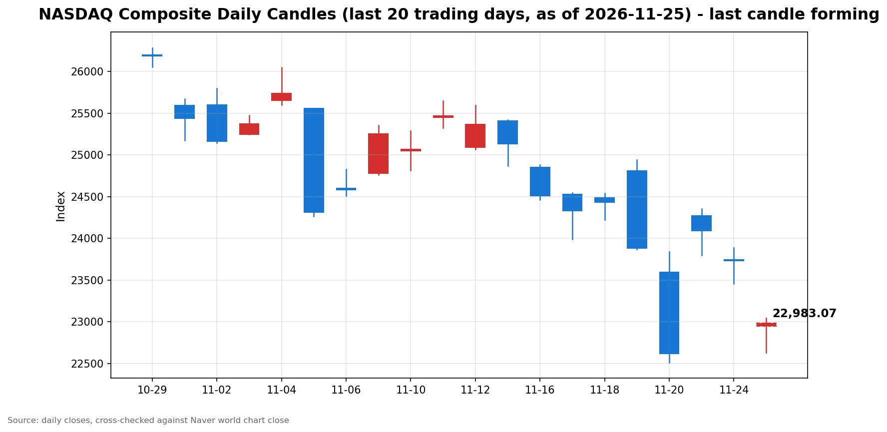

안녕하세요, [한국투자증권](https://securities.koreainvestment.com/main/Main.jsp)에서 [한투-한국투자증권](https://play.google.com/store/apps/details?id=com.truefriend.neosmartarenewal&hl=ko) 개발을 담당하고 있는 way입니다. 
나스닥이 AI 매도 심화와 물가·관세 부담 속에 3% 넘게 하락하며 개장했습니다. 

## 개장 배경

지난 11월 23일(현지시간) 나스닥 종합지수는 24,089.56으로 6.51% 급등 마감했습니다. 
젠슨 황 엔비디아 최고경영자(CEO)의 복직 소식이 전해지며 투자 심리가 빠르게 회복됐습니다. 
엔비디아는 이날 31% 넘게 급등했습니다. 
그러나 랠리는 하루 만에 꺾였습니다. 
11월 24일 나스닥은 23,733.54로 1.48% 하락 마감했고, 엔비디아는 5.9% 가까이 되돌렸습니다. 
같은 날 다우는 0.85% 올랐고 S&P500은 0.50% 내리며 지수 간 방향이 엇갈렸습니다. 
중앙일보 GMC의 11월 25일자 G브닝 브리핑은 "황 복귀에도 식은 월가, 오늘 밤엔 물가"라는 제목을 달았습니다. 
같은 날짜의 G프터눈 브리핑 제목은 "벨트 꽉 매셔유, 아직 안 끝났습니다"였습니다. 
아시아 증시도 미국발 매도를 이어받았습니다. 
11월 25일 코스피는 4,697.51로 6.16% 급락하며 전일 상승분을 모두 반납했습니다. 
삼성전자는 9.19%, SK하이닉스는 8.55% 하락했습니다. 
외국인은 이날 삼성전자 1조 80억원, SK하이닉스 5,596억원을 순매도했습니다. 
추수감사절을 앞두고 목요일은 휴장, 금요일은 단축 거래가 예정돼 있습니다. 

## 오늘의 스냅샷

| 지수 | 현재가 | 전일 대비 | 등락률 | 전일 종가 | 시가 | 고가 | 저가 |
| --- | --- | --- | --- | --- | --- | --- | --- |
| [나스닥 종합](https://stock.naver.com/worldstock/index/.IXIC/price) | 22,990.31 | -743.22 | -3.13% | 23,733.54 | 22,948.48 | 23,043.79 | 22,632.40 |
| S&P500 | 7,055.63 | -145.46 | -2.02% | 7,201.09 | 7,060.33 | 7,060.33 | 6,970.11 |
| 다우 | 49,371.46 | -647.24 | -1.29% | 50,018.70 | 49,469.86 | 49,469.86 | 48,913.74 |

스냅샷 기준 시각은 2026년 11월 25일 오전 10시(미국 동부시간), 2026년 11월 26일 오전 0시(한국시간)입니다. 
S&P500과 다우 수치는 같은 날 오전 10시 4분에 확인한 값입니다. 
나스닥 수치는 [네이버 월드 차트](https://finance.naver.com/world/sise.naver?symbol=NAS@IXIC)와 [Npay 증권 나스닥 종합 페이지](https://stock.naver.com/worldstock/index/.IXIC/price)에서 확인했습니다. 
전일 종가는 한투 MTS 해외 대시보드의 수치와도 일치합니다. 
장중 고가와 저가는 개장 이후 형성된 값이며, 당일 수치는 마감 전까지 계속 변합니다. 
나스닥 거래량은 324,396천주, S&P500 거래량은 506,217천주, 다우 거래량은 143,945천주입니다. 

## 차트

최근 20거래일 일봉 차트입니다. 
빨간 봉은 종가가 시가보다 높은 날, 파란 봉은 종가가 시가보다 낮은 날입니다. 
당일 봉은 형성 중인 봉으로, 마감 전에는 계속 변합니다. 

## 원인·촉매 분석

오늘 개장 하락의 중심에는 AI 투자 수익성에 대한 의구심이 있습니다. 
젠슨 황 CEO 복직으로 월요일에 31% 넘게 올랐던 엔비디아는 화요일에 5.9% 가까이 되돌렸고, 수요일 개장 전에도 5.1% 더 내렸습니다. 
하루짜리 랠리에 그친 셈입니다. 
시장의 질문은 리더십이 아니라 AI 설비 투자 비용이 수익으로 이어지는지 여부로 옮겨갔습니다. 
두 번째 촉매는 물가입니다. 
개장 전 발표된 10월 근원 개인소비지출(PCE) 물가지수는 전월 대비 0.3% 상승으로 예상에 부합했으나, 전년 대비 3.3% 상승으로 예상치 3.2%를 웃돌았습니다. 
헤드라인 PCE 물가지수는 전년 대비 3.8%, 전월 대비 0.3%로 예상에 부합했습니다. 
발표 뒤 시장이 반영한 12월 연방준비제도 금리인상 확률은 97%까지 높아졌습니다. 
세 번째 촉매는 관세입니다. 
트럼프 행정부가 중국 등 여러 나라에 대한 추가 관세를 추진한다는 보도가 투자 심리를 눌렀습니다. 
중국은 이를 정치적 술수라고 반발했습니다. 
관세는 물가 경로와 연준 정책 전망의 불확실성을 함께 키웁니다. 
한편 11월 소비자신뢰지수는 103.3으로 1년 9개월 만에 최고 수준까지 반등했습니다. 
예상치 92.4를 크게 웃돈 수치입니다. 
그러나 시장의 관심은 소비 심리가 아니라 AI와 물가, 관세에 머물렀습니다. 
국채수익률은 유가 하락과 안전자산 선호 속에 소폭 내렸습니다. 
10년물 수익률은 4.80% 수준에서 움직였습니다. 

## 핵심 사건 3가지

### 1. 젠슨 황 복귀 랠리 하루 만에 소멸, 반도체 매도 심화

엔비디아는 월요일 31% 넘게 급등한 뒤 화요일에 5.9% 가까이 내렸고, 수요일 개장 전 거래에서도 5.1% 더 내렸습니다. 
마이크론은 개장 전 6%, AMD는 6.5%, 마벨은 5.7% 내렸습니다. 
필라델피아 반도체지수는 화요일에 7%대 급락했습니다. 
AI 인프라 투자 비용이 계속 불어나는 가운데, 좋은 실적과 상향된 전망도 투자 심리를 되돌리지 못했습니다. 
델은 호실적과 상향된 전망에도 주가가 내렸고, 앰바렐라는 실망스러운 4분기 전망에 30% 넘게 폭락했습니다. 
상장 나흘째인 앤트로픽도 개장 전 5% 내리며 공모가 83달러를 밑돌았습니다. 
AI 성장 서사에 대한 시장의 신뢰가 흔들리고 있다는 신호입니다. 

### 2. 10월 PCE 물가 발표, 12월 금리인상 전망 강화

연준이 가장 중시하는 물가 지표인 근원 PCE 물가지수가 10월에 전년 대비 3.3% 올랐습니다. 
예상치 3.2%를 웃돈 수치입니다. 
전월 대비 상승률은 0.3%로 예상에 부합했습니다. 
헤드라인 PCE 물가지수는 전년 대비 3.8%, 전월 대비 0.3%로 예상에 부합했습니다. 
시장은 12월 금리인상 확률을 97%로 반영했고, 내년 1월 추가 인상 확률은 63%로 반영했습니다. 
일부에서는 12월부터 내년 1월, 3월까지 세 차례 연속 인상 전망까지 거론됩니다. 
물가 둔화가 멈춘 상황에서 연준의 연내 마지막 회의 전 마지막 주요 지표라는 점이 부담을 키웠습니다. 
3분기 국내총생산(GDP) 2차 추정치와 주간 실업수당 청구건수도 같은 날 발표됩니다. 

### 3. 미국의 추가 관세 추진 보도, 무역 마찰 재점화

트럼프 행정부가 중국 등 여러 나라에 대한 추가 관세를 추진한다는 보도가 전해졌습니다. 
중국은 이를 정치적 술수라고 반발하며 휴전을 지켜야 한다고 밝혔습니다. 
관세는 수입 물가와 기업 비용을 동시에 자극해 물가 경로의 불확실성을 키웁니다. 
무역 마찰은 AI 매도와 물가 부담에 겹치며 위험 회피 심리를 키웠습니다. 
아시아 증시는 미국발 매도를 그대로 이어받았습니다. 
코스피는 6.16% 급락했고, 삼성전자와 SK하이닉스가 8~9%대 하락했습니다. 
BNP파리바는 메모리 반도체 공급 과잉 가능성을 경고했습니다. 
관세 보도가 실제 조치로 이어질지는 확인이 필요합니다. 

## 지수·섹터 영향 체인

낙폭은 나스닥이 가장 크고, S&P500, 다우 순으로 작아졌습니다. 
나스닥은 3.13%, S&P500은 2.02%, 다우는 1.29% 내렸습니다. 
기술·반도체 비중이 높은 나스닥이 AI 매도의 직격탄을 맞은 구조입니다. 
금리인상 전망은 성장주 밸류에이션에 직접적인 부담입니다. 
미래 이익을 현재 가치로 환산하는 할인율이 높아지면 고성장 기술주의 적정 가치 눈높이가 낮아집니다. 
AI 설비 투자 수익성에 대한 의구심은 반도체와 AI 인프라 기업에 집중됐습니다. 
반면 다우는 화요일에 0.85% 오르며 기술주와 엇갈린 바 있습니다. 
내수·가치주 쪽으로 자금이 순환했다는 해석이 가능합니다. 
오늘은 다우도 하락했으나 낙폭은 나스닥보다 작았습니다. 
유가 하락은 에너지 비용 부담을 낮추는 요인이나, 이날은 위험 회피 심리가 우세했습니다. 
국채수익률이 소폭 내린 점은 안전자산 선호가 커졌음을 보여줍니다. 
S&P500과 나스닥은 모두 2008년 이후 최악의 11월로 향하고 있습니다. 

## 다우·S&P500 흐름

다우는 전일 종가 50,018.70에서 49,371.46으로 1.29% 내렸습니다. 
장중 저가는 48,913.74까지 내려갔습니다. 
S&P500은 전일 종가 7,201.09에서 7,055.63으로 2.02% 내렸습니다. 
장중 저가는 6,970.11까지 내려갔습니다. 
두 지수 모두 시가와 고가가 같아 개장 직후부터 하락 흐름이 이어졌습니다. 
화요일에는 다우가 오르고 나스닥이 내리는 순환 흐름이 나타났으나, 수요일 개장에서는 세 지수가 함께 내렸습니다. 
낙폭의 차이는 기술·반도체 노출도의 차이에서 비롯됐습니다. 

## 단기·중기 전망과 장 초반 확인할 시나리오

단기적으로는 AI 매도가 이어지는 흐름인지, 일시적인 차익 실현인지를 구분해야 합니다. 
장 초반에는 나스닥이 전일 저가 23,455.84와 23,000선을 지키는지 확인할 필요가 있습니다. 
시가 22,948.48 부근과 장중 저가 22,632.40도 지지 구간으로 볼 수 있습니다. 
위쪽으로는 전일 종가 23,733.54와 전일 고가 23,884.74가 저항 구간입니다. 
엔비디아를 비롯한 반도체 대형주가 장중에 반등하는지도 흐름을 가늠하는 단서가 됩니다. 
PCE 세부 수치 소화 뒤 금리인상 확률의 변화도 확인할 필요가 있습니다. 
3분기 GDP 2차 추정치와 주간 실업수당 청구건수 발표 뒤의 반응도 지켜봐야 합니다. 
중기적으로는 11월 낙폭이 2008년 이후 최대 수준이라는 점이 부담입니다. 
AI 설비 투자 수익성에 대한 시장의 판단이 바뀌지 않는 한 변동성은 이어질 수 있습니다. 
목요일 휴장과 금요일 단축 거래를 앞두고 포지션 정리 흐름이 더해질 수 있습니다. 

## 마치며

나스닥은 AI 매도와 물가·관세 부담이 겹치며 3% 넘게 하락 출발했습니다. 
장 초반 지지 구간과 금리인상 확률의 변화를 확인하며 흐름을 지켜볼 필요가 있습니다. 
이 글은 교육과 시장 해설을 위한 것으로, 특정 종목의 매수나 매도를 권유하지 않습니다. 
