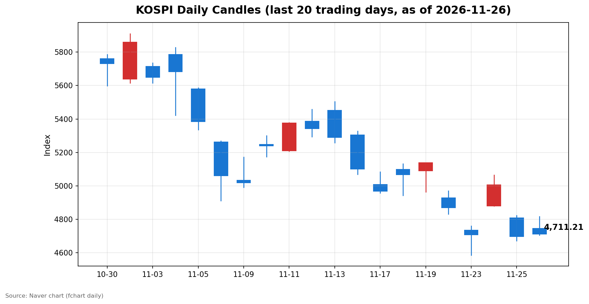
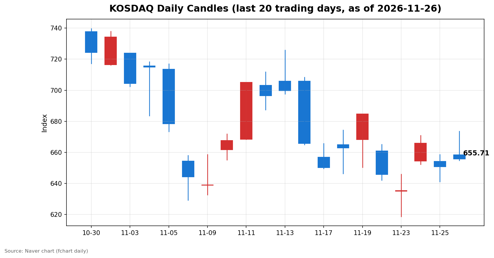

안녕하세요, [한국투자증권](https://securities.koreainvestment.com/main/Main.jsp)에서 [한투-한국투자증권](https://play.google.com/store/apps/details?id=com.truefriend.neosmartarenewal&hl=ko) 개발을 담당하고 있는 way입니다. 
오늘 국내 증시는 한국은행의 기준금리 인상 결정 속에 코스피와 코스닥이 동반 반등하며 마감했습니다. 

## 마감 요약

코스피는 전일 대비 13.70포인트 오른 4,711.21로 0.29% 상승 마감했습니다. 
코스닥은 전일 대비 5.07포인트 오른 655.71로 0.78% 상승 마감했습니다. 
전일 코스피가 6.16% 급락했던 점을 감안하면 오늘 반등 폭은 제한적이었습니다. 
장중 흐름은 강하게 출발해 되돌아오는 모양이었습니다. 
코스피는 장중 4,817.77까지 올라 전일 종가 대비 2.56% 상승했으나, 오후 들어 상승 폭을 대부분 반납했습니다. 
코스닥도 장중 673.57까지 올라 전일 종가 대비 3.53% 상승했다가 마감에는 0.78% 상승에 그쳤습니다. 
오늘의 핵심 재료는 한국은행의 기준금리 인상과 성장률 전망 상향, 미국의 대한국 과잉생산 관세 조사 결과, 반도체 대형주의 주주환원 기대였습니다. 

## 오늘의 마감 스냅샷

| 지수 | 종가 | 전일 대비 | 등락률 | 시가 | 고가 | 저가 | 거래량 | 거래대금 |
| --- | --- | --- | --- | --- | --- | --- | --- | --- |
| [코스피](https://finance.naver.com/sise/sise_index.naver?code=KOSPI) | 4,711.21 | +13.70 | +0.29% | 4,745.10 | 4,817.77 | 4,704.65 | 1억 6,238만 주 | 12조 2,843억 원 |
| [코스닥](https://finance.naver.com/sise/sise_index.naver?code=KOSDAQ) | 655.71 | +5.07 | +0.78% | 658.46 | 673.57 | 654.80 | 3억 9,144만 주 | 4조 8,316억 원 |

수치는 네이버 실시간 시세 기준이며, 거래량은 천 주 단위, 거래대금은 백만 원 단위 원자료를 환산한 값입니다. 
원/달러 환율은 1,343.9원 수준에서 전일 대비 소폭 하락하며 보합권에 머물렀습니다. 

## 차트

최근 20거래일 일봉 차트입니다. 
빨간 봉은 종가가 시가보다 높은 날, 파란 봉은 종가가 시가보다 낮은 날입니다. 

## 원인·촉매 분석

오늘 장의 가장 큰 변수는 한국은행 금융통화위원회의 기준금리 인상 결정이었습니다. 
한국은행은 기준금리를 연 3.00%에서 3.25%로 0.25%포인트 인상했습니다. 
2024년 11월 이후 2년 만에 가장 높은 수준이며, 하반기 들어 세 번째 인상입니다. 
금리 인상은 통상 성장주 밸류에이션에 부담으로 작용합니다. 
그러나 이번 인상은 이미 상당 부분 예상된 결정이었고, 성장률 전망 상향이 함께 발표되면서 인상 충격이 상쇄됐습니다. 
한국은행은 올해 성장률 전망을 3.3%에서 3.9%로, 내년 전망을 2.9%에서 4.1%로 대폭 상향했습니다. 
상향의 배경은 글로벌 인공지능 투자 확대에 따른 메모리 반도체 수출 호황입니다. 
성장 전망이 높아졌다는 사실 자체가 금리 인상에도 불구하고 경기에 대한 자신감을 시장에 전달했습니다. 
다만 금통위원 2명이 동결 소수 의견을 냈고, 점도표에서는 6개월 뒤 3.5%에 가장 많은 점이 몰렸습니다. 
추가 인상 가능성이 남아 있다는 점은 금리 민감 업종에는 부담 요인으로 작용할 수 있습니다. 
반도체 대형주의 주주환원 기대도 지수를 떠받쳤습니다. 
SK하이닉스는 2026회계연도 기준 약 100조 원 규모의 주주환원 계획을 제시한 것으로 전해졌습니다. 
삼성전자는 인공지능 데이터센터용 500단 낸드 개발과 HBM 기술 진전을 알리며 메모리 사업 성장 기대를 키웠습니다. 
삼성전자는 171,600원으로 0.53% 상승 마감했고, SK하이닉스는 1,056,000원으로 2.52% 상승 마감했습니다. 
반면 미국의 대한국 과잉생산 관세 조사 결과는 오후 들어 상승 폭을 되돌리는 부담으로 작용했습니다. 
수급 면에서는 외국인의 매도 강도가 전일보다 크게 완화된 점이 눈에 띕니다. 
전일 외국인은 코스피에서 1조 8,192억 원을 순매도했으나, 오늘은 1,161억 원 순매도에 그쳤습니다. 
기관은 코스피에서 7,530억 원을 순매수하며 외국인과 개인의 매도 물량을 받아냈습니다. 
개인은 전일 1조 3,449억 원 순매수에서 오늘 1조 434억 원 순매도로 돌아섰습니다. 
급락 다음 날 나타난 전형적인 저가 매수 주체 교체 흐름으로 해석됩니다. 

## 핵심 사건 3가지

### 1. 한국은행, 기준금리 3.25%로 인상과 성장률 전망 대폭 상향

한국은행은 오늘 기준금리를 연 3.00%에서 3.25%로 0.25%포인트 인상했습니다. 
동시에 올해 성장률 전망을 3.9%로, 내년 전망을 4.1%로 상향했습니다. 
내년 전망 상향 폭 1.2%포인트는 전망 발표 이래 가장 큰 폭입니다. 
상향의 근거는 메모리 반도체 수출 호황과 인공지능 투자 확대입니다. 
한국은행은 반도체 가격 하락 시 정보기술 제조업 비중이 다시 낮아지며 성장률 산출 가중치가 작아질 수 있다는 점도 함께 설명했습니다. 
금리 인상과 성장 전망 상향이 동시에 나온 것은 시장에 두 가지 신호를 줬습니다. 
통화정책은 긴축 방향이지만, 그 배경이 경기 둔화가 아니라 반도체 호황이라는 점입니다. 
이는 금리 인상에도 불구하고 지수가 반등 마감한 이유를 설명합니다. 
다만 내년 소비자물가 전망도 2.3%에서 2.4%로 상향됐고, 추가 인상 전망이 남아 있습니다. 
블룸버그 이코노믹스는 내년 2월 3.50%로 추가 인상을 전망하고 있습니다. 

### 2. 미국 무역대표부, 대한국 과잉생산 관세 조사 결과 발표

미국 무역대표부는 현지시간 25일 무역법 301조에 따른 과잉생산 조사 결과를 발표했습니다. 
한국은 강제노동 관련 조사에 따른 12.5%와 과잉생산 조사에 따른 2.5%를 더해 일단 15%의 관세율을 부과받게 될 전망입니다. 
미국은 한국의 호남 반도체 클러스터 조성 구상과 150조 원 규모의 국민성장펀드 등 산업 육성 정책을 과잉생산의 근거로 지목했습니다. 
다만 무역확장법 232조 관세가 적용되는 반도체 품목은 이번 추가 관세의 예외로 제시됐습니다. 
자동차는 이미 15% 관세가 적용되고 있어 추가 부담이 제한적입니다. 
석유화학은 설비 재편 압박을 받는 쪽으로 거론됐습니다. 
미국은 협의가 불만족스러울 경우 관세를 최대 25%까지 검토할 수 있다는 입장도 밝혔습니다. 
이 사건이 중요한 이유는 관세율이 확정된 것이 아니라 협의 과정이 남아 있다는 점입니다. 
반도체가 예외로 분류된 점은 국내 증시의 직접 충격을 제한했지만, 협상 불확실성은 당분간 이어질 전망입니다. 

### 3. 반도체 대형주 주주환원 기대와 인공지능 투자 확대

SK하이닉스는 2026회계연도 기준 약 100조 원 규모의 주주환원 계획을 제시했습니다. 
삼성전자와 SK하이닉스의 내년 영업이익이 합산 1,000조 원에 근접할 수 있다는 전망도 제기됐습니다. 
이는 인공지능 시대의 반도체 초호황이 이어진다는 전망에 근거한 것으로, 아직 확정된 실적이 아닙니다. 
한투 MTS의 장중 브리핑에서도 HBM과 고대역폭메모리, FC-BGA 기판 테마가 시장의 중심축으로 꼽혔습니다. 
삼성전기는 인공지능 서버용 기판 증설과 엔비디아 협력 확대 소식에 장중 강세를 보였습니다. 
반면 간밤 미국 증시에서는 엔비디아 주가가 젠슨 황 최고경영자 복귀에도 3.7% 하락했습니다. 
앤트로픽은 상장 나흘 만에 공모가를 밑돌며 24일 종가 81.90달러를 기록했습니다. 
인공지능 투자 기대가 커지는 동시에, 인공지능 관련주의 밸류에이션에 대한 경계도 함께 커지고 있습니다. 
국내 반도체주의 강세는 실적과 주주환원이라는 구체적 재료에 기반하고 있으나, 글로벌 인공지능주의 조정은 심리적인 부담 요인으로 작용할 수 있습니다. 

## 섹터·테마 영향 체인

오늘 시장의 중심축은 HBM과 고대역폭메모리, FC-BGA 기판, 바이오, 보안, K뷰티였습니다. 
한투 MTS의 장중 테마 분석에 따르면 HBM 테마는 대규모 주주환원 정책과 인공지능 서버용 신기술 개발, 3분기 실적 개선 소식이 맞물리며 강세를 보였습니다. 
FC-BGA와 PCB 기판 테마는 인공지능 서버용 기판 투자 확대와 엔비디아 협력 강화 소식에 힘입어 성장 기대가 높아졌습니다. 
이는 금리 인상이라는 거시 변수보다 반도체 실적과 주주환원이라는 미시 재료가 오늘 장을 주도했다는 의미입니다. 
바이오 테마는 장기지속형 플랫폼 기술 확인과 대규모 마일스톤 수령 소식에 투자심리가 개선됐습니다. 
보안 테마는 글로벌 해킹 사고와 인공지능 보안 위협 확산으로 사이버 보안 수요가 급증할 것이라는 전망에 강세를 보였습니다. 
K뷰티 테마는 한중 교류 확대 기대와 북미, 유럽향 수출 성장세가 맞물리며 강세를 보였습니다. 
우주항공과 로켓 테마는 스페이스엑스의 기술적 진보와 합병 가능성 보도가 관련 투자자산 가치 기대를 키우며 강세를 보였습니다. 
반면 관세 조사 결과는 업종별로 다른 영향을 줬습니다. 
반도체는 232조 예외로 직접 충격이 제한됐고, 자동차는 이미 15% 관세가 적용되고 있어 추가 부담이 작았습니다. 
석유화학은 설비 재편 압박이 거론되며 상대적으로 불리한 위치에 놓였습니다. 
금리 인상은 성장주 전반의 밸류에이션에는 부담이지만, 반도체는 실적 전망이 이를 상쇄하는 구조였습니다. 
결국 오늘 장은 금리라는 거시 변수보다 반도체 실적과 주주환원, 관세 예외 여부라는 개별 재료가 섹터별 방향을 갈랐다고 볼 수 있습니다. 

## 최근 5거래일 일봉

### 코스피

| 날짜 | 시가 | 고가 | 저가 | 종가 | 전일 대비 | 등락률 |
| --- | --- | --- | --- | --- | --- | --- |
| 2026-11-20 | 4,928.51 | 4,971.31 | 4,831.69 | 4,869.96 | -267.93 | -5.21% |
| 2026-11-23 | 4,734.90 | 4,759.88 | 4,586.80 | 4,708.54 | -161.42 | -3.31% |
| 2026-11-24 | 4,880.16 | 5,065.74 | 4,880.16 | 5,006.03 | +297.49 | +6.32% |
| 2026-11-25 | 4,809.00 | 4,823.36 | 4,672.55 | 4,697.51 | -308.52 | -6.16% |
| 2026-11-26 | 4,745.10 | 4,817.77 | 4,704.65 | 4,711.21 | +13.70 | +0.29% |

### 코스닥

| 날짜 | 시가 | 고가 | 저가 | 종가 | 전일 대비 | 등락률 |
| --- | --- | --- | --- | --- | --- | --- |
| 2026-11-20 | 660.98 | 665.15 | 642.13 | 645.68 | -39.13 | -5.71% |
| 2026-11-23 | 634.93 | 645.93 | 618.74 | 635.45 | -10.23 | -1.58% |
| 2026-11-24 | 654.31 | 670.95 | 652.21 | 665.88 | +30.43 | +4.79% |
| 2026-11-25 | 654.21 | 658.67 | 641.08 | 650.64 | -15.24 | -2.29% |
| 2026-11-26 | 658.46 | 673.57 | 654.80 | 655.71 | +5.07 | +0.78% |

최근 5거래일 동안 코스피는 4,700선 안팎에서 큰 폭의 등락을 반복했습니다. 
11월 24일의 6.32% 반등과 11월 25일의 6.16% 급락이 하루 간격으로 나타났고, 오늘은 0.29% 소폭 반등에 그쳤습니다. 
변동성이 극단적으로 커진 구간이라는 점이 최근 5거래일 표에서 확인됩니다. 

## 당일 수급

코스피에서 외국인은 1,161억 원을 순매도했습니다. 
전일 1조 8,192억 원 순매도와 비교하면 매도 강도가 크게 완화된 수치입니다. 
개인은 1조 434억 원을 순매도했습니다. 
전일 1조 3,449억 원 순매수에서 하루 만에 순매도로 돌아섰습니다. 
기관은 7,530억 원을 순매수했습니다. 
기관 세부로는 금융투자가 6,249억 원으로 가장 많이 순매수했고, 투신이 937억 원, 보험이 374억 원으로 뒤를 이었습니다. 
기타법인은 4,067억 원을 순매수했습니다. 
코스닥에서는 외국인이 1,063억 원, 개인이 1,358억 원을 순매도했고, 기관이 2,331억 원을 순매수했습니다. 
코스닥 기관 순매수에서는 금융투자 1,121억 원, 사모펀드 446억 원, 투신 419억 원이 중심이었습니다. 
수급 구도를 해석하면 외국인의 매도 공세는 한풀 꺾였고, 기관이 저가 매수 주체로 나섰습니다. 
개인은 전일 급락 국면에서 저가 매수에 나섰다가, 오늘 장중 반등 국면에서 차익 실현성 매도로 돌아선 것으로 보입니다. 
외국인과 개인이 함께 판 물량을 기관과 기타법인이 받아낸 하루였습니다. 
다만 외국인의 순매도가 완전히 멈춘 것은 아니므로, 내일 이후 외국인 수급이 추가로 완화되는지 확인할 필요가 있습니다. 

## 강했던 테마와 흐름

오늘 가장 강했던 흐름은 HBM과 반도체, FC-BGA 기판이었습니다. 
대규모 주주환원 계획과 인공지능 서버용 신기술 개발, 실적 개선 소식이 한꺼번에 작용했습니다. 
바이오 테마도 장기지속형 플랫폼 기술 확인과 마일스톤 수령 소식에 강세를 보였습니다. 
보안 테마는 해킹 사고와 인공지능 보안 위협 확산이라는 수요 전망에 강세를 보였습니다. 
K뷰티 테마는 수출 성장 기대와 한중 교류 확대 기대에 강세를 보였습니다. 
우주항공 테마는 스페이스엑스 관련 보도에 강세를 보였습니다. 
로보틱스와 피지컬 인공지능 테마도 대규모 인공지능 공급 계약과 정부 로봇 과제 선정 소식에 강세를 보였습니다. 
반면 관세 조사 결과에 직접 노출된 석유화학은 상대적으로 약한 흐름을 보였습니다. 
전반적으로 오늘 장은 지수보다 테마별 재료가 방향을 가른 하루였습니다. 

## 단기·중기 전망과 내일 확인할 시나리오

단기적으로는 오늘의 장중 고점 되돌림이 일시적인 차익 실현인지, 반등 동력 약화의 신호인지가 관건입니다. 
코스피는 장중 4,817.77까지 올랐다가 4,711.21로 마감하며 고점 대비 약 100포인트를 반납했습니다. 
내일 확인할 첫 번째 수치는 4,700선 지지 여부입니다. 
4,700선을 지켜내면 반등 흐름이 이어질 여지가 있고, 이탈하면 변동성 확대 구간이 다시 열릴 수 있습니다. 
저항 구간으로는 오늘 장중 고점인 4,817.77 부근이 우선 확인됩니다. 
코스닥은 650선을 지지선으로, 673.57 부근을 저항선으로 확인할 수 있습니다. 
두 번째로 확인할 점은 외국인 수급의 추가 완화 여부입니다. 
외국인 순매도가 오늘 1,161억 원까지 축소됐으나, 순매수 전환까지 이어지는지가 중요합니다. 
세 번째는 미국 시장의 추수감사절 일정입니다. 
미국 증시는 26일 조기 폐장하고 27일 추수감사절로 휴장합니다. 
이 기간에는 외국인 수급의 방향성을 가늠할 단서가 줄어들 수 있습니다. 
네 번째는 올해 마지막 연방공개시장위원회 의사록과 10월 비농업 고용 지표입니다. 
9월 개인소비지출 물가지수는 전년 대비 2.8%로 예상에 부합했고, 12월 금리인하 확률은 87%까지 올랐습니다. 
미국의 금리인하 기대가 유지되는지는 국내 증시의 외부 환경에 영향을 줍니다. 
다섯 번째는 미국의 대한국 과잉생산 관세 협의 진행 상황입니다. 
15% 관세율이 확정된 것이 아니라 협의 과정이 남아 있고, 최대 25%까지 거론된 만큼 관련 보도가 이어질 수 있습니다. 
중기적으로는 한국은행의 추가 인상 가능성과 반도체 실적 전망이 함께 작용할 전망입니다. 
성장률 전망 상향의 근거가 된 메모리 반도체 수출 호황이 실제로 이어지는지가 중기 방향을 가를 핵심 변수입니다. 
이 글은 교육과 해설 목적의 시황 정리이며, 특정 종목의 매수나 매도를 권유하지 않습니다. 

## 마치며

오늘 국내 증시는 한국은행의 기준금리 인상 속에서도 성장률 전망 상향과 반도체 주주환원 기대에 힘입어 동반 반등했습니다. 
다만 장중 고점을 크게 되돌린 만큼, 내일 4,700선 지지 여부와 외국인 수급 흐름을 함께 확인할 필요가 있습니다. 
