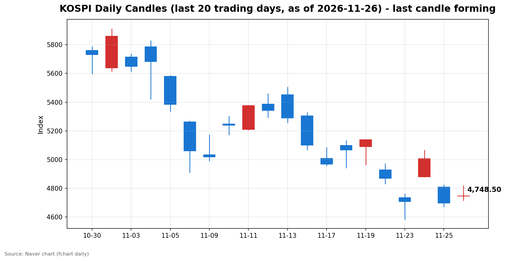
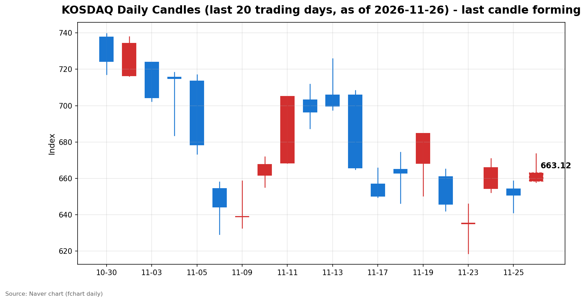

안녕하세요, [한국투자증권](https://securities.koreainvestment.com/main/Main.jsp)에서 [한투-한국투자증권](https://play.google.com/store/apps/details?id=com.truefriend.neosmartarenewal&hl=ko) 개발을 담당하고 있는 way입니다. 
오늘 오전 국내 증시는 전일 급락을 딛고 반등하는 흐름을 보였습니다. 

## 오전장 요약

코스피는 전일 종가 대비 1.11% 오른 4,749.80까지 회복했습니다. 
코스닥은 1.89% 오른 662.95를 기록했습니다. 
전일 코스피는 6.16% 급락하며 4,697.51로 마감했습니다. 
코스닥도 전일 2.29% 하락했습니다. 
오늘 오전 장은 시가부터 상승 출발했습니다. 
코스피는 장중 4,817.77까지 올랐습니다. 
이후 상승폭을 일부 되돌리며 4,749.80 수준에서 오전을 마쳤습니다. 
반도체와 우주항공 테마가 반등을 이끌었습니다. 
한국은행의 기준금리 인상이 오전 중 발표됐습니다. 
금리 인상은 이미 시장에서 예상했던 재료였습니다. 

## 오늘의 스냅샷

| 지수 | 현재가 | 전일 대비 | 등락률 | 시가 | 고가 | 저가 | 거래량 | 거래대금 |
| --- | --- | --- | --- | --- | --- | --- | --- | --- |
| 코스피 | 4,749.80 | +52.29 | +1.11% | 4,745.10 | 4,817.77 | 4,715.81 | 100,885천주 | 7조 5,686억원 |
| 코스닥 | 662.95 | +12.31 | +1.89% | 658.46 | 673.57 | 657.88 | 275,524천주 | 3조 3,678억원 |

스냅샷 기준 시각은 2026년 11월 26일 12시 27분(KST)입니다. 
전일 종가는 코스피 4,697.51, 코스닥 650.64입니다. 
당일 봉은 형성 중인 봉으로, 마감 전에는 계속 변합니다. 
코스피 차트는 [네이버 코스피 시세](https://finance.naver.com/sise/sise_index.naver?code=KOSPI)에서 확인할 수 있습니다. 
코스닥 차트는 [네이버 코스닥 시세](https://finance.naver.com/sise/sise_index.naver?code=KOSDAQ)에서 확인할 수 있습니다. 

## 차트

최근 20거래일 일봉 차트입니다. 
빨간 봉은 종가가 시가보다 높은 날, 파란 봉은 종가가 시가보다 낮은 날입니다. 
당일 봉은 형성 중인 봉으로, 마감 전에는 계속 변합니다. 

## 원인·촉매 분석

오늘 오전 반등의 가장 직접적인 촉매는 반도체 업종의 주주환원 재료입니다. 
SK하이닉스는 11월 25일 기업가치 제고 이행 현황을 공시했습니다. 
올해 회계연도 기준 총 100조원 규모의 주주환원을 추진한다는 내용입니다. 
현금배당 30조원 이상과 자사주 매입·소각 60조원 이상이 포함됩니다. 
지난해 주주환원 규모 14조 3,000억원의 약 7배에 해당합니다. 
이 공시가 HBM과 기판, 반도체 장비 전반의 투자심리를 끌어올렸습니다. 
삼성전기는 AI 서버용 기판 증설과 자사주 소각 결정이 함께 부각됐습니다. 

전일 수급 구도는 반등의 배경을 설명합니다. 
11월 25일 코스피에서 외국인은 1조 8,193억원을 순매도했습니다. 
개인은 같은 날 1조 3,449억원을 순매수했습니다. 
기관은 39억원 순매수로 사실상 중립이었습니다. 
기관 내부에서는 금융투자가 3,714억원을 순매수했습니다. 
반면 투신은 3,506억원을 순매도해 서로 상쇄됐습니다. 
기타법인은 4,704억원을 순매수했습니다. 
코스닥에서는 외국인이 165억원을 순매수했습니다. 
개인은 516억원을 순매도했고 기관은 281억원을 순매수했습니다. 
외국인의 대규모 매도를 개인이 받아낸 장이었습니다. 
외국인 매도가 일단락되자 낙폭 과대에 대한 되돌림 매수가 들어왔습니다. 
장중 수급은 확인이 필요합니다. 

한국은행의 기준금리 인상은 오전 장의 또 다른 변수였습니다. 
금통위는 기준금리를 연 3.00%에서 3.25%로 0.25%포인트 인상했습니다. 
올해 들어 7월과 8월에 이은 세 번째 인상입니다. 
내년 성장률 전망은 4.1%로 상향됐습니다. 
인상은 사전에 우세했던 전망과 같았습니다. 
금리 인상 자체보다 성장률 상향이 경기에 대한 자신감으로 읽혔습니다. 
다만 금리 인상은 성장주 밸류에이션에는 부담 요인입니다. 
오전 고점 대비 상승폭이 축소된 배경에도 이 경계감이 반영됐습니다. 
신현송 총재는 주가 움직임이 금리 결정 변수가 아니라고 밝혔습니다. 

간밤 뉴욕 증시의 흐름도 심리에 영향을 줬습니다. 
나스닥은 장중 4.6%까지 급락했다가 0.62% 하락으로 마감했습니다. 
공포의 정점을 확인하고 낙폭을 대부분 만회한 흐름입니다. 
국내 증시는 이 되돌림 흐름을 이어받아 상승 출발했습니다. 

## 핵심 사건 3가지

첫째, 한국은행이 기준금리를 연 3.25%로 인상했습니다. 
올해 세 번째 인상으로, 연 3.00%에서 0.25%포인트 올렸습니다. 
내년 성장률 전망은 4.1%로 상향됐습니다. 
반도체 호황과 물가 부담이 인상 배경으로 지목됐습니다. 
인상 자체는 예상됐던 재료라 충격은 제한적이었습니다. 
다만 추가 인상 가능성에 대한 총재 발언 해석이 오후 장의 변수로 남습니다. 

둘째, 뉴욕 증시가 장중 급락 후 낙폭을 대부분 만회했습니다. 
나스닥종합지수는 25일 현지시간 23,585.80으로 마감했습니다. 
전일 대비 0.62% 하락했습니다. 
장중에는 4.6%까지 밀렸습니다. 
AI 투자 수익성과 신용에 대한 불안이 매도 촉매였습니다. 
미국 정부의 추가 관세 추진 움직임도 투자심리를 위축시켰습니다. 
다우존스지수는 0.33% 올랐고 S&P500지수는 0.25% 내렸습니다. 
추수감사절 휴장을 앞두고 저가 매수세가 유입됐습니다. 
오늘 미국 증시는 추수감사절로 휴장합니다. 
중앙일보 GMC의 오늘 아침 브리핑도 AI 투자 불안과 인플레이션을 주제로 다뤘습니다. 
JP모건은 AI 투자가 내년까지 급증한 뒤 2028년에는 정체될 것으로 전망했습니다. 
앤트로픽은 상장 나흘 만에 공모가를 밑돌았습니다. 
AI 거품론에 대한 경계가 여전히 시장의 기저에 깔려 있습니다. 

셋째, 미국 연방통신위원회가 스페이스X의 궤도 데이터센터 계획을 승인했습니다. 
스페이스X의 AI 기반 궤도 데이터센터 시스템인 스타마인드입니다. 
위성 100만기의 발사·운용이 25일 현지시간 최종 승인됐습니다. 
우주 데이터센터용 위성군에 대한 미국의 첫 승인입니다. 
2033년 11월까지 첫 위성을 발사해야 합니다. 
2035년 11월까지 10만기, 2038년 11월까지 50만기를 배치해야 합니다. 
전체 배치는 2040년 11월까지 완료해야 합니다. 
국내 우주항공 관련주는 오전 일제히 급등했습니다. 
미래에셋벤처투자는 오전 10시 30분 기준 23.51% 올랐습니다. 
LK삼양은 상한가를 기록했습니다. 
스피어와 에이치브이엠도 두 자릿수 상승률을 보였습니다. 
다만 국내 기업의 직접 수혜가 확정된 것은 아닙니다. 
테마 차원의 기대감이 선반영된 흐름으로 보는 것이 적절합니다. 

## 섹터·테마 영향 체인

반도체 밸류체인이 오전 장의 중심이었습니다. 
SK하이닉스의 주주환원 공시가 HBM 테마 전반을 끌어올렸습니다. 
기판과 반도체 재료, 장비로 온기가 확산됐습니다. 
MLCC 테마는 4.76% 올랐습니다. 
삼성전기는 6.49%, 삼화콘덴서는 3.94% 상승했습니다. 
유리기판 테마는 3.08%, PCB 테마는 2.18% 올랐습니다. 
반도체재료 테마는 2.66% 상승했습니다. 
CXL 테마는 2.49%, 온디바이스AI 테마는 2.46% 올랐습니다. 
AI 서버향 고부가 부품 수요 기대가 밸류체인을 따라 번졌습니다. 
반도체 장비주도 대규모 수주 소식과 함께 강세를 보였습니다. 

우주항공 테마는 스페이스X 승인 소식에 직접 반응했습니다. 
우주 위성과 발사체 테마는 3.20% 올랐습니다. 
투자 지분이나 공급망으로 연결된 종목들이 급등했습니다. 
실적 기여 시점은 2033년 이후로 먼 편입니다. 
단기 실적보다는 사업화 기대감이 주가를 움직였습니다. 

보안주도 강세를 보였습니다. 
글로벌 해킹 사고와 AI 보안 위협이 부각됐습니다. 
안랩은 6.90%, 라온시큐어는 4.06% 상승했습니다. 
사이버보안 수요 확대 기대가 반영된 흐름입니다. 

바이오는 장기지속형 플랫폼과 마일스톤 소식이 투자심리를 개선했습니다. 
올릭스는 13.88%, 알지노믹스는 14.52% 상승했습니다. 
K뷰티도 한·중 교류 확대 기대와 수출 성장세에 강세를 보였습니다. 

반면 에너지·전력 테마는 약세를 보였습니다. 
데이터센터와 AI 전력 인프라 수주 소식에도 불구하고 주가는 밀렸습니다. 
실적 성장 둔화와 자금조달에 따른 희석 우려가 작용했습니다. 
금리 인상이 자금조달 비용 부담을 키우는 쪽으로 작용했습니다. 
금리 인상은 성장주와 고부채 업종에는 부담입니다. 
반도체 호황에 따른 성장률 상향은 경기 민감주에는 우호적입니다. 
두 힘이 맞물리며 업종별 온도 차가 커졌습니다. 

## 최근 5거래일 일봉

### 코스피

| 날짜 | 시가 | 고가 | 저가 | 종가 | 거래량 |
| --- | --- | --- | --- | --- | --- |
| 11월 19일 | 5,090.04 | 5,137.89 | 4,963.61 | 5,137.89 | 195,695천주 |
| 11월 20일 | 4,928.51 | 4,971.31 | 4,831.69 | 4,869.96 | 206,729천주 |
| 11월 23일 | 4,734.90 | 4,759.88 | 4,586.80 | 4,708.54 | 218,577천주 |
| 11월 24일 | 4,880.16 | 5,065.74 | 4,880.16 | 5,006.03 | 194,134천주 |
| 11월 25일 | 4,809.00 | 4,823.36 | 4,672.55 | 4,697.51 | 205,391천주 |

최근 5거래일 동안 코스피는 5,137.89에서 4,697.51로 8.57% 하락했습니다. 
11월 24일 6.32% 반등 뒤 11월 25일 6.16% 급락했습니다. 
변동성이 극단적으로 커진 구간입니다. 

### 코스닥

| 날짜 | 시가 | 고가 | 저가 | 종가 | 거래량 |
| --- | --- | --- | --- | --- | --- |
| 11월 19일 | 668.31 | 684.81 | 650.39 | 684.81 | 398,792천주 |
| 11월 20일 | 660.98 | 665.15 | 642.13 | 645.68 | 421,847천주 |
| 11월 23일 | 634.93 | 645.93 | 618.74 | 635.45 | 405,856천주 |
| 11월 24일 | 654.31 | 670.95 | 652.21 | 665.88 | 441,902천주 |
| 11월 25일 | 654.21 | 658.67 | 641.08 | 650.64 | 441,495천주 |

최근 5거래일 동안 코스닥은 684.81에서 650.64로 4.99% 하락했습니다. 
코스피보다 낙폭이 작았습니다. 
코스닥은 오전 상승률이 코스피보다 높았습니다. 

## 오전 강했던 테마와 흐름 변화

오전 가장 강했던 테마는 MLCC였습니다. 
4.76% 상승했습니다. 
우주 위성과 발사체 테마는 3.20% 올랐습니다. 
유리기판은 3.08%, 5G는 2.90% 상승했습니다. 
반도체재료는 2.66%, CXL은 2.49% 올랐습니다. 
온디바이스AI는 2.46%, PCB는 2.18% 상승했습니다. 
반도체와 우주항공, 통신장비 쪽으로 매수가 집중됐습니다. 
에너지·전력 테마는 상대적으로 약했습니다. 

흐름 변화도 확인할 수 있습니다. 
코스피는 시가 4,745.10으로 전일 대비 1.01% 상승 출발했습니다. 
장중 고가 4,817.77까지 올라 상승률이 2.56%까지 확대됐습니다. 
이후 4,749.80까지 되돌리며 상승률은 1.11%로 축소됐습니다. 
상승 출발 후 고점을 찍고 되돌리는 흐름입니다. 
방향이 바뀐 것은 아니지만 상승폭이 줄었습니다. 
코스닥도 시가 658.46에서 고가 673.57까지 올랐습니다. 
현재 662.95로 고점 대비 되돌림이 진행 중입니다. 
오전 후반 들어 차익 매물이 나오고 있습니다. 

## 오후 전망과 확인할 시나리오

오후에는 오전 반등이 이어지는지 확인할 필요가 있습니다. 
미국 증시가 추수감사절로 휴장합니다. 
해외 변수가 비는 만큼 국내 수급과 재료 소화가 관건입니다. 

첫 번째로 확인할 수치는 코스피 4,800선 안착 여부입니다. 
오전 고가는 4,817.77이었습니다. 
오후에 4,800선을 회복하면 반등 흐름이 이어지는 것으로 볼 수 있습니다. 
반대로 4,700선 아래로 밀리면 전일 종가 부근을 다시 시험하게 됩니다. 
전일 종가 4,697.51이 지지선 역할을 할지 지켜봐야 합니다. 

코스닥은 670선 안착 여부가 관건입니다. 
오전 고가는 673.57이었습니다. 
670선을 지키면 상승 흐름이 유지됩니다. 
650선 아래로 밀리면 전일 종가 부근까지 되돌릴 수 있습니다. 

두 가지 시나리오를 생각할 수 있습니다. 
첫째, 오전 흐름이 이어지는 시나리오입니다. 
반도체와 우주항공 강세가 유지됩니다. 
외국인 매도가 진정되고 기관 매수가 더해지면 지수는 고점을 다시 시험합니다. 
둘째, 일시적 되돌림에 그치는 시나리오입니다. 
금리 인상 부담과 AI 거품론 경계가 다시 부각됩니다. 
오전 고점 대비 되돌림이 확대되면 4,700선 지지가 시험받습니다. 
어느 쪽인지 판단하는 기준은 오후 거래량과 외국인 매매 방향입니다. 
장중 수급은 확인이 필요합니다. 
총재 기자회견 발언에 대한 시장의 해석도 오후에 이어질 변수입니다. 
리스크 관리 관점에서는 변동성 확대에 유의해야 합니다. 
최근 5거래일의 일중 변동폭이 매우 컸습니다. 
특정 종목의 매수나 매도를 권유하는 내용이 아닙니다. 

## 마치며

오늘 오전 국내 증시는 전일 급락 뒤 반도체와 우주항공 강세에 힘입어 반등했습니다. 
다만 금리 인상 부담과 AI 거품론 경계가 남아 있어 오후에는 4,800선 안착 여부와 수급 방향을 확인해야 합니다. 
이 글은 교육과 해설 목적의 시황 정리이며, 매수나 매도를 권유하는 내용이 아닙니다. 
