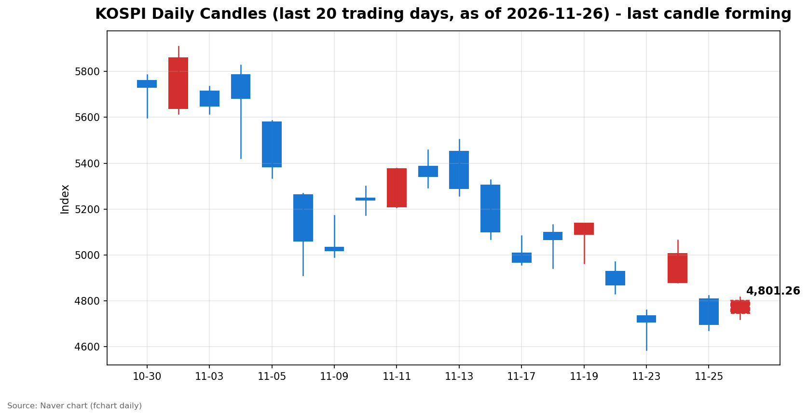
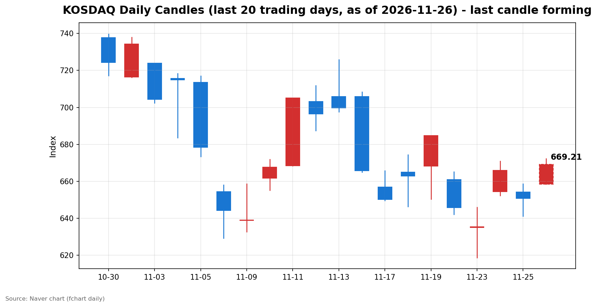

안녕하세요, [한국투자증권](https://securities.koreainvestment.com/main/Main.jsp)에서 [한투-한국투자증권](https://play.google.com/store/apps/details?id=com.truefriend.neosmartarenewal&hl=ko) 개발을 담당하고 있는 way입니다. 
오늘 국내 증시는 전일 6%대 급락 뒤 반발 매수세가 유입되며 코스피가 4,800선을 회복하는 흐름으로 출발했습니다. 

## 배경: 간밤 미국 증시

간밤 미국 증시는 장중 급락 뒤 낙폭을 크게 만회하며 혼조세로 마감했습니다. 
다우존스30산업평균지수는 전 거래일보다 0.33% 올랐습니다. 
반면 스탠더드앤드푸어스(S&P)500지수는 0.25%, 기술주 중심의 나스닥 종합지수는 0.62% 내린 23,585.80에 각각 마감했습니다. 
나스닥은 장중 한때 4.6%까지 밀렸고, 나스닥100지수는 사상 최고 종가 대비 20% 하락에 근접하며 약세장 문턱에 다가서기도 했습니다. 
엔비디아 주가는 3.9% 하락했습니다. 
중앙일보 GMC 11월 26일자 G모닝 브리핑은 젠슨 황 최고경영자(CEO) 복귀 당일 31% 폭등했던 엔비디아가 다음 날 6% 가까이 하락한 데 이어 간밤에도 4% 가까이 떨어졌다며, 월가에서는 복귀가 AI 관련주 하락을 막아줄 것이라는 이른바 젠슨 풋 기대가 통하지 않는다는 평가가 나온다고 전했습니다. 
마이크론은 4.57%, 샌디스크는 5.57% 하락했습니다. 
미국 3분기 경제성장률은 시장 예상치를 웃돌았고, 10월 개인소비지출(PCE) 물가지수는 전년 대비 3.8%, 근원 PCE는 3.3%로 예상치를 웃돌았습니다. 
강한 성장과 높은 물가가 동시에 확인되면서 연방준비제도(Fed·연준)의 12월 추가 금리 인상 전망이 강화됐습니다. 
미국 무역대표부(USTR)는 25일(현지시간) 한국을 포함해 14개 경제주체를 상대로 무역법 301조 조사 결과에 따른 과잉생산 관세를 예고했습니다. 
한국에 대해서는 15% 상한이 유지되는 것으로 전해졌습니다. 
오늘 미국 증시는 추수감사절로 휴장합니다. 

## 오늘의 스냅샷

| 지수 | 현재가 | 전일 대비 | 등락률 | 시가 | 고가 | 저가 | 거래량 | 거래대금 |
| --- | --- | --- | --- | --- | --- | --- | --- | --- |
| 코스피 | 4,817.77 | +120.26 | +2.56% | 4,745.10 | 4,817.77 | 4,719.73 | 32,960천주 | 2,610,046백만원 |
| 코스닥 | 670.74 | +20.10 | +3.09% | 658.46 | 672.21 | 658.46 | 87,804천주 | 1,221,564백만원 |

스냅샷 기준 시각은 2026년 11월 26일 09시 28분(KST)입니다. 
전일 종가는 코스피 4,697.51, 코스닥 650.64입니다. 
전일 종가는 네이버 실시간 데이터에서 역산한 값과 일봉 차트의 전일 종가가 일치합니다. 
코스피는 시가 4,745.10으로 전일 종가보다 1.01% 높은 수준에서 출발한 뒤 장 초반 고점을 높였습니다. 
코스닥도 시가 658.46으로 전일 종가보다 1.20% 높은 수준에서 출발했습니다. 
전일 국내 증시는 코스피가 6.16%, 코스닥이 2.29% 하락했습니다. 
오늘 상승분은 전일 낙폭의 일부를 되돌리는 수준입니다. 
지수 차트는 [코스피](https://finance.naver.com/sise/sise_index.naver?code=KOSPI)와 [코스닥](https://finance.naver.com/sise/sise_index.naver?code=KOSDAQ)에서 확인할 수 있습니다. 

## 차트

최근 20거래일 일봉 차트입니다. 
빨간 봉은 종가가 시가보다 높은 날, 파란 봉은 종가가 시가보다 낮은 날입니다. 
당일 봉은 형성 중인 봉으로, 마감 전에는 계속 변합니다. 

## 원인·촉매 분석

오늘 반등의 가장 직접적인 촉매는 전일 낙폭에 대한 반발 매수와 저가 매수세의 유입입니다. 
코스피는 전일 6.16% 하락하며 4,700선을 내줬고, 코스닥도 2.29% 하락했습니다. 
단기간 낙폭이 컸던 만큼 장 초반부터 되돌림 매수가 들어왔습니다. 
간밤 미국 증시가 장중 급락 뒤 낙폭을 대부분 만회한 점도 투자심리 안정에 기여했습니다. 
나스닥이 장중 4.6%까지 밀렸다가 0.62% 하락으로 마감했고, 다우는 상승 전환했습니다. 
코스피200 야간선물은 0.35% 오른 것으로 전해졌습니다. 
정부의 시장 안정 조치도 하방 심리를 받치는 요인으로 작용했습니다. 
정부는 11월 22일 관계부처 긴급회의(F4 회의)에서 증권시장안정펀드(증안펀드) 가동 체계를 정비하고, 자사주 매입 한도 완화를 11월 24일부터 시행했으며, 불법 공매도 집중 감시를 병행하기로 했습니다. 
다만 긴축 우려가 해소된 것은 아닙니다. 
미국 10월 물가가 예상치를 웃돌면서 연준의 12월 추가 금리 인상 전망이 커졌고, 이는 성장주 밸류에이션에 부담으로 작용합니다. 
오늘 오전 9시 50분 전후로 발표되는 한국은행 금융통화위원회 결정도 대기 요인입니다. 
전문가 20명을 대상으로 한 서베이에서는 18명(90%)이 0.25%포인트 인상을 예상했습니다. 
금리 인상 자체보다 점도표가 내년 추가 인상 가능성을 얼마나 열어두는지가 시장의 관심사입니다. 
장 초반 수급은 전일과 방향이 달라졌습니다. 
한국투자증권 MTS 9시 10분 브리핑 기준 코스피에서 외국인은 2,149억 원, 기관은 627억 원 순매수했고, 개인은 3,178억 원 순매도했습니다. 
코스닥에서도 외국인은 332억 원, 기관은 598억 원 순매수했고, 개인은 928억 원 순매도했습니다. 
다만 선물 시장에서는 외국인이 2,126억 원 순매도했고 기관이 2,233억 원 순매수해 현물과 선물 수급이 엇갈렸습니다. 
전일 현물 수급은 외국인이 코스피에서 1조 8,192억 원을 순매도했고 개인이 1조 3,449억 원을 순매수하며 물량을 받았습니다. 
기관은 39억 원 순매수로 사실상 중립이었습니다. 
전일 코스닥에서는 외국인이 165억 원, 기관이 281억 원 순매수했고, 개인은 516억 원 순매도했습니다. 
외국인의 대규모 매도를 개인이 받아낸 구도에서 주가가 급락했다는 점은, 전일 하락이 수급 공백보다는 매도 압력 자체가 컸음을 보여줍니다. 
오늘 장 초반 외국인의 현물 순매수 전환이 전일과 다른 흐름으로 이어질지가 관전 포인트입니다. 

## 핵심 사건 3가지

첫째, 미국 10월 물가 지표가 예상치를 웃돌면서 연준 추가 긴축 전망이 강화됐습니다. 
10월 PCE 물가지수는 전년 대비 3.8%, 근원 PCE는 3.3%로 집계됐습니다. 
3분기 경제성장률도 시장 예상치를 웃돌았습니다. 
강한 성장과 높은 물가가 동시에 확인되면서 연준이 12월에 이어 내년 1월에도 금리를 올릴 수 있다는 전망이 나왔습니다. 
금리가 오르면 미래 이익을 현재 가치로 환산할 때 할인율이 높아져 성장주 밸류에이션이 낮아집니다. 
이는 간밤 나스닥이 장중 4.6%까지 밀린 직접적인 배경입니다. 
다만 장 후반 저가 매수세가 유입되며 낙폭을 대부분 만회한 점은, 긴축 우려가 이미 가격에 상당 부분 반영됐다는 해석도 가능하게 합니다. 

둘째, 국제 신용평가사 스탠더드앤드푸어스(S&P)가 엔비디아의 신용등급 강등 검토에 들어갔습니다. 
S&P는 25일(현지시간) 엔비디아의 장기 기업 신용등급과 선순위 무담보 채권 신용등급인 AA를 부정적 관찰 대상으로 올렸습니다. 
젠슨 황 최고경영자(CEO) 복귀 과정에서 드러난 지배구조 취약성과 대중국 수출통제 위반 의혹이 근거로 제시됐습니다. 
S&P는 향후 90일간 검토를 거쳐 등급을 하향 조정할 수 있다고 밝혔습니다. 
다만 조사나 정보 공개를 통해 평판이나 사업 전망이 훼손됐다고 판단하지 않는 한 강등 폭은 한 단계(AA에서 AA-)에 그칠 것으로 예상했습니다. 
무디스는 안정적 전망을 유지했습니다. 
신용등급 검토 자체보다 중요한 것은 AI 투자 사이클에 대한 신뢰가 흔들렸다는 점입니다. 
엔비디아 주가는 이날 3.9% 하락했고, AI 투자 수익성과 자금조달 불확실성에 대한 우려가 반도체주 전반으로 번졌습니다. 

셋째, 미국이 한국을 포함한 14개 경제주체에 과잉생산 관세를 예고했습니다. 
미국 무역대표부(USTR)는 25일(현지시간) 무역법 301조 조사 결과를 바탕으로 한국·일본·중국·유럽연합(EU) 등 14개 경제주체를 상대로 과잉생산을 문제 삼는 관세를 제시했습니다. 
한국에 대해서는 15% 상한이 유지되는 것으로 전해졌습니다. 
관세는 수출 기업의 원가와 가격 경쟁력에 직접 영향을 미치기 때문에, 대상 품목과 세율이 구체화되기 전까지 불확실성이 이어질 수 있습니다. 
다만 한국에 대한 상한이 유지됐다는 점은 최악의 시나리오를 피했다는 의미로도 읽힙니다. 
전일 국내 증시 급락에는 이 관세 예고가 임박했다는 소식도 영향을 미친 것으로 보입니다. 

## 섹터·테마 영향 체인

오늘 장 초반 상승은 반도체·AI 하드웨어 밸류체인 중심으로 확산됐습니다. 
한국투자증권 MTS 테마 기준 MLCC는 7.83% 올랐고, 유리기판은 5.68%, 온디바이스AI는 4.72%, 3D낸드는 4.48%, CXL은 4.22%, HBM은 4.19% 올랐습니다. 
MLCC와 유리기판은 전 종목이 상승했습니다. 
삼성전자의 차세대 메모리 기술 공개와 반도체 부품·장비주의 실적 개선 및 수주 소식이 HBM 테마의 흐름을 주도했습니다. 
테스는 SK하이닉스로부터 481억 원 규모 공급 계약을 체결한 것으로 전해졌습니다. 
간밤 엔비디아가 약세를 보였음에도 국내 반도체 밸류체인이 강세를 보인 것은, 전일 낙폭에 대한 되돌림과 개별 재료가 겹친 결과로 해석됩니다. 
AI 투자 사이클에 대한 신뢰가 흔들린 상황에서, 국내 반도체주의 강세가 지속되려면 실적과 수주라는 실물 근거가 뒤따라야 합니다. 
2차전지 테마도 반등했습니다. 
전고체배터리는 4.02%, 폴리실리콘은 4.25% 올랐습니다. 
에너지저장장치(ESS) 계약과 흑자 기대가 2차전지 반등의 배경으로 거론됐습니다. 
위성통신 테마도 새롭게 부각됐습니다. 
미국 연방통신위원회(FCC)가 스페이스X의 최대 100만 기 위성을 활용한 우주 데이터센터 구축 계획을 조건부 승인했다는 소식도 전해졌습니다. 
반면 금리 경로는 성장주 전반에 부담으로 남습니다. 
연준의 추가 인상 전망과 오늘 금통위 결정이 성장주 밸류에이션에 작용하는 방향은 같습니다. 
금리 부담이 커지면 밸류체인 내에서도 실적이 확인된 쪽과 기대감만으로 오른 쪽의 온도 차가 벌어질 수 있습니다. 

## 최근 5거래일 일봉

| 날짜 | 시가 | 고가 | 저가 | 종가 | 거래량 |
| --- | --- | --- | --- | --- | --- |
| 2026-11-19 | 5,090.04 | 5,137.89 | 4,963.61 | 5,137.89 | 195,695천주 |
| 2026-11-20 | 4,928.51 | 4,971.31 | 4,831.69 | 4,869.96 | 206,729천주 |
| 2026-11-23 | 4,734.90 | 4,759.88 | 4,586.80 | 4,708.54 | 218,577천주 |
| 2026-11-24 | 4,880.16 | 5,065.74 | 4,880.16 | 5,006.03 | 194,134천주 |
| 2026-11-25 | 4,809.00 | 4,823.36 | 4,672.55 | 4,697.51 | 205,391천주 |
| 2026-11-26 (형성 중) | 4,745.10 | 4,815.96 | 4,719.73 | 4,815.96 | 32,833천주 |

| 날짜 | 시가 | 고가 | 저가 | 종가 | 거래량 |
| --- | --- | --- | --- | --- | --- |
| 2026-11-19 | 668.31 | 684.81 | 650.39 | 684.81 | 398,792천주 |
| 2026-11-20 | 660.98 | 665.15 | 642.13 | 645.68 | 421,847천주 |
| 2026-11-23 | 634.93 | 645.93 | 618.74 | 635.45 | 405,856천주 |
| 2026-11-24 | 654.31 | 670.95 | 652.21 | 665.88 | 441,902천주 |
| 2026-11-25 | 654.21 | 658.67 | 641.08 | 650.64 | 441,495천주 |
| 2026-11-26 (형성 중) | 658.46 | 672.21 | 658.46 | 670.90 | 87,163천주 |

위 표는 코스피와 코스닥 순서입니다. 
2026년 11월 26일 행은 장중 형성 중인 봉으로, 종가와 거래량은 마감 전에는 계속 변합니다. 
11월 26일 행의 수치는 일봉 차트 조회 시점 기준이며, 스냅샷 수치와 조회 시점이 달라 소폭 차이가 날 수 있습니다. 

## 전일 수급

전일(11월 25일) 코스피 수급은 외국인의 대규모 매도와 개인의 대규모 매수가 맞선 구도였습니다. 
외국인은 1조 8,192억 원을 순매도했고, 개인은 1조 3,449억 원을 순매수했습니다. 
기관은 39억 원 순매수로 사실상 중립이었습니다. 
기관 세부로는 금융투자가 3,714억 원 순매수했고, 연기금이 451억 원, 보험이 362억 원 순매수했습니다. 
반면 투신은 3,506억 원, 사모펀드는 860억 원 순매도했습니다. 
외국인의 매도 물량을 개인이 대부분 받아냈지만 주가는 6.16% 하락했습니다. 
이는 매수 주체의 성격보다 매도 압력의 크기가 시장을 결정했음을 보여줍니다. 
전일 코스닥 수급은 코스피와 방향이 달랐습니다. 
외국인이 165억 원, 기관이 281억 원 순매수했고, 개인은 516억 원 순매도했습니다. 
기관 세부로는 금융투자가 1,370억 원 순매수했고, 투신은 545억 원, 사모펀드는 275억 원, 연기금은 258억 원 순매도했습니다. 
코스닥에서 외국인과 기관이 순매수했음에도 지수가 2.29% 하락한 점은, 시장 전체의 위험 회피 심리가 개별 수급보다 강했음을 보여줍니다. 
오늘 장 초반에는 외국인이 코스피와 코스닥 현물에서 모두 순매수로 돌아섰습니다. 
다만 선물 시장에서는 외국인이 순매도를 이어가고 있어, 현물 매수가 추세 전환인지 단기 되돌림인지는 아직 확인되지 않았습니다. 

## 단기·중기 전망과 확인할 시나리오

단기적으로는 반등 지속과 되돌림 재개라는 두 가지 경로가 모두 열려 있습니다. 
반등이 이어지는 시나리오에서는 금통위 결정이 중요합니다. 
금리가 0.25%포인트 인상되더라도 점도표가 내년 추가 인상 기대를 누그러뜨리면 안도감이 형성될 수 있습니다. 
이 경우 코스피는 11월 24일 종가인 5,006.03과 5,000선 회복을, 코스닥은 11월 24일 종가인 665.88 회복 여부를 확인할 수 있습니다. 
반등이 되돌림에 그치는 시나리오에서는 연준 긴축 우려와 관세 불확실성이 다시 부각될 수 있습니다. 
이 경우 코스피는 전일 저가 4,672.55와 11월 23일 저가 4,586.80이, 코스닥은 전일 저가 641.08이 지지선으로 작용하는지 확인할 필요가 있습니다. 
중기적으로는 AI 투자 사이클의 신뢰 회복 여부가 관건입니다. 
엔비디아 신용등급 검토와 AI 수익성 논란이 이어지면 반도체 밸류체인의 변동성은 당분간 클 수 있습니다. 
반면 실적과 수주가 확인되는 밸류체인에서는 변동성 속에서도 차별화가 나타날 수 있습니다. 
오늘 미국 증시가 추수감사절로 휴장하는 만큼, 국내 증시는 외부 변수 없이 금통위 결과와 수급 흐름만으로 방향을 정하게 됩니다. 
확인할 수치는 금통위 결정과 점도표, 외국인의 현물 순매수 지속 여부, 거래대금의 추이입니다. 
본 글은 교육·해설 목적의 시장 정리이며, 특정 종목의 매수·매도를 권유하지 않습니다. 

## 장 초반 확인할 점

첫째, 한국은행 금융통화위원회 결정 발표(오전 9시 50분 전후)와 신현송 총재 기자간담회(오전 11시 10분)입니다. 
금리 결정과 함께 발표되는 수정 경제전망과 점도표가 내년 통화정책 방향을 가늠하는 단서가 됩니다. 
둘째, 외국인의 현물 순매수 지속 여부입니다. 
장 초반 순매수가 유지되는지와 선물 시장에서의 순매도가 축소되는지를 함께 확인할 필요가 있습니다. 
셋째, 거래대금의 추이입니다. 
장 초반 거래대금은 코스피 2조 6,100억 원, 코스닥 1조 2,216억 원 수준입니다. 
반등이 거래대금 증가와 함께 이어지는지 확인할 필요가 있습니다. 
넷째, 반도체·AI 하드웨어 밸류체인의 강세 지속 여부입니다. 
MLCC·유리기판·HBM 등 테마의 상승이 오후까지 이어지는지 확인할 필요가 있습니다. 

## 마치며

전일 급락 뒤 오늘 국내 증시는 반발 매수세와 함께 코스피 4,800선을 회복하는 흐름으로 출발했습니다. 
다만 연준 긴축 우려와 금통위 결정을 앞둔 만큼, 반등이 추세 전환인지 되돌림인지는 오전에 발표될 금통위 결과와 외국인 수급의 지속 여부를 통해 확인해야 합니다. 
본 글은 시장 상황을 정리한 해설이며, 특정 종목의 매수·매도를 권유하지 않습니다. 
