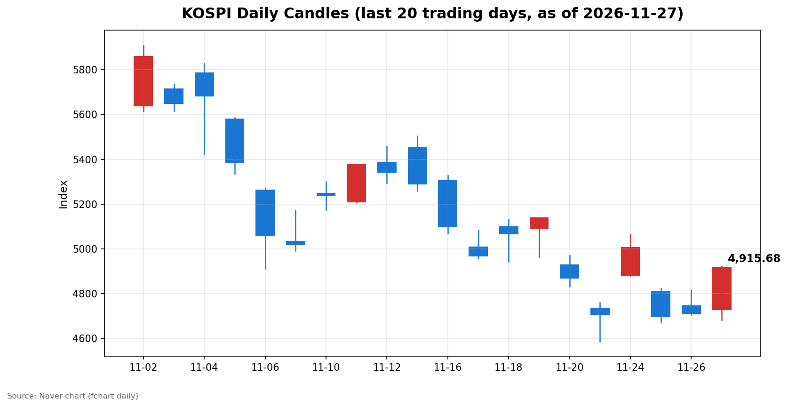
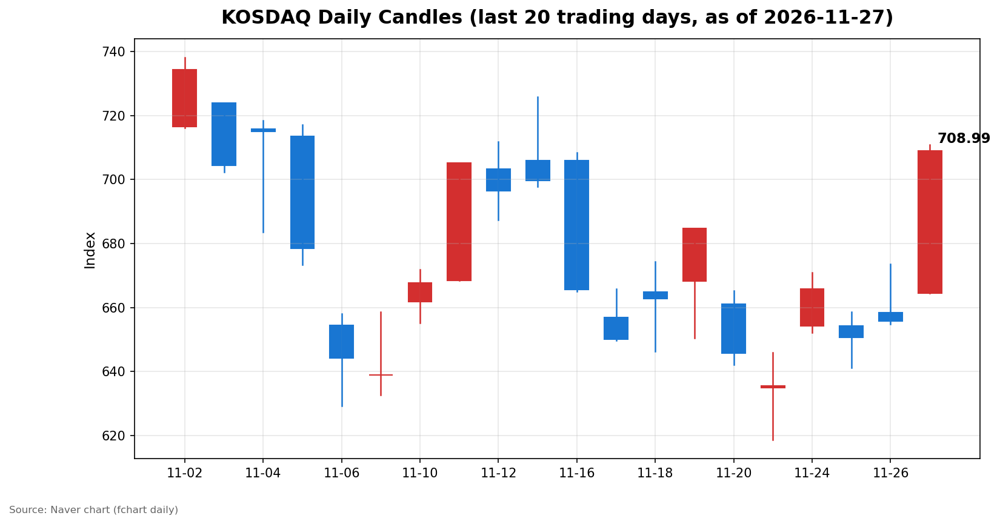

안녕하세요, [한국투자증권](https://securities.koreainvestment.com/main/Main.jsp)에서 [한투-한국투자증권](https://play.google.com/store/apps/details?id=com.truefriend.neosmartarenewal&hl=ko) 개발을 담당하고 있는 way입니다. 
11월 27일 국내 증시 마감 상황을 정리했습니다. 

## 마감 요약

코스피는 4,915.68로 전일 대비 204.47포인트, 4.34% 상승했습니다. 
코스닥은 708.99로 전일 대비 53.28포인트, 8.13% 상승했습니다. 
양 시장이 동반 급반등하며 코스피는 4,900선을, 코스닥은 700선을 회복했습니다. 
코스닥 시장에서는 오전 10시 22분 매수 사이드카가 발동했습니다. 
외국인이 양 시장에서 1조 4천억 원 넘게 순매수하며 반등을 이끌었습니다. 

## 오늘의 마감 스냅샷

2026년 11월 27일 16시 기준, 네이버 실시간 시세 마감 수치입니다. 

| 지수 | 종가 | 전일 대비 | 등락률 | 시가 | 고가 | 저가 | 거래량 | 거래대금 |
| --- | --- | --- | --- | --- | --- | --- | --- | --- |
| 코스피 | 4,915.68 | +204.47 | +4.34% | 4,728.80 | 4,922.94 | 4,682.43 | 175,941천주 | 12조 8,603억 원 |
| 코스닥 | 708.99 | +53.28 | +8.13% | 664.52 | 710.90 | 664.52 | 486,076천주 | 6조 4,232억 원 |

전일 종가는 네이버 실시간 등락률로 역산한 값과 일봉 종가가 일치했습니다. 
코스피 차트는 [네이버 코스피 시세](https://finance.naver.com/sise/sise_index.naver?code=KOSPI), 코스닥 차트는 [네이버 코스닥 시세](https://finance.naver.com/sise/sise_index.naver?code=KOSDAQ)에서 확인할 수 있습니다. 

## 차트

최근 20거래일 일봉 차트입니다. 
빨간 봉은 종가가 시가보다 높은 날, 파란 봉은 종가가 시가보다 낮은 날입니다. 

## 원인·촉매 분석

낙폭 과대 인식이 반등의 출발점이었습니다. 
코스피는 11월 25일 6.16% 급락한 뒤 이틀 만에 강한 되돌림을 보였습니다. 
11월 들어 5% 안팎의 급등락이 반복되는 변동성 국면에서 저가 매수세가 유입됐습니다. 

외국인의 귀환이 반등을 이끌었습니다. 
외국인은 코스피에서 1조 1,317억 원, 코스닥에서 3,029억 원을 순매수했습니다. 
전일 외국인이 코스피에서 841억 원을 순매도했던 점과 대조됩니다. 
개인은 양 시장에서 2조 6,632억 원을 순매도했고, 외국인과 기관이 이 매물을 받아냈습니다. 

삼성전자 배당 지급이 투자 심리를 뒷받침했습니다. 
역대 최대 규모인 30조 원의 배당금이 11월 27일 지급됐습니다. 
개인 투자자가 받는 배당금은 5조 원을 웃돌 것으로 추산됩니다. 
배당금 유입에 대한 기대가 시장 전반의 매수 심리에 보탬이 됐습니다. 

증권시장안정펀드 가동 기대가 정책 수급에 대한 기대를 키웠습니다. 
금융위원회가 11월 30일 5대 금융지주를 긴급 소집한다는 소식이 전해졌습니다. 
10조 원대 증권시장안정펀드 가동 준비 보도가 시장 안정에 대한 기대를 높였습니다. 

해외 변수가 비어 있는 가운데 국내 요인이 장세를 주도했습니다. 
11월 27일은 미국 추수감사절로 뉴욕 증시가 휴장했습니다. 
해외 단서 없이 국내 수급과 정책 기대가 상승을 이끌었습니다. 

한국은행의 금리 인상 재료도 반등을 막지 못했습니다. 
한국은행은 11월 26일 기준금리를 3.00%에서 3.25%로 인상했습니다. 
인상 다음 날 시장이 급반등한 점은 금리 인상 재료가 이미 주가에 반영됐다는 해석을 뒷받침합니다. 

[중앙일보 GMC 허브](https://www.joongang.co.kr/gmc/partner/koreainvestment?user=kinvestapp)에서는 11월 27일자 G브닝이 저녁 발행 예정이라 마감 시점에는 확인되지 않았습니다. 
11월 26일자 G프터눈과 G모닝에서 전한 한은 금리 인상과 AI 거품론 논쟁은 교차 확인되었습니다. 

## 핵심 사건 3가지

### 1. 코스닥 매수 사이드카 발동과 700선 회복

한국거래소는 11월 27일 오전 10시 22분 코스닥 시장에 매수 사이드카를 발동했습니다. 
코스닥150 현물지수가 3% 이상 오르고 코스닥150 선물가격이 6% 이상 오른 상태가 1분 이상 지속되면 발동되는 제도입니다. 
올해 코스닥 사이드카 발동은 이번이 41번째입니다. 
코스닥은 오전 10시 31분 693.60까지 오른 뒤 상승폭을 넓혀 종가 708.99로 700선을 회복했습니다. 
사이드카는 프로그램 매수 호가를 일시 정지시키는 장치라 상승 자체를 막지는 않습니다. 
급반등 국면에서 매수세가 얼마나 강했는지를 보여주는 신호로 읽힙니다. 

### 2. 삼성전자 역대 최대 30조 원 배당 지급

삼성전자는 11월 27일 국내 기업 사상 최대 규모인 30조 원의 배당금을 지급했습니다. 
작년 배당금의 2.7배 수준입니다. 
개인 투자자가 받는 배당금은 세전 5조 원을 웃돌 것으로 추산됩니다. 
이재용 삼성전자 회장의 배당금은 세전 약 4,488억 원입니다. 
삼성전자는 이번 배당에 이어 추가적인 주주환원도 추진한다고 밝혔습니다. 
대규모 배당금 지급은 배당금 재투자 기대와 주주환원 정책에 대한 신뢰를 동시에 자극했습니다. 

### 3. 증권시장안정펀드 가동 기대

금융위원회가 11월 30일 5대 금융지주를 긴급 소집한다는 소식이 전해졌습니다. 
10조 원대 증권시장안정펀드 가동 준비 보도가 이어졌습니다. 
증안펀드는 시장 급락 시 매수 주체로 나서는 정책 수단입니다. 
가동 기대 자체가 하락장에서 매도 심리를 누그러뜨리는 역할을 했습니다. 
다만 펀드 가동 여부와 규모는 아직 확인되지 않았습니다. 
11월 30일 회의 결과가 다음 거래일의 관전 포인트입니다. 

## 섹터·테마 영향 체인

반도체 밸류체인이 반등의 중심이었습니다. 
HBM 테마가 9.98% 올랐고, 반도체재료 9.48%, 유리기판 9.50%, 3D낸드 8.84%가 뒤를 이었습니다. 
AI 반도체 수요 지속 전망과 HBM 패키징 투자 확대 기대가 장비와 소재, 기판으로 확산됐습니다. 
한국투자증권 MTS 요약도 반도체 대형주와 장비주 강세를 마감의 특징으로 꼽았습니다. 

로봇과 바이오 등 후발 테마로 매기가 확산됐습니다. 
로봇 테마는 9.15%, 바이오소재는 9.73%, 바이오인식은 8.63% 올랐습니다. 
반도체 주도주가 오른 뒤 로봇과 바이오, 2차전지 등 후발 테마로 매수세가 번지는 양상입니다. 

전력과 통신 인프라 테마도 강했습니다. 
복합화력발전 테마가 10.26%, ESS 테마가 9.44% 올랐습니다. 
AI 데이터센터 전력 수요 기대가 발전과 에너지 저장 설비 테마로 연결됐습니다. 
5G 테마도 9.82% 오르며 통신과 네트워크 장비 쪽 강세를 보였습니다. 

약했던 쪽은 뚜렷하지 않았습니다. 
상위 테마가 모두 상승했고, 특정 섹터의 일방적인 약세는 확인되지 않았습니다. 
시장 전체의 폭넓은 반등이었다는 점이 이날 장세의 특징입니다. 

## 최근 5거래일 일봉

### 코스피

| 날짜 | 시가 | 고가 | 저가 | 종가 | 등락률 |
| --- | --- | --- | --- | --- | --- |
| 11월 23일 | 4,734.90 | 4,759.88 | 4,586.80 | 4,708.54 | -3.31% |
| 11월 24일 | 4,880.16 | 5,065.74 | 4,880.16 | 5,006.03 | +6.32% |
| 11월 25일 | 4,809.00 | 4,823.36 | 4,672.55 | 4,697.51 | -6.16% |
| 11월 26일 | 4,745.10 | 4,817.77 | 4,704.65 | 4,711.21 | +0.29% |
| 11월 27일 | 4,728.80 | 4,922.94 | 4,682.43 | 4,915.68 | +4.34% |

### 코스닥

| 날짜 | 시가 | 고가 | 저가 | 종가 | 등락률 |
| --- | --- | --- | --- | --- | --- |
| 11월 23일 | 634.93 | 645.93 | 618.74 | 635.45 | -1.58% |
| 11월 24일 | 654.31 | 670.95 | 652.21 | 665.88 | +4.79% |
| 11월 25일 | 654.21 | 658.67 | 641.08 | 650.64 | -2.29% |
| 11월 26일 | 658.46 | 673.57 | 654.80 | 655.71 | +0.78% |
| 11월 27일 | 664.52 | 710.90 | 664.52 | 708.99 | +8.13% |

## 당일 수급

네이버 시장동향 API 기준, KRX 시장 수치입니다. 

| 시장 | 개인 | 외국인 | 기관 | 기타법인 |
| --- | --- | --- | --- | --- |
| 코스피 | -1조 7,788억 원 | +1조 1,317억 원 | +2,365억 원 | +4,106억 원 |
| 코스닥 | -8,844억 원 | +3,029억 원 | +5,868억 원 | -53억 원 |

외국인이 양 시장에서 1조 4,346억 원을 순매수했습니다. 
개인은 양 시장에서 2조 6,632억 원을 순매도했습니다. 
급락장에서 개인이 던진 매물을 외국인과 기관이 받아낸 구도입니다. 

기관은 코스닥에서 5,868억 원으로 코스피 2,365억 원보다 크게 순매수했습니다. 
중소형주 반등에 기관 매수가 가세한 모습입니다. 
코스피 기관 세부에서는 금융투자가 5,459억 원을 순매도했고, 연기금이 2,883억 원, 투신이 2,537억 원을 순매수했습니다. 
코스닥 기관 세부에서는 금융투자가 4,171억 원을 순매수하며 기관 매수를 이끌었습니다. 

전일과 비교하면 외국인 태도가 하루 만에 바뀌었습니다. 
11월 26일 외국인은 코스피에서 841억 원을 순매도했습니다. 
11월 27일 외국인은 코스피에서 1조 1,317억 원을 순매수했습니다. 
외국인 순매수가 이어지는지가 다음 거래일의 첫 번째 확인 사항입니다. 

## 강했던 테마와 흐름

한국투자증권 MTS 기준, 당일 상승률 상위 테마입니다. 

| 테마 | 등락률 |
| --- | --- |
| 복합화력발전 | +10.26% |
| HBM | +9.98% |
| 5G | +9.82% |
| 바이오소재 | +9.73% |
| 유리기판 | +9.50% |
| 반도체재료 | +9.48% |
| ESS | +9.44% |
| 로봇 | +9.15% |
| 3D낸드 | +8.84% |
| 바이오인식 | +8.63% |

상위 10개 테마가 모두 8% 넘게 올랐습니다. 
각 테마 안에서 상승 종목이 전 종목을 차지하는 경우도 많았습니다. 
반도체가 주도하고 로봇과 바이오, 전력 인프라로 확산되는 흐름이 하루 종일 유지됐습니다. 

## 단기·중기 전망과 다음 거래일에 확인할 시나리오

하루 급반등만으로 추세 전환을 단정하기는 어렵습니다. 
11월 들어 코스피는 5% 안팎의 급등락을 반복했고, 사이드카와 서킷브레이커가 수차례 발동했습니다. 
변동성 국면이 이어지고 있다는 점은 염두에 둘 필요가 있습니다. 

흐름이 이어지는 시나리오에서는 외국인 순매수 지속이 관건입니다. 
외국인 매수가 이어지고 코스피가 5,000선을 회복하면 반등 흐름이 이어질 수 있습니다. 
반대로 증안펀드 기대가 실망으로 바뀌거나 미국 증시가 휴장 이후 약세로 돌아서면 반등 폭을 되돌릴 수 있습니다. 

다음 거래일인 11월 30일 월요일에 확인할 사항은 다음과 같습니다. 
첫째, 코스피 5,000선 안착 여부와 당일 고가 4,922.94 상회 여부입니다. 
둘째, 외국인 순매수가 이어지는지 여부입니다. 
셋째, 11월 30일 금융위원회 5대 금융지주 회의에서 증안펀드 관련 소식이 나오는지 여부입니다. 
넷째, 추수감사절 이후 미국 증시 흐름입니다. 

가격 레벨로는 코스피 저항이 11월 24일 고가 5,065.74 부근, 지지가 4,700선 부근입니다. 
코스닥은 당일 고가 710.90 상회 여부와 700선 안착 여부가 관건이며, 지지는 665선 부근입니다. 

중기적으로는 AI 거품론 논쟁이 해소되지 않은 만큼 변동성이 이어질 수 있습니다. 
젠슨 황 엔비디아 CEO 복귀에도 AI 투자 수익성에 대한 의문은 남아 있습니다. 
황 CEO는 12월 1일 하원 관련 위원회 비공개 만남과 12월 3일 상원 은행위원회 청문회 증언을 앞두고 있습니다. 
섹터별로는 반도체 밸류체인의 강세가 이어지는지, 후발 테마 확산이 지속되는지를 확인할 필요가 있습니다. 

## 마치며

11월 27일 국내 증시는 외국인 매수세와 정책 기대 속에 양 시장이 동반 급반등하며 마감했습니다. 
다음 거래일에는 외국인 수급 지속 여부와 증안펀드 관련 소식을 확인하며 변동성에 유의할 필요가 있습니다. 
이 글은 시장 해설을 위한 교육 목적의 정리이며, 특정 종목의 매수나 매도를 권유하지 않습니다. 

수급 수치는 네이버 시장동향 API 기준이며, 테마 등락률은 한국투자증권 MTS 기준입니다. 
