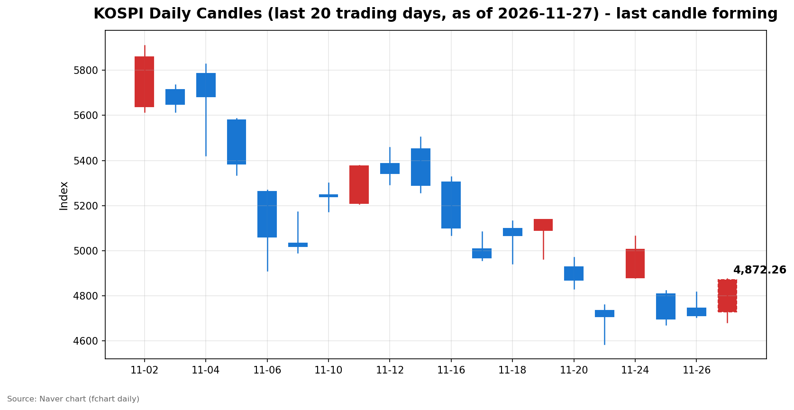
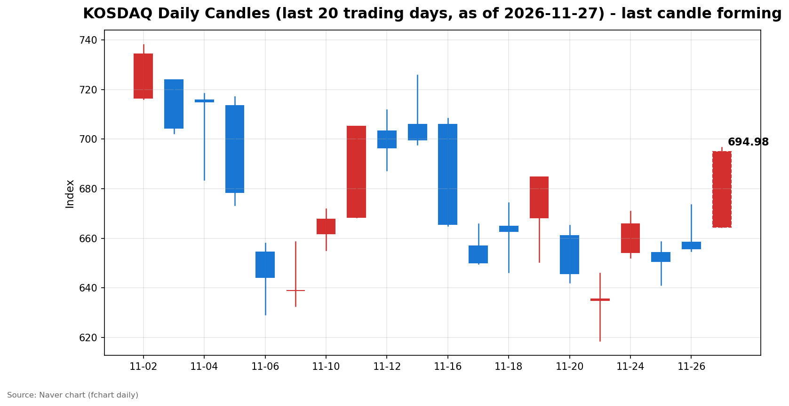

안녕하세요, [한국투자증권](https://securities.koreainvestment.com/main/Main.jsp)에서 [한투-한국투자증권](https://play.google.com/store/apps/details?id=com.truefriend.neosmartarenewal&hl=ko) 개발을 담당하고 있는 way입니다. 
오늘 국내 증시는 증안펀드 가동 기대감에 코스피와 코스닥이 동반 급등했습니다. 

## 오전장 요약

코스피는 낮 12시 27분 기준 4,869.91로 전일 대비 3.37% 올랐습니다. 
코스닥은 같은 시각 695.17로 전일 대비 6.02% 급등했습니다. 
코스피는 시가 4,728.80으로 출발한 뒤 장중 4,682.43까지 밀렸다가 4,875.24까지 반등했습니다. 
코스닥은 시가 664.52가 곧 장중 저가였고, 장중 내내 상승 흐름을 이어갔습니다. 
코스닥 급등으로 한국거래소는 오전 10시 22분 21초에 매수 사이드카를 발동했습니다. 
올해 들어 23번째 매수 사이드카 발동입니다. 
중앙일보 GMC 허브에서는 오늘자 G프터눈 브리핑이 아직 게시되지 않았습니다. 
오늘자 GMC 리포트는 AI 확산 속 소프트웨어 기업의 실적을 다룬 워크데이 분석 1건이 확인됐습니다. 
전날 G프터눈은 미국 추수감사절 휴장과 한국은행 기준금리 인상 등을 다뤘습니다. 

## 오늘의 스냅샷

| 지수 | 현재가 | 전일 대비 | 등락률 | 시가 | 고가 | 저가 | 거래량 | 거래대금 |
|---|---|---|---|---|---|---|---|---|
| 코스피 | 4,869.91 | +158.70 | +3.37% | 4,728.80 | 4,875.24 | 4,682.43 | 103,024천 주 | 7조 1,619억 원 |
| 코스닥 | 695.17 | +39.46 | +6.02% | 664.52 | 696.58 | 664.52 | 323,510천 주 | 4조 2,111억 원 |

스냅샷 기준 시각은 2026년 11월 27일 낮 12시 27분(KST)입니다. 
전일 종가는 코스피 4,711.21, 코스닥 655.71입니다. 
전일 종가는 네이버 실시간 등락률로 역산한 값과 일봉 종가가 일치해 확인됐습니다. 
원·달러 환율은 1,343.90원으로 오전 1,345.30원보다 1.40원 내렸습니다. 
코스피는 [네이버 코스피 차트](https://finance.naver.com/sise/sise_index.naver?code=KOSPI), 코스닥은 [네이버 코스닥 차트](https://finance.naver.com/sise/sise_index.naver?code=KOSDAQ)에서 확인할 수 있습니다. 
당일 봉은 형성 중인 봉으로, 마감 전에는 계속 변합니다. 

## 차트

최근 20거래일 일봉 차트입니다. 
빨간 봉은 종가가 시가보다 높은 날, 파란 봉은 종가가 시가보다 낮은 날입니다. 
당일 봉은 형성 중인 봉으로, 마감 전에는 계속 변합니다. 

## 원인·촉매 분석

오늘 오전 반등의 중심에는 증안펀드 가동 기대감이 있습니다. 
정부가 11월 22일 발표한 시장안정조치의 이행 상황을 점검하면서, 증권시장안정펀드 가동 가능성이 부각됐습니다. 
정책 기대가 커지자 오전 보도 기준 외국인과 기관이 양 시장에서 매수에 나선 것으로 전해졌습니다. 
다만 장중 수급 확정치는 아직 확인되지 않아, 정확한 매매 규모는 확인이 필요합니다. 
전일 수급을 보면 기관이 저가 매수에 나서며 지수 하방을 받친 흐름이 확인됩니다. 
11월 26일 코스피에서 기관은 7,529억 원을 순매수했고, 금융투자가 6,248억 원으로 그 중심이 됐습니다. 
같은 날 개인은 1조 748억 원을 순매도했고, 외국인은 880억 원을 순매도했습니다. 
코스닥에서도 기관은 2,378억 원을 순매수했고, 외국인은 1,115억 원, 개인은 1,339억 원을 순매도했습니다. 
기관이 개인 매물을 받아내는 구도가 전일부터 이어졌고, 오늘 오전 정책 기대가 더해지며 매수세가 확산된 것으로 해석됩니다. 
금리 쪽에서는 노무라증권이 한국은행의 금리 인상 사이클이 사실상 종료됐다고 진단했습니다. 
최종금리 전망을 3.50%에서 3.25%로 낮췄습니다. 
금리 인상 부담이 완화될 것이라는 기대는 성장주 밸류에이션에 대한 부담을 덜어주는 요인입니다. 
원·달러 환율이 1,343.90원으로 안정된 점도 외국인 수급에는 우호적입니다. 
간밤 미국 증시는 추수감사절로 휴장해 해외 변수는 비어 있었습니다. 
직전 거래일 나스닥 종합지수는 23,585.80으로 0.62% 하락했습니다. 
해외 재료 공백 속에서 국내 정책 기대와 테마 수급이 장 방향을 정한 오전이었습니다. 

## 핵심 사건 3가지

첫째, 증안펀드 가동 기대감과 정부의 시장상황점검회의입니다. 
정부는 11월 27일 이형일 부총리 겸 재정경제부 장관 주재로 관계기관 합동 시장상황점검회의를 열었습니다. 
회의에서는 최근 국내외 금융·외환시장 동향과 11월 22일 발표한 시장안정조치의 이행 상황을 점검했습니다. 
정부는 공매도 과열 등 특이 동향이 없다고 밝혔습니다. 
시장안정조치 이행 점검 소식이 전해지며 증안펀드 가동 기대가 커졌고, 코스닥은 장중 6% 넘게 오르며 매수 사이드카가 발동됐습니다. 
정책 기대가 실제 자금 유입으로 이어질지는 오후 외국인·기관 매매 동향을 확인해야 합니다. 

둘째, 삼성전자의 역대 최대 규모 배당금 지급입니다. 
삼성전자는 11월 27일 주주들에게 약 30조 원의 배당금을 지급했습니다. 
올해 3분기 배당금 총액은 30조 30억 원으로 역대 최대 규모입니다. 
이재용 삼성전자 회장은 이번 배당으로 세전 기준 약 4,488억 원을 받습니다. 
삼성전자는 지난 10월 말 3분기 실적 발표 당시 올해 주주환원 규모를 최대 110조 원으로 제시했습니다. 
대규모 배당은 배당 재투자 기대와 주주환원 확대 기대를 함께 키우는 재료입니다. 
반도체 대형주가 초반 약세에서 강세로 돌아선 흐름과도 맞물렸습니다. 

셋째, 노무라증권의 한국은행 금리 인상 종료 진단입니다. 
노무라는 11월 27일 보고서에서 한국은행의 기준금리 인상 사이클이 사실상 종료됐다고 진단했습니다. 
반도체 호황의 파급 효과가 가계 소비로 이어지는 데 제한적이고, 내년 금융 여건이 긴축되면서 소비와 물가 상승 압력이 약해질 것이라는 판단입니다. 
최종금리 전망은 3.50%에서 3.25%로 낮췄습니다. 
한국은행은 11월 26일 기준금리를 연 3.00%에서 3.25%로 인상한 바 있습니다. 
인상 직후 추가 인상 종료 전망이 나오면서, 시장은 금리보다 성장과 수급에 더 주목하는 모습입니다. 

## 섹터·테마 영향 체인

로봇 테마가 오전 내내 가장 강했습니다. 
삼성전자의 휴머노이드 시장 진출 본격화와 대규모 공급 계약 소식이 전해지며 관련 종목들이 일제히 급등했습니다. 
한투 MTS 12시 시장 브리핑 기준 코스모로보틱스는 상한가를 기록했고, 대성하이텍은 29.90%, 앤로보틱스는 25.42% 올랐습니다. 
HBM과 반도체 장비 테마도 강했습니다. 
마이크론과 TSMC 등 글로벌 반도체 기업들의 AI 설비 투자 확대와 장기 공급 계약 기대감이 관련 장비주 강세를 이끌었습니다. 
피에스케이홀딩스는 13.74%, 한미반도체는 6.97%, SK하이닉스는 4.56% 올랐습니다. 
2차전지 테마는 ESS 입찰 물량 확보와 공급 계약 등 실질적인 수주 성과에 자사주 소각 계획이 더해지며 강세를 보였습니다. 
엔켐은 25.78%, 에코프로비엠은 10.36% 올랐습니다. 
바이오 테마는 글로벌 제약사와의 기술 협력과 임상 성공 소식, 대규모 해외 공급 계약이 이어지며 올랐습니다. 
큐리언트는 상한가를 기록했고, 에이비엘바이오는 21.11%, 리가켐바이오는 17.46% 올랐습니다. 
5G와 6G 통신장비 테마도 미국 5G 인프라 투자 기대와 수주 소식에 올랐습니다. 
케이엠더블유는 16.82% 올랐습니다. 
상법개정과 자사주 테마에서는 미래에셋증권이 12.11% 올랐습니다. 
보안과 양자암호 테마도 AI 보안 수요 확대 기대에 견조했습니다. 
영향의 연결고리는 정책 기대에서 시작됩니다. 
증안펀드 기대가 외국인·기관 매수를 이끌고, 금리 인상 종료 전망이 성장주 밸류에이션 부담을 덜어주면서 고베타 성장 테마로 자금이 동시에 몰렸습니다. 
코스닥이 코스피보다 더 오른 것은 성장주와 소형주 비중이 높은 코스닥이 정책·금리 기대에 더 민감하게 반응했기 때문입니다. 
반도체 대형주가 초반 약세에서 강세로 돌아선 점도 지수 반등의 폭을 키웠습니다. 

## 최근 5거래일 일봉

| 날짜 | 코스피 시가 | 코스피 고가 | 코스피 저가 | 코스피 종가 | 코스피 거래량 |
|---|---|---|---|---|---|
| 11월 20일 | 4,928.51 | 4,971.31 | 4,831.69 | 4,869.96 | 206,729천 주 |
| 11월 23일 | 4,734.90 | 4,759.88 | 4,586.80 | 4,708.54 | 218,577천 주 |
| 11월 24일 | 4,880.16 | 5,065.74 | 4,880.16 | 5,006.03 | 194,134천 주 |
| 11월 25일 | 4,809.00 | 4,823.36 | 4,672.55 | 4,697.51 | 205,391천 주 |
| 11월 26일 | 4,745.10 | 4,817.77 | 4,704.65 | 4,711.21 | 170,996천 주 |

| 날짜 | 코스닥 시가 | 코스닥 고가 | 코스닥 저가 | 코스닥 종가 | 코스닥 거래량 |
|---|---|---|---|---|---|
| 11월 20일 | 660.98 | 665.15 | 642.13 | 645.68 | 421,847천 주 |
| 11월 23일 | 634.93 | 645.93 | 618.74 | 635.45 | 405,856천 주 |
| 11월 24일 | 654.31 | 670.95 | 652.21 | 665.88 | 441,902천 주 |
| 11월 25일 | 654.21 | 658.67 | 641.08 | 650.64 | 441,495천 주 |
| 11월 26일 | 658.46 | 673.57 | 654.80 | 655.71 | 416,816천 주 |

## 오전 강했던 테마와 흐름 변화

한투 MTS 12시 시장 브리핑은 로봇 강세가 이어지는 가운데 HBM 대형주와 2차전지로 매수세가 확산되고 있다고 전했습니다. 
시가 대비 방향 전환 여부를 보면 코스피와 코스닥의 결이 달랐습니다. 
코스피는 시가 4,728.80으로 출발한 뒤 장중 저가 4,682.43까지 밀리며 전일 종가 아래로 내려갔다가 반등했습니다. 
스냅샷 기준 시가 대비 상승률은 2.98%입니다. 
코스닥은 시가가 곧 저가였고, 장중 내내 한 방향으로 올랐습니다. 
스냅샷 기준 시가 대비 상승률은 4.61%입니다. 
반도체 대형주가 초반 약세에서 2% 이상 상승세로 돌아선 점이 코스피의 방향 전환을 이끌었습니다. 
코스닥은 로봇과 2차전지, 바이오 등 성장 테마가 장 초반부터 강세를 이어가며 전환 없이 상승했습니다. 

## 오후 전망과 확인할 시나리오

오전 흐름이 이어지는지, 일시적인 반등에 그치는지를 가르는 기준은 당일 고가 돌파 여부입니다. 
코스피는 당일 고가 4,875.24를 넘는지, 코스닥은 696.58을 넘고 700선에 다가서는지를 확인해야 합니다. 
고가를 넘지 못하고 되돌린다면 정책 기대만으로 오른 만큼 차익 매물이 나올 수 있습니다. 
지지 구간으로는 코스피 4,800선과 코스닥 680선이 우선 확인 대상입니다. 
오후에 확인할 수치는 외국인·기관의 매매 동향입니다. 
장중 수급 확정치는 아직 확인되지 않았고, 마감 후 최종 수급에서 외국인 매수가 이어졌는지를 봐야 합니다. 
원·달러 환율이 1,340원대에서 안정되는지도 확인할 수치입니다. 
미국 증시는 추수감사절 연휴로 11월 27일 밤 11시 30분부터 28일 새벽 3시까지 단축 거래가 예정돼 있습니다. 
해외 변수보다는 증안펀드 관련 추가 언급과 오후 테마별 매수 지속 여부가 오후 장의 변수입니다. 
지수와 섹터 단위에서 흐름을 확인하는 것이 바람직하며, 특정 종목에 대한 매수·매도 판단은 이 글의 범위가 아닙니다. 

## 마치며

오늘 오전 국내 증시는 정책 기대와 금리 부담 완화 기대가 맞물리며 코스피와 코스닥이 동반 급등했습니다. 
오후에는 당일 고가 돌파 여부와 마감 수급을 확인하며 오전 흐름의 지속 여부를 가늠해야 합니다. 
이 글은 시장 해설을 위한 교육 목적의 글이며, 매수·매도 권유가 아닙니다. 
