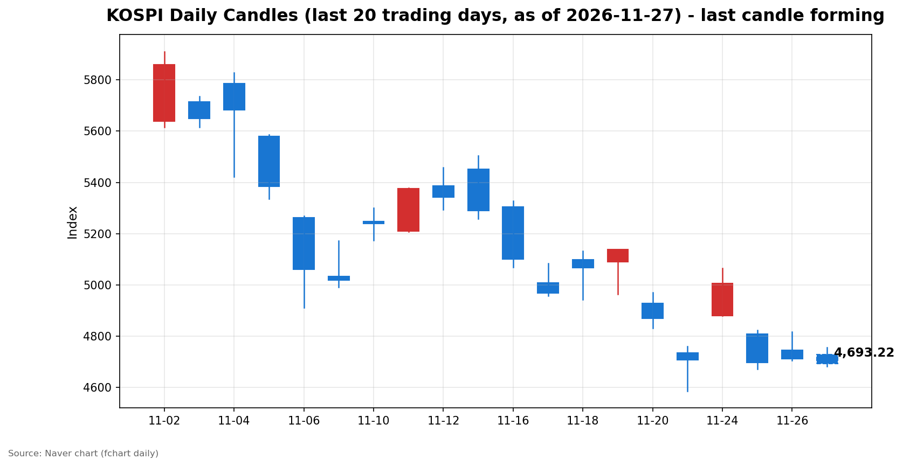
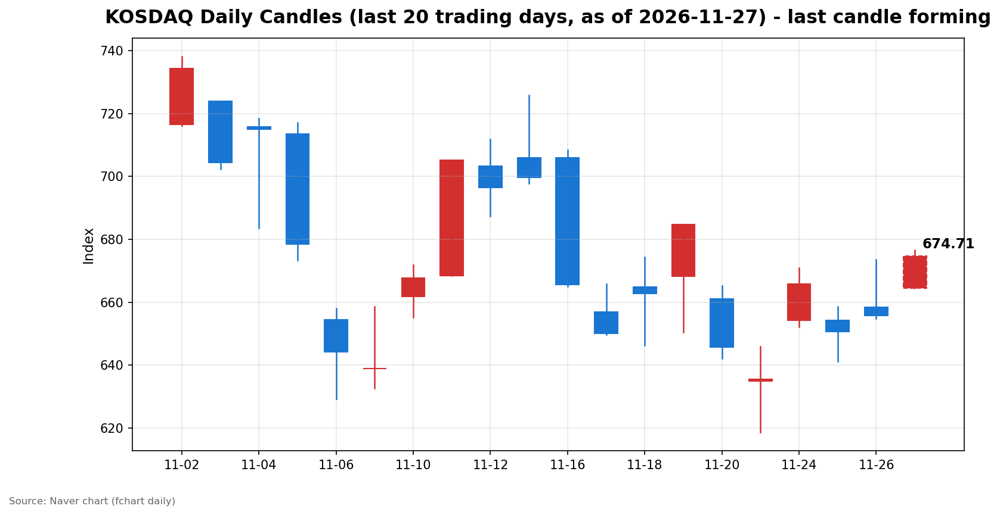

안녕하세요, [한국투자증권](https://securities.koreainvestment.com/main/Main.jsp)에서 [한투-한국투자증권](https://play.google.com/store/apps/details?id=com.truefriend.neosmartarenewal&hl=ko) 개발을 담당하고 있는 way입니다. 
오늘 국내 증시는 코스피 약세와 코스닥 강세가 엇갈리는 출발을 보였습니다. 

## 배경

간밤 미국 증시는 추수감사절로 휴장했습니다. 
직전 거래일인 11월 25일 나스닥 종합지수는 23,585.80으로 0.62% 하락했습니다. 
한투 MTS 해외 지수 기준 S&P500도 같은 날 0.25% 하락했습니다. 
미국발 재료가 비어 있는 가운데 국내 재료와 테마가 장 초반 방향을 정하고 있습니다. 
전일 한국은행은 기준금리를 연 3.00%에서 3.25%로 인상했습니다. 
올해 세 번째 인상이며, 지난 7월과 8월 인상에 이은 결정입니다. 
중앙일보 GMC 허브에서는 오늘자 G모닝 브리핑이 아직 게시되지 않았습니다. 
오늘자 GMC 리포트는 AI 확산 속 소프트웨어 기업의 실적을 다룬 워크데이 분석 1건이 확인됐습니다. 

## 오늘의 스냅샷

| 지수 | 현재가 | 전일 대비 | 등락률 | 시가 | 고가 | 저가 | 거래량 | 거래대금 |
|---|---|---|---|---|---|---|---|---|
| 코스피 | 4,693.22 | -17.99 | -0.38% | 4,728.80 | 4,755.67 | 4,683.44 | 23,591천 주 | 1조 5,958억 원 |
| 코스닥 | 674.71 | +19.00 | +2.90% | 664.52 | 676.63 | 664.52 | 100,964천 주 | 1조 2,710억 원 |

스냅샷 기준 시각은 2026년 11월 27일 오전 9시 28분(KST)입니다. 
전일 종가는 코스피 4,711.21, 코스닥 655.71입니다. 
원·달러 환율은 1,345.30원으로 전일 대비 1.40원 올랐습니다. 
코스피는 [네이버 코스피 차트](https://finance.naver.com/sise/sise_index.naver?code=KOSPI), 코스닥은 [네이버 코스닥 차트](https://finance.naver.com/sise/sise_index.naver?code=KOSDAQ)에서 확인할 수 있습니다. 

## 차트

최근 20거래일 일봉 차트입니다. 
빨간 봉은 종가가 시가보다 높은 날, 파란 봉은 종가가 시가보다 낮은 날입니다. 
당일 봉은 형성 중인 봉으로, 마감 전에는 계속 변합니다. 

## 원인·촉매 분석

코스피 약세의 중심에는 반도체 대형주에 집중된 외국인 매도 압력이 있습니다. 
외국인은 11월 들어 지난 26일까지 반도체 대형주를 중심으로 11조 원 넘게 순매도했습니다. 
삼성전자와 SK하이닉스 두 종목의 코스피 시가총액 비중이 47.7%에 달합니다. 
이 때문에 외국인 매도 압력의 향방이 곧 지수 방향을 좌우하는 구조입니다. 
다만 11월 26일 외국인은 SK하이닉스를 3,141억 원 순매수했습니다. 
11거래일 만에 순매수로 돌아선 것으로, 매도 압력의 변곡점인지 확인할 필요가 있습니다. 
전일 기관은 코스피를 7,529억 원 순매수하며 외국인 매도를 받았습니다. 
금융투자가 6,248억 원을 순매수해 기관 매수의 중심이 됐습니다. 
개인은 같은 날 1조 748억 원을 순매도했습니다. 
한국은행의 기준금리 인상은 장 초반에 직접적인 충격으로 작용하지 않았습니다. 
인상 자체는 예상된 범위였고, 시장은 추가 인상 속도가 조절될 것이라는 신호에 더 주목하는 모습입니다. 
원·달러 환율이 1,345.30원으로 0.10% 오른 점도 외국인 수급에는 우호적이지 않습니다. 
코스닥 강세는 금리보다 테마와 성장주 수급이 주도하고 있습니다. 
보안·로봇·바이오 등 성장 테마로 자금이 모이며 지수 간 온도 차가 벌어졌습니다. 

## 핵심 사건 3가지

첫째, 한국은행이 기준금리를 3.25%로 인상했습니다. 
전일 열린 올해 마지막 금융통화위원회에서 연 3.00%에서 0.25%포인트 올렸습니다. 
지난 7월과 8월에 이은 올해 세 번째 인상입니다. 
흥국증권은 추가 인상 시기가 상당 기간 늦춰질 수 있다고 분석했습니다. 
내년 1분기 관망 뒤 2분기 추가 인상, 내년 말 최종 금리 3.50% 수준을 전망했습니다. 
금리 인상에도 전일 양 지수가 반등한 점은 시장이 인상보다 향후 속도 조절에 무게를 두고 있음을 보여줍니다. 

둘째, 미국 증시가 추수감사절로 휴장했습니다. 
간밤 뉴욕증시는 열리지 않았고, 직전 거래일 나스닥은 0.62% 하락했습니다. 
미국발 재료 공백은 국내 증시의 자체 재료와 테마에 대한 민감도를 높입니다. 
오늘 국내 장은 미국 선물 움직임보다 전일 수급과 테마 흐름이 더 큰 변수입니다. 

셋째, 통상 불확실성이 이어지며 반도체 투자세액공제 연장이 요청됐습니다. 
대한상공회의소를 중심으로 경제계가 미국 반도체 시설 투자세액공제 연장을 정부에 요청했습니다. 
미국 중간선거 이후에도 보호무역 기조가 이어지고 무역법 301조에 따른 추가 통상조치 가능성이 거론됩니다. 
반도체 업계의 미국 투자 비용 부담이 커질 수 있다는 우려가 외국인 매도의 배경 중 하나입니다. 
다만 외국인 매도가 11월 내내 이어진 만큼, 공제 연장 논의가 진전되면 수급 심리가 바뀔 여지도 있습니다. 

## 섹터·테마 영향 체인

보안 테마가 장 초반 가장 강합니다. 
한투 MTS 테마 기준 보안은 5.86% 올랐습니다. 
글로벌 해킹 사고와 AI 보안 위협 확산으로 사이버 보안 수요가 커질 것이라는 전망이 배경입니다. 
라온시큐어는 25.77%, 안랩은 13.01% 올랐습니다. 
보안 수요 확대는 단기 이슈를 넘어 AI 시대의 구조적 투자 테마로 연결됩니다. 
로봇 테마도 4.67% 오르며 휴머노이드 강세 흐름이 이어졌습니다. 
5G 테마는 4.45%, 우주 테마는 4.10% 올랐습니다. 
비만치료제 테마는 5.04%, 면역항암제 테마는 3.94% 올랐습니다. 
바이오 테마 강세는 코스닥 상승률 우위를 뒷받침했습니다. 
블록체인 테마는 5.31% 올랐습니다. 
반면 반도체 대형주는 통상 불확실성과 외국인 매도 압력에 눌려 있습니다. 
금리 인상은 성장주 밸류에이션에 부담 요인입니다. 
그러나 오늘 코스닥이 강세를 보이는 점은 금리보다 테마별 재료가 우위에 있음을 보여줍니다. 

## 최근 5거래일 일봉

| 날짜 | 시가 | 고가 | 저가 | 종가 | 거래량 |
|---|---|---|---|---|---|
| 11월 20일 | 4,928.51 | 4,971.31 | 4,831.69 | 4,869.96 | 206,729천 주 |
| 11월 23일 | 4,734.90 | 4,759.88 | 4,586.80 | 4,708.54 | 218,577천 주 |
| 11월 24일 | 4,880.16 | 5,065.74 | 4,880.16 | 5,006.03 | 194,134천 주 |
| 11월 25일 | 4,809.00 | 4,823.36 | 4,672.55 | 4,697.51 | 205,391천 주 |
| 11월 26일 | 4,745.10 | 4,817.77 | 4,704.65 | 4,711.21 | 170,996천 주 |
| 11월 27일(형성 중) | 4,728.80 | 4,755.67 | 4,683.44 | 4,693.22 | 23,591천 주 |

위 표는 코스피 기준입니다. 
코스닥은 11월 20일 645.68에서 11월 26일 655.71로 5거래일간 1.55% 올랐습니다. 
코스피는 같은 기간 4,869.96에서 4,711.21로 3.26% 내렸습니다. 
당일 봉은 형성 중인 봉으로, 마감 전에는 계속 변합니다. 

## 전일 수급

11월 26일 코스피 수급은 기관이 외국인 매도를 받아낸 구도였습니다. 
외국인은 880억 원을 순매도했습니다. 
개인은 1조 748억 원을 순매도했습니다. 
기관은 7,529억 원을 순매수했습니다. 
기타법인은 4,098억 원을 순매수했습니다. 
외국인과 개인이 함께 판 물량을 기관과 기타법인이 받았다는 점이 특징입니다. 
기관 매수의 중심은 금융투자였고, 연기금은 220억 원을 순매도했습니다. 
코스닥에서는 외국인이 111억 원, 개인이 1,339억 원을 순매도했습니다. 
기관은 2,378억 원을 순매수하며 코스닥 반등을 뒷받침했습니다. 
전일 양 지수가 반등한 배경에는 기관의 저가 매수세가 자리하고 있습니다. 
다만 외국인의 반도체 매도가 완전히 멈췄다고 보기는 이릅니다. 
SK하이닉스 순매수 전환이 하루짜리인지 이어지는지가 관건입니다. 

## 단기·중기 전망과 확인할 시나리오

단기적으로는 코스피와 코스닥의 온도 차가 이어질 가능성이 있습니다. 
코스피는 반도체 대형주 수급에, 코스닥은 테마별 재료에 방향이 좌우됩니다. 
코스피가 4,700선을 지키는지, 11월 26일 고가 4,817.77을 회복하는지가 첫 관문입니다. 
아래로는 11월 23일 저가 4,586.80이 지지 구간으로 확인됩니다. 
위로는 11월 24일 고가 5,065.74과 5,000선이 저항 구간입니다. 
코스닥은 오늘 고가 676.63으로 전일 고가 673.57을 넘어섰습니다. 
680선 안착 여부와 테마별 순환 강도가 다음 확인할 수치입니다. 
중기적으로는 한은의 추가 인상 시기와 미국의 통상 정책이 핵심 변수입니다. 
흥국증권 전망대로 추가 인상이 늦춰지면 금리 부담은 점차 완화될 수 있습니다. 
반대로 무역법 301조 등 통상 조치가 현실화하면 반도체 수급 부담이 커질 수 있습니다. 
외국인 반도체 매도 둔화, 원·달러 환율 안정, 미국 증시 재개 후 흐름을 함께 확인할 필요가 있습니다. 
본 글은 교육·해설 목적이며, 특정 종목의 매수·매도를 권유하지 않습니다. 

## 장 초반 확인할 점

외국인의 반도체 대형주 매매 방향을 확인할 필요가 있습니다. 
SK하이닉스 순매수 전환이 이어지는지 주목합니다. 
기관의 순매수 강도가 전일 수준을 유지하는지도 확인합니다. 
보안·로봇·바이오 테마의 강세가 오후까지 이어지는지 살펴봅니다. 
원·달러 환율이 1,345원대에서 더 오르는지도 확인합니다. 
미국 증시 휴장 공백이 길어지지 않으므로, 재개 후 나스닥 흐름도 함께 봅니다. 

## 마치며

오늘 국내 증시는 코스피 약세와 코스닥 강세가 엇갈리는 출발을 보였습니다. 
금리 인상 이후 첫 거래일인 만큼 수급과 테마의 방향을 차분히 확인할 필요가 있습니다. 
본 글은 교육·해설 목적이며, 특정 종목의 매수·매도를 권유하지 않습니다. 
