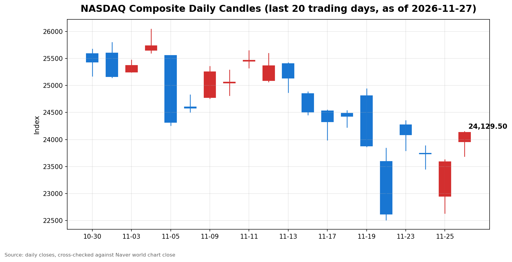

안녕하세요, [한국투자증권](https://securities.koreainvestment.com/main/Main.jsp)에서 [한투-한국투자증권](https://play.google.com/store/apps/details?id=com.truefriend.neosmartarenewal&hl=ko) 개발을 담당하고 있는 way입니다. 
추수감사절 연휴 다음 날인 11월 27일 나스닥은 AI·기술주 저가 매수세에 힘입어 2.31% 급등 마감했습니다. 

## 마감 요약

나스닥 종합지수는 24,129.50으로 전일 대비 543.70포인트, 2.31% 올랐습니다. 
S&P500은 1.60%, 다우는 1.18% 올라 3대 지수가 동반 상승했습니다. 
이날은 블랙프라이데이로 미국 동부시간 오후 1시에 조기 마감하는 반쪽짜리 장이었고, 거래량은 평소보다 한산했습니다. 
주간으로는 나스닥이 6.7%, 다우가 5.5%, S&P500이 5.6% 올라 극심한 변동성을 보인 한 주를 상승으로 마무리했습니다. 
반도체가 상승을 주도했고, 대장주 엔비디아는 중국 관련 악재로 약세를 보여 지수와 엇갈린 흐름을 나타냈습니다. 
이번 반등은 낙폭 과대에 대한 반발 매수 성격이 강하고, AI 투자 수익성에 대한 논란은 아직 해소되지 않았습니다. 

## 오늘의 마감 스냅샷

| 지수 | 종가 | 전일 대비 | 등락률 | 전일 종가 | 시가 | 당일 고가 | 당일 저가 |
| --- | --- | --- | --- | --- | --- | --- | --- |
| 나스닥 종합 | 24,129.50 | +543.70 | +2.31% | 23,585.80 | 23,958.46 | 24,149.09 | 23,690.60 |
| S&P500 | 7,297.49 | +114.71 | +1.60% | 7,182.78 | 7,262.61 | 7,304.10 | 7,211.46 |
| 다우존스 | 50,774.94 | +591.99 | +1.18% | 50,182.95 | 50,458.86 | 50,830.19 | 50,398.29 |

스냅샷은 [네이버 월드 차트](https://finance.naver.com/world/sise.naver?symbol=NAS@IXIC) 폴링 데이터와 야후 파이낸스 일봉 데이터를 교차 확인한 값입니다. 
[네이버 월드 차트(나스닥 종합)](https://stock.naver.com/worldstock/index/.IXIC/price)에서도 같은 종가를 확인할 수 있습니다. 
한투 MTS 해외 대시보드는 마감 직후 지연된 값을 보여 스냅샷에는 쓰지 않았습니다. 
전일 종가는 종가에서 전일 대비를 뺀 값과 일치합니다. 

## 차트

최근 20거래일 일봉 차트입니다. 
빨간 봉은 종가가 시가보다 높은 날, 파란 봉은 종가가 시가보다 낮은 날입니다. 

## 원인·촉매 분석

가장 직접적인 촉매는 AI·기술주에 대한 저가 매수세였습니다. 
지난주 급락으로 낙폭이 컸던 성장주와 반도체주를 중심으로 반발 매수가 유입됐고, 반도체지수는 4.7% 올랐습니다. 
연휴 특수성도 작용했습니다. 
조기 마감에 거래량이 줄면서 매도세가 잦아들었고, 적은 매수에도 지수가 탄력적으로 올랐습니다. 
금리 환경은 우호적이지 않았습니다. 
보도에 따르면 미 10년물 금리는 4.93%로 올랐습니다. 
통상 금리 상승은 성장주 밸류에이션에 부담이지만, 이날은 낙폭과 수급 요인이 금리보다 우세했습니다. 
TD증권 전략가는 국채금리 재상승의 배경으로 위험자산 투자심리 개선에 따른 안전자산 수요 감소를 지목했습니다. 
글로벌 증시의 동반 반등도 심리를 뒷받침했습니다. 
국내 코스피는 4.34% 오른 4,915.68, 코스닥은 8.13% 급등한 708.99로 마감했고, 상하이와 닛케이도 각각 3.73%, 2.11% 올랐습니다. 
국내에서는 외국인 순매수와 증권시장안정펀드 확대 기대가 반등에 작용했습니다. 
이번 주 흐름을 되짚으면 반등의 성격이 더 분명해집니다. 
11월 23일에는 젠슨 황 엔비디아 최고경영자 복귀 소식에 엔비디아가 31% 폭등하며 나스닥이 6.51% 급등했습니다. 
그러나 11월 24일과 25일에는 AI 투자 수익성에 대한 우려가 다시 부각되며 되돌림이 나타났습니다. 
11월 27일 반등은 이 되돌림 이후 낙폭을 되돌리는 반발 매수에 가깝습니다. 

## 핵심 사건 3가지

첫째, AI·기술주 저가 매수와 반도체 강세입니다. 
보도에 따르면 마이크론과 마벨은 7%대 상승했고, 반도체지수 상승률은 4.7%에 달했습니다. 
AI 투자 과열과 수익성에 대한 의구심이 여전하다는 지적도 함께 나왔습니다. 
단기 투자자금이 레버리지를 축소하며 기술주에서 빠져나간 규모가 컸던 만큼, 이 자금이 다시 매수에 나설 경우 다음 주에도 반등이 이어질 수 있다는 전망이 있습니다. 
다만 이는 시장 참여자의 전망일 뿐, 지속 여부는 확인이 필요합니다. 

둘째, 엔비디아의 엇갈린 흐름입니다. 
엔비디아는 장 초반 강세로 출발했으나 블랙웰의 중국 유입 의혹 보도가 나온 뒤 약세로 돌아서 3%대 하락 마감했습니다. 
지수가 2% 넘게 오르는 날 대장주가 나홀로 약세를 보인 셈입니다. 
AI 규제와 중국 리스크가 여전히 시장의 발목을 잡고 있음을 보여주는 대목입니다. 
프리마켓에서는 5% 안팎의 강세를 보였던 만큼, 장중 악재 보도에 따른 방향 전환으로 해석됩니다. 

셋째, 주간 변동성의 마무리와 AI 수익화 논쟁입니다. 
주간 상승률은 다우 5.5%, S&P500 5.6%, 나스닥 6.7%였습니다. 
다우는 2022년 10월 이후, S&P500은 2025년 4월 이후, 나스닥은 2026년 4월 이후 가장 큰 주간 상승률을 기록했습니다. 
한편 중앙일보 GMC 리포트는 AI 수익화의 다른 면을 제시했습니다. 
워크데이의 에이전틱 AI 연간 반복 매출은 전년 대비 130% 늘어난 7억5,000만 달러를 돌파했습니다. 
막대한 AI 설비투자의 수익성을 의심하는 시각과 실제 AI 매출이 나는 기업의 간극이 이번 주 극심한 변동성의 본질로 보입니다. 

## 지수·섹터 영향 체인

상승폭은 나스닥 2.31%, S&P500 1.60%, 다우 1.18% 순이었습니다. 
기술·성장주 비중이 클수록 상승폭이 컸고, 낙폭이 컸던 쪽의 반발이 컸다는 의미입니다. 
기술과 반도체가 상승을 주도했고, 전통 산업과 가치주 비중이 높은 다우는 상대적으로 덜 올랐습니다. 
금리에서 성장주 밸류에이션으로 이어지는 연결고리는 이날 역방향으로 작용했습니다. 
10년물 금리가 올랐음에도 성장주가 강세를 보였고, 이는 금리 경로보다 낙폭과 수급 요인이 우세했음을 시사합니다. 
다만 금리 상승이 이어지면 성장주 밸류에이션 부담은 다시 커질 수 있습니다. 
AI 밸류체인 안에서도 선별이 나타났습니다. 
반도체와 AI 인프라 관련주가 강세를 보인 반면, 중국 매출 노출이 부각된 엔비디아는 약세를 보였습니다. 
AI 지출의 수혜와 규제 리스크가 같은 밸류체인 안에서 엇갈린 셈입니다. 
국내외 증시의 동반 반등은 위험자산 전반의 심리 개선을 보여줍니다. 
국내 증시는 외국인 순매수와 증권시장안정펀드 기대 속에 코스피와 코스닥이 동반 급등했습니다. 
이날 유가와 달러 움직임은 스냅샷에 포함되지 않았으며 확인이 필요합니다. 

## 다우·S&P500 마감 흐름

다우는 50,774.94로 591.99포인트, 1.18% 올랐습니다. 
S&P500은 7,297.49로 114.71포인트, 1.60% 올랐습니다. 
주간 기준으로 다우는 5.5% 올라 2022년 10월 이후 가장 큰 주간 상승률을 기록했습니다. 
S&P500은 주간 5.6% 올라 2025년 4월 이후 최고의 한 주를 보냈습니다. 
기술주 비중이 낮은 다우도 1%대 상승한 점은 반등이 기술주에만 국한되지 않았음을 보여줍니다. 
다만 주간 상승률의 절대 규모가 큰 만큼, 낙폭 만회의 성격도 함께 고려해야 합니다. 

## 단기·중기 전망과 다음 거래일 확인할 시나리오

반등 지속 시나리오에서는 당일 고가 24,149.09를 넘어서는지가 첫 관문입니다. 
이어 11월 23일 장중 고가인 24,353.65 회복 여부도 확인할 필요가 있습니다. 
단기 자금의 재진입이 이어지고 AI 수익성 우려가 완화되면 반등이 이어질 수 있습니다. 
일시적 노이즈 시나리오에서는 얇은 거래 속 반등이라는 점을 주목해야 합니다. 
다음 주 정상 거래량에서 매수세가 이어지는지 확인이 필요하고, 엔비디아 약세와 AI 수익성 논란이 지속되면 되돌림이 나타날 수 있습니다. 
지지 구간으로는 당일 저가 23,690.60과 전일 종가 23,585.80을 확인할 수 있습니다. 
다음 거래일에는 고용지표 발표와 12월 FOMC를 앞둔 경계감이 변수입니다. 
중기적으로는 AI 수익화 논쟁이 이어질 것으로 보입니다. 
실제 AI 매출이 늘어나는 기업과 설비투자 부담이 큰 기업의 선별이 진행될 가능성이 있습니다. 
이 글은 지수와 섹터 단위의 흐름을 해설한 것이며, 특정 종목의 매수나 매도를 권유하지 않습니다. 

## 마치며

11월 27일 나스닥은 낙폭 과대에 대한 반발 매수로 급등 마감했습니다. 
다만 AI 수익성 논란과 금리 상승 부담이 남아 있어, 반등의 지속 여부는 다음 주 정상 거래에서의 매수세와 고용지표, 12월 FOMC를 확인하며 판단할 필요가 있습니다. 
