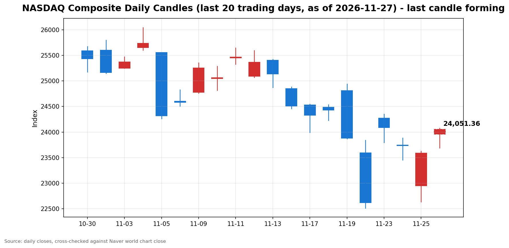

안녕하세요, [한국투자증권](https://securities.koreainvestment.com/main/Main.jsp)에서 [한투-한국투자증권](https://play.google.com/store/apps/details?id=com.truefriend.neosmartarenewal&hl=ko) 개발을 담당하고 있는 way입니다. 
나스닥이 추수감사절 휴장 뒤 첫 거래에서 장중 2.08% 반등했습니다. 

## 장중 요약

나스닥 종합지수는 미국 동부시간 12시 58분 기준 24,075.51로 전일 대비 489.71포인트, 2.08% 올랐습니다. 
개장 직후 1.58% 상승 출발한 뒤 초반 되돌림을 거쳤고, 다시 고점을 높이며 강세를 이어갔습니다. 
장중 저가는 23,690.60으로 전일 종가 23,585.80을 밑돌지 않았습니다. 
11월 27일은 블랙프라이데이 단축 거래일로 미국 동부시간 오후 1시에 조기 마감됩니다. 
스냅샷 시점은 마감 2분 전이라 사실상 마감 부근 흐름을 보여줍니다. 

## 오늘의 스냅샷

| 지수 | 현재가 | 전일 대비 | 등락률 | 전일 종가 | 시가 | 장중 고가 | 장중 저가 |
| --- | --- | --- | --- | --- | --- | --- | --- |
| [나스닥 종합](https://stock.naver.com/worldstock/index/.IXIC/price) | 24,075.51 | +489.71 | +2.08% | 23,585.80 | 23,958.46 | 24,077.49 | 23,690.60 |
| S&P500 | 7,283.08 | +100.30 | +1.40% | 7,182.78 | 확인 필요 | 7,292.01 | 7,217.90 |
| 다우존스30 | 개장 50,458.86 | 개장 +275.90 | 개장 +0.55% | 확인 필요 | 확인 필요 | 확인 필요 | 확인 필요 |

스냅샷 기준 시각은 미국 동부시간 2026년 11월 27일 12시 58분, 한국시간 2026년 11월 28일 02시 58분입니다. 
나스닥 수치는 [네이버 월드 차트](https://finance.naver.com/world/sise.naver?symbol=NAS@IXIC)와 [Npay 증권 나스닥 종합 페이지](https://stock.naver.com/worldstock/index/.IXIC/price)에서 확인했습니다. 
S&P500 수치는 한국투자증권 MTS 해외 대시보드 교차값입니다. 
다우존스30 수치는 개장 시점 보도 기준이며, 장중 현재가는 이번 스냅샷에서 확인되지 않아 확인 필요로 표기합니다. 
나스닥 거래량은 네이버 표기 기준 576,592,000주입니다. 
원/달러 환율은 1,333.90원으로 전일 대비 10.00원, 0.74% 하락해 원화 강세를 보였습니다. 
당일 수치는 조기 마감 전까지 형성 중인 수치입니다. 
52주 범위는 최저 20,690.25, 최고 27,722.75입니다. 

## 차트

최근 20거래일 일봉 차트입니다. 
빨간 봉은 종가가 시가보다 높은 날, 파란 봉은 종가가 시가보다 낮은 날입니다. 
당일 봉은 형성 중인 봉으로, 마감 전에는 계속 변합니다. 

## 원인·촉매 분석

이번 반등의 첫 번째 촉매는 낙폭 과대에 대한 저가 매수세입니다. 
나스닥은 11월 20일 5.28% 폭락했고, 11월 23일 6.51% 급반등한 뒤 11월 25일 0.62% 조정받았습니다. 
일주일 사이 5%대 급락과 급등이 반복되는 변동성 장세에서, 주간 낙폭이 컸던 AI 관련주에 매수세가 몰렸습니다. 
두 번째 촉매는 달러 약세입니다. 
원/달러 환율이 0.74% 하락했고, 달러 약세는 성장주 밸류에이션 부담을 덜어주는 방향으로 작용합니다. 
세 번째 촉매는 글로벌 위험 선호의 회복입니다. 
같은 날 일본 닛케이225는 2.11%, 홍콩 항셍지수는 2.11% 올랐습니다. 
국내 증시도 같은 날 코스피 4.34%, 코스닥 8.13% 급등하며 매수 사이드카가 발동했습니다. 
미국 국채 수익률과 유가 수치는 이번 스냅샷에서 확인되지 않아 확인 필요로 표기합니다. 
전일 지수 간 방향 차이는 뚜렷했습니다. 
11월 25일 나스닥은 0.62% 하락 마감했고, 이는 11월 23일 급등 이후 차익 실현과 AI 자본 지출 우려가 겹친 결과로 보입니다. 
하루 만에 방향이 뒤집힌 것은 추세 전환의 확인이 아니라 변동성 장세 속 되돌림 성격이 강합니다. 

## 핵심 사건 3가지

첫 번째 사건은 AI·기술주 저가 매수세의 유입입니다. 
추수감사절 휴장 뒤 재개된 거래에서 AI 관련주에 매수가 몰리며 나스닥은 개장부터 1.58% 올랐습니다. 
장중 상승 폭은 2.08%까지 확대됐습니다. 
주간 낙폭이 컸던 종목군에 대한 되돌림 매수가 지수 상승을 주도했습니다. 
이는 AI 성장성에 대한 재평가라기보다 낙폭 과대에 대한 기술적 반등 성격이 강합니다. 

두 번째 사건은 엔비디아 블랙웰의 중국 유입 의혹입니다. 
블룸버그 단독 보도로 "밀수 불가능하다"던 엔비디아 블랙웰이 중국 데이터센터에서 발견됐다는 소식이 전해졌습니다. 
엔비디아는 이날 1%대에서 3% 하락했다는 보도가 나왔고, 지수 상승 속에서도 나홀로 약세를 보였습니다. 
수출 통제와 지정학 리스크가 AI 대장주에 직접 타격을 준 사례입니다. 
중앙일보 GMC 허브의 11월 26일자 리포트 제목도 "젠슨 황도 못 막을 탈엔비디아…구글이 노리는 'CUDA 해자'"로 같은 맥락을 짚고 있습니다. 
엔비디아의 약세가 지수 상승을 막지 못했다는 점은 AI 섹터 내 선별 흐름이 진행 중임을 보여줍니다. 

세 번째 사건은 블랙프라이데이 단축 거래와 소비 시즌 기대입니다. 
11월 27일은 미국 동부시간 오후 1시에 조기 마감되는 단축 거래일입니다. 
거래량이 평소보다 얇은 가운데 상승 흐름이 이어졌고, 이는 장중 움직임이 과장될 수 있음을 의미합니다. 
연말 소비 시즌에 대한 기대가 투자 심리를 지지하는 배경으로 작용했습니다. 
중앙일보 GMC의 11월 27일자 G브닝 브리핑 제목은 "해피 블프데이! 숨 좀 돌립시다"입니다. 
같은 날짜의 G프터눈 브리핑 제목은 "땡큐, 외국인!"입니다. 
브리핑 본문은 확인하지 못해 제목 수준에서만 참고합니다. 

## 지수·섹터 영향 체인

지수별 상승 폭은 나스닥 2.08%, S&P500 1.40%, 다우존스30 개장 0.55% 순으로 갈렸습니다. 
기술·성장주 비중이 높은 나스닥이 가장 강했고, 경기·금융 비중이 높은 다우는 상대적으로 약했습니다. 
이는 금리나 경기 지표보다 AI·기술주 되돌림이 이날 상승을 주도했음을 보여줍니다. 
반도체·AI 섹터에서는 대장주 엔비디아가 악재로 약세를 보인 반면, 다른 AI 관련주는 저가 매수세로 온기가 돌았습니다. 
대장주와 후발주 간 온도 차가 벌어진 것은 섹터 전체의 동반 상승이 아니라 선별적 되돌림임을 뜻합니다. 
소비재·유통 섹터는 블랙프라이데이 소비 시즌 기대가 심리를 지지했습니다. 
에너지 섹터와 관련해서는 중국 원유 사재기 소식이 거론됐으나, 유가 수치는 이번 스냅샷에서 확인되지 않아 확인 필요로 표기합니다. 
달러 약세는 성장주 밸류에이션 부담을 덜어주고, 아시아 증시 동반 강세와도 연결됩니다. 
반면 단축 거래로 거래량이 얇았다는 점은 이날 상승 폭을 그대로 추세로 읽기 어렵게 만듭니다. 

## 다우·S&P500 흐름

S&P500은 7,283.08로 1.40% 올랐습니다. 
장중 고가는 7,292.01, 저가는 7,217.90으로 저점도 전일 종가 7,182.78을 웃돌았습니다. 
다우존스30은 개장 시점 50,458.86으로 275.90포인트, 0.55% 상승 출발했습니다. 
개장 수치는 로이터 통신 보도 기준이며, 장중 현재가는 이번 스냅샷에서 확인되지 않았습니다. 
S&P500이 나스닥보다 상승 폭이 작았다는 점은 대형 기술주 중심의 반등이 지수 전반으로 확산되지는 않았음을 보여줍니다. 
다우의 상대적 약세는 기술주보다 경기 민감주와 금융주 비중이 높은 지수 구조와 연결됩니다. 

## 오전과 오후 흐름 변화

시가 23,958.46은 전일 대비 1.58% 높은 수준에서 출발했습니다. 
개장 직후 저가 23,690.60까지 되돌림이 나왔고, 상승 폭은 한때 0.44%까지 축소됐습니다. 
이후 재상승 흐름이 이어지며 장중 고가 24,077.49를 기록했고, 12시 58분 현재가는 24,075.51로 고가 부근을 유지했습니다. 
오전 초반 되돌림 이후 방향이 꺾이지 않고 고점을 높인 점이 이날 흐름의 특징입니다. 
장중 저점이 전일 종가를 웃돌았다는 점도 하방 지지 의지를 보여줍니다. 
다만 단축 거래라는 점을 고려하면 오후 1시 조기 마감까지의 흐름은 얇은 거래 속 움직임으로 봐야 합니다. 

## 마감까지 전망과 확인할 시나리오

조기 마감까지 남은 시간은 스냅샷 기준 2분 수준이라 마감 자체는 현재 흐름대로 굳어질 가능성이 큽니다. 
확인할 첫 번째 구간은 24,000선입니다. 
24,000선을 웃돌며 마감하면 단기 반등 흐름이 이어질 여지가 생깁니다. 
24,000선을 내주며 마감하면 이날 상승이 장중 되돌림에 그쳤다는 신호로 볼 수 있습니다. 
두 번째로 확인할 것은 엔비디아의 종가입니다. 
엔비디아가 약세로 마감하면 AI 대장주에 대한 수출 통제 우려가 다음 주에도 이어질 수 있습니다. 
세 번째로 확인할 것은 다음 주 발표되는 미국 경제지표와 연준 인사 발언입니다. 
단축 거래의 얇은 거래량 속 상승은 추세 확인이 아니라 되돌림일 수 있어, 정상 거래가 재개되는 다음 주 초 흐름이 중요합니다. 
지수 단위에서 단기 지지 구간은 23,690.60 부근의 장중 저가와 23,585.80의 전일 종가입니다. 
저항 구간은 24,077.49 부근의 장중 고가와 52주 최고 27,722.75 사이 구간입니다. 
본 글은 교육·해설 목적이며 특정 종목의 매수·매도 추천이나 목표주가 제시가 아닙니다. 

## 마치며

나스닥은 추수감사절 휴장 뒤 첫 거래에서 AI 저가 매수세에 힘입어 장중 2.08% 반등했습니다. 
다만 단축 거래의 얇은 거래량과 엔비디아 악재라는 변수가 남아 있어, 다음 주 정상 거래에서의 흐름 확인이 필요합니다. 
