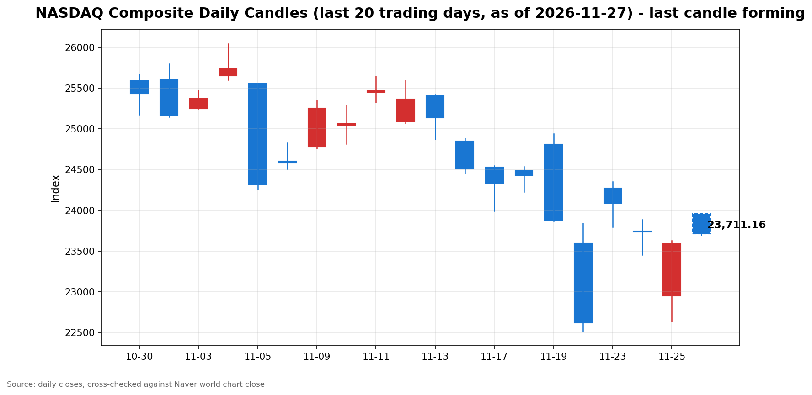

안녕하세요, [한국투자증권](https://securities.koreainvestment.com/main/Main.jsp)에서 [한투-한국투자증권](https://play.google.com/store/apps/details?id=com.truefriend.neosmartarenewal&hl=ko) 개발을 담당하고 있는 way입니다. 
나스닥이 추수감사절 휴장을 마치고 0.63% 상승 출발했습니다. 

## 개장 배경

지난 11월 25일(현지시간) 나스닥 종합지수는 23,585.80으로 0.62% 하락 마감했습니다. 
11월 23일 6.51% 급등 이후 이틀 연속 조정을 받았습니다. 
11월 26일은 추수감사절로 미국 증시가 휴장했습니다. 
오늘 11월 27일은 오후 1시에 조기 마감되는 단축 거래일입니다. 
휴장 기간에도 CME 주가지수 선물은 거래됐고, 나스닥 선물은 강세를 이어갔습니다. 
같은 날 국내 증시는 급등했습니다. 
코스피는 4,915.68로 4.34% 올랐고, 코스닥은 708.99로 8.13% 급등해 매수 사이드카가 발동했습니다. 
외국인은 국내 증시에서 1조 1,317억원을 순매수했습니다. 
삼성전자는 4%, SK하이닉스는 5% 올랐습니다. 
중앙일보 GMC의 11월 27일자 G브닝 브리핑 제목은 "해피 블프데이! 숨 좀 돌립시다"입니다. 
같은 날짜의 G프터눈 브리핑 제목은 "땡큐, 외국인!"입니다. 

## 오늘의 스냅샷

| 지수 | 현재가 | 전일 대비 | 등락률 | 전일 종가 | 시가 | 고가 | 저가 |
| --- | --- | --- | --- | --- | --- | --- | --- |
| [나스닥 종합](https://stock.naver.com/worldstock/index/.IXIC/price) | 23,734.12 | +148.32 | +0.63% | 23,585.80 | 23,958.46 | 23,961.28 | 23,701.38 |
| S&P500 | 7,217.24 | +34.46 | +0.48% | 7,182.78 | 확인 필요 | 7,247.64 | 7,217.24 |
| [다우](https://stock.naver.com/worldstock/index/.DJI/price) | 50,477.44 | +294.49 | +0.59% | 50,182.95 | 50,458.86 | 50,697.38 | 50,398.29 |

스냅샷 기준 시각은 2026년 11월 27일 오전 10시 1분(미국 동부시간), 2026년 11월 28일 오전 0시 1분(한국시간)입니다. 
다우 수치는 같은 날 오전 10시 4분에 확인한 값입니다. 
S&P500 수치는 같은 날 오전 9시 58분경 확인한 한투 MTS 해외 대시보드 값입니다. 
나스닥 수치는 [네이버 월드 차트](https://finance.naver.com/world/sise.naver?symbol=NAS@IXIC)와 [Npay 증권 나스닥 종합 페이지](https://stock.naver.com/worldstock/index/.IXIC/price)에서 확인했습니다. 
나스닥 전일 종가는 한투 MTS 해외 대시보드의 수치와도 일치합니다. 
한투 MTS 해외 대시보드의 나스닥 값은 23,728.85로 0.61% 상승이었고, 네이버 값과 대체로 일치합니다. 
S&P500 시가는 확인되지 않아 확인 필요로 표기합니다. 
장중 고가와 저가는 개장 이후 형성된 값이며, 당일 수치는 마감 전까지 계속 변합니다. 
나스닥 거래량은 209,132천주, 다우 거래량은 93,886천주입니다. 
S&P500 거래량은 확인 필요입니다. 

## 차트

최근 20거래일 일봉 차트입니다. 
빨간 봉은 종가가 시가보다 높은 날, 파란 봉은 종가가 시가보다 낮은 날입니다. 
당일 봉은 형성 중인 봉으로, 마감 전에는 계속 변합니다. 

## 원인·촉매 분석

오늘 개장의 가장 큰 특징은 갭업 출발 뒤 상승폭 축소입니다. 
나스닥은 전일 종가보다 1.58% 높은 23,958.46에 출발했으나, 현재는 0.63% 상승 수준까지 되돌렸습니다. 
휴장 뒤 첫 거래라는 점과 단축 거래일이라는 점이 함께 작용한 흐름입니다. 
거래가 얇은 날에는 개장 초반의 방향이 그대로 이어지지 않는 경우가 많습니다. 
두 번째 특징은 기술주 주도의 반등입니다. 
나스닥 상승률 0.63%는 S&P500 상승률 0.48%를 웃돕니다. 
AI 조정 공포가 진정되는 가운데 기술주에 매수세가 먼저 들어온 모습입니다. 
세 번째 요인은 달러 약세입니다. 
원/달러 환율은 1,336.00원으로 전일 대비 0.59% 내렸습니다. 
달러가 약해지면 위험자산 전반에 우호적인 환경이 됩니다. 
나스닥 선물은 26,282.75로 0.70% 올랐습니다. 
휴장 기간의 선물 강세가 현물 개장에도 이어진 셈입니다. 
다만 국채수익률과 유가 등 다른 촉매의 당일 수치는 확인되지 않아 단정하지 않습니다. 
연준 금리 인하 여부는 GMC 허브의 "연준 금리 인하, 정말 올까요?"라는 제목에서도 다뤄졌으나, 결론이 확인된 사안은 아닙니다. 

## 핵심 사건 3가지

### 1. 엔비디아발 AI 조정 진정, 국내 증시 급등으로 확산

젠슨 황 엔비디아 최고경영자(CEO)의 복귀 이후 AI 조정에 대한 공포가 진정되는 양상입니다. 
11월 23일 나스닥은 6.51% 급등했고, 엔비디아는 31% 넘게 올랐습니다. 
이후 이틀간 조정을 받았으나, 11월 27일 국내 증시는 급등으로 응답했습니다. 
코스피는 4.34%, 코스닥은 8.13% 올랐고, 코스닥에는 매수 사이드카가 발동했습니다. 
코스닥 상장사 1,800여 개 중 1,500여 개가 올랐고, 상한가 종목은 12개였습니다. 
외국인은 국내 증시에서 1조 1,317억원을 순매수했습니다. 
시장의 관심은 리더십 이슈에서 AI 투자 자체의 지속 가능성으로 옮겨가고 있습니다. 

### 2. 추수감사절 휴장 속 선물 거래, 블랙프라이데이가 다음 관전 포인트

11월 26일 미국 증시는 추수감사절로 휴장했습니다. 
CME 주가지수 선물은 휴일에도 거래됐습니다. 
이데일리에 따르면 마켓워치는 한국 증시가 삼성전자와 SK하이닉스를 통해 AI 투자에 크게 쏠려 있어, 추수감사절 저녁 시간대 한국 증시 흐름이 미국 주가지수 선물 거래에 영향을 줄 수 있다고 보도했습니다. 
실제로 국내 증시 급등과 함께 나스닥 선물은 강세를 이어갔습니다. 
오늘은 블랙프라이데이입니다. 
GMC의 G브닝 브리핑은 엔비디아와 알파벳, 메타, 넷플릭스, 월마트, 로우스 등을 언급했습니다. 
소매주의 움직임은 연말 소비 심리를 가늠하는 재료가 됩니다. 
단축 거래일이라 오후 1시 조기 마감 전까지 거래량이 얼마나 붙는지도 확인할 지점입니다. 

### 3. AI 수익화 논쟁: 누가 AI로 돈을 버는가

GMC 리포트 "AI를 누가 쓰느냐의 문제 [워크데이]"는 11월 27일자로 실렸습니다. 
워크데이가 AI 기업이 아니라 AI를 활용하는 기업이라는 분석입니다. 
같은 GMC 허브에는 "오라클, 이젠 AI 버블의 역풍을 맞다"와 "오픈AI, 엔비디아의 새 칩에 발목"이라는 제목의 글도 함께 실려 있습니다. 
AI 인프라 투자 비용이 수익으로 이어지는지를 묻는 논쟁이 이어지고 있습니다. 
중국 데이터센터에서 엔비디아 블랙웰이 사용되고 있다는 보도도 나왔습니다. 
반면 한 해외 증권사는 중국 메모리 수요 둔화와 DRAM 상승세 둔화를 전망했습니다. 
AI 밸류체인 안에서도 수요 신호와 둔화 신호가 엇갈리고 있습니다. 
하드웨어와 소프트웨어, 활용 기업 간의 온도 차가 시장의 다음 관심사입니다. 

## 지수·섹터 영향 체인

나스닥이 S&P500보다 더 오른 것은 기술주와 반도체 중심의 반등이 강했기 때문입니다. 
AI 조정 진정의 수혜는 하드웨어와 반도체 쪽에 먼저 닿습니다. 
중국 데이터센터의 블랙웰 사용 보도는 AI 가속기 수요가 이어지고 있다는 신호입니다. 
반면 메모리 쪽에서는 수요 둔화 전망이 나왔습니다. 
같은 AI 밸류체인 안에서도 가속기와 메모리, 활용 기업의 상황이 다릅니다. 
소프트웨어와 AI 활용 기업은 워크데이 사례처럼 수익화 관점에서 재평가를 받고 있습니다. 
인프라 투자 비용 부담이 큰 기업은 역풍을 맞는 흐름입니다. 
소비재는 블랙프라이데이를 앞두고 소매 실적 기대가 작용하는 구간입니다. 
달러 약세는 성장주 밸류에이션 부담을 덜어주는 방향입니다. 
에너지와 금융 등 다른 섹터의 당일 움직임은 확인되지 않아 단정하지 않습니다. 

## 다우·S&P500 흐름

다우는 50,477.44로 0.59% 올랐습니다. 
시가 50,458.86에서 출발해 장중 고가 50,697.38까지 올랐다가 현재는 시가 위에서 움직이고 있습니다. 
나스닥이 시가에서 되돌린 것과 달리, 다우는 시가 위를 지키고 있습니다. 
S&P500은 7,217.24로 0.48% 올랐습니다. 
장중 고가 7,247.64에서 현재는 장중 저가 수준까지 밀렸습니다. 
세 지수가 모두 오르고 있으나, 장중 흐름은 다우가 가장 안정적입니다. 
기술주 중심의 나스닥과 S&P500은 갭업 뒤 차익 매물이 나오는 모습입니다. 
이는 지수 간 방향 차이가 아니라 장중 강도 차이로 보는 것이 적절합니다. 

## 단기·중기 전망과 장 초반 확인할 시나리오

단기적으로는 전일 종가 23,585.80 위를 지키는지가 첫 번째 관전 포인트입니다. 
현재 지수는 전일 종가보다 0.63% 위에 있습니다. 
장중 저가 23,701.38을 이탈하면 전일 종가 테스트가 이어질 수 있습니다. 
반대로 시가 23,958.46과 장중 고가 23,961.28을 회복하면 갭업 흐름이 이어질 수 있습니다. 
단축 거래일이라 오후 1시 조기 마감 전까지 거래량이 얼마나 붙는지가 중요합니다. 
얇은 거래 속 상승은 다음 거래일 반납 가능성을 함께 봐야 합니다. 
중기적으로는 52주 최고점 27,722.75와는 약 14% 거리가 있습니다. 
AI 수익화 논쟁이 해소되지 않으면 반등이 이어져도 변동성은 클 수 있습니다. 
확인할 시나리오는 세 가지입니다. 
첫째, 블랙프라이데이 소비 지표와 소매주 움직임입니다. 
둘째, 다음 주 연준 금리 인하 기대의 변화입니다. 
셋째, AI 하드웨어 수요와 메모리 둔화 전망 중 어느 쪽이 실적과 주문으로 확인되는지입니다. 
단축 거래일의 움직임만으로 추세를 단정하지 않는 것이 적절합니다. 

## 마치며

나스닥은 휴장 뒤 갭업 출발했으나 상승폭을 일부 반납하며 0.63% 상승 출발했습니다. 
이 글은 시황 해설이며 특정 종목의 매수나 매도를 권유하지 않습니다. 
